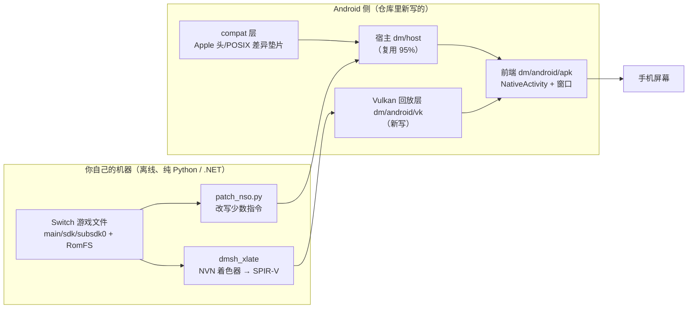

# 安卓移植：流程与进度全景（便于与其他项目横向对比）

> **这份文档是干什么的**：把 `d2r-mobile` 的**安卓支线**（Switch《暗黑破坏神 II：狱火重生》的
> 移植 / HLE 兼容层）从头到尾的**流程（怎么走）**与**进度（走到哪）**压成一页可对比的口径，
> 供其他移植项目（安卓、Linux、其他平台、其他游戏）拿来做**逐项对齐**。
>
> **口径来源**：全部事实取自仓库内文档与真机日志，不掺推测——
> `docs/ANDROID.zh-CN.md`（可行性）、`docs/ANDROID_PLAN.zh-CN.md`（计划 + 进度记录）、
> `docs/CROSS_MACHINE.zh-CN.md` §7（交接现状）、`.work/recon/handoff.md`（本机事实与取证数据）。
> 凡本页与上述文档冲突处，已在 §13「口径提醒」中标出。
>
> **基线**：分支 `android`，HEAD `afd7500`（2026-10-16，「M3-3e」续：分级复量把触发点收窄到"客体在 AHB 堆上的
> 原子操作"、第二台的 AHB 线暂停；其前 `0da66c0` = M3-3e、`e5468fc` = M3-3e 收尾、`d16de56` = M3-3d 收尾）。
> **自本提交起，Windows 上一切命令走项目内的 `.venv` Python**（规则 `.codebuddy/rules/windows-python-only/RULE.mdc`，alwaysApply）。
> 主线 `main` 是不含安卓的 iOS / macOS 版本。

---

## 0. 一页速览

| 维度 | 现状 |
|---|---|
| 支线目标 | 把已存在的 iOS/macOS 兼容层（宿主 + Metal 图形层 + iOS 前端）搬到 Android |
| 阶段 | **M1 完成、M2 未验收、M3 进行中**（M0 完成，M4 未开始） |
| 工作窗口 | 2026-10-13 ～ 2026-10-15，**97 个提交**（10-13：1 / 10-14：73 / 10-15：23） |
| 安卓侧代码量 | `dm/android/` 50 个源文件、约 **10,700 行**（C/H）；兼容层 15 个头/源 |
| 产物 | `dm.apk` **6.10 MB**（内含 `libdm.so` 6.09 MB，宿主 + 回放层全静态链入） |
| 目标机 | Redmi K90（骁龙 8 Elite / Adreno 830 / Android 16 / SDK 36 / arm64-v8a） |
| 已达成 | 改写产物在真机装载执行 → 进 `nnMain`；Vulkan 通路 + 零拷贝内存模型落地；出图与上屏链路真机通（窗口能显示主机像素）；绘制真下发（≈40 万次/轮、零失败） |
| 未达成 | **M2 验收判据「屏幕出（游戏自己的）画面」未过**：渲染目标读回仍是全零 |
| 当前卡点 | 每轮约 **10 秒**的「GPU/显示通路整体停摆」（提交在飞、GPU 却在等新活），会把交付节奏按帧率切成两半 |
| 下一步 | ① 换设备 / 换驱动对照；② 有 `trace_processor` 的机器上读停顿窗口的 trace；③ 若仍在这台机上：试「GPU 保活」（隔 N 毫秒空提交）；④ **卡点 A 侧**：真机装 Validation Layers（见 §14 A1，**不依赖换设备**） |

---

## 1. 项目与目标

### 1.1 母项目

`d2r-mobile` 是一个 MIT 许可的开源**兼容层**：让用户**自己购买的** Switch 版 D2R（含「术士君临」资料片，
Switch 1.0.34.0 = PC 3.3.94012）在 iPhone / iPad / Mac 上**原生执行**——不模拟 CPU，游戏自己的 aarch64
程序逐字节执行（只改写少数苹果内核下不可原样执行的指令），平台服务由自写宿主提供，图形接口在 Metal 上重实现。

### 1.2 安卓支线要什么

| 项 | 内容 |
|---|---|
| 复用原则 | **不重写游戏逻辑**，复用现有宿主；只替换「面向平台」的两侧：**前端**与**图形后端** |
| 要换的两侧 | 前端：UIKit/CAMetalLayer → `NativeActivity` / `ANativeWindow`；图形：Metal 回放层 → **Vulkan 回放层** |
| 交付物 | 一个可安装的 APK（包名 `ai.d2rm.dm`）+ 设备侧只读数据（改写产物 / SPIR-V / RomFS） |
| 明确不做 | 不改游戏规则、不做 CPU 模拟、不联机、**仓库不含任何游戏内容**（游戏文件与生成物都在 `.work/`，已 gitignore） |
| 工作量重心 | 图形回放层约 **60–70%**（`nvn_mtl.m` 约 5,800 行 Metal → Vulkan） |

---

## 2. 流程总览（技术路线）



**四段流水**（每段都有自己的验收）：

1. **离线准备**：游戏文件 → 改写产物（aarch64）+ 6923 个 SPIR-V。与运行平台无关，安卓直接复用同一份。
2. **宿主底座**：装载改写产物、接管内核调用（SVC）、文件系统、线程同步、音频、存档。
3. **图形后端**：把 NVN 语义映射到 Vulkan（内存池零拷贝、命令流解释器、管线、贴图、上屏）。
4. **前端与交互**：窗口/生命周期/输入/文本/存档提示/触摸界面。

---

## 3. 阶段划分与验收判据

| 阶段 | 目标 | 验收判据（原文口径） | 状态 |
|---|---|---|---|
| **M0** | 环境就绪 | NDK 能编出原生程序并推到真机和跑起来 | ✅ 完成 |
| **探路 A** | 量化宿主复用率 | 拿到「要改哪些文件、改多少处」的清单 | ✅ 完成 |
| **探路 B** | 着色器翻译链落地 | 确认「NVN 着色器 → Vulkan SPIR-V」在本机可复现 | ✅ 完成 |
| **M1** | 无窗口跑通宿主 | APK 装上真机、画面全黑，但日志里出现游戏的 `UNIMPL` 行 | ✅ 完成 |
| **M2** | 最小 Vulkan 回放层 | 屏幕能出画面（先清屏成一个颜色，再逐步到主菜单） | ⚠️ **未验收**（链路通、画面未出） |
| **M3** | 前端 + 触摸 + 音频 | 能建角、进局、有声音 | 🔄 进行中（底层已通、玩家面功能未开始） |
| **M4** | 收尾 | 手柄、云同步、诊断、性能调优（对标 iOS 60 fps / 3.8 W） | ⬜ 未开始 |

---

## 4. 进度总表（里程碑 × 硬证据）

| 里程碑 | 结论 | 硬证据（真机/离线读数） | 详见 |
|---|---|---|---|
| M0 | 工具链与真机就绪 | NDK r30/clang 21 编译并真机执行 hello | `ANDROID_PLAN` §一 |
| 探路 A | 宿主 C 复用率 **≈95%+** | 87 个编译单元：**56 个零改动通过**；29 个文件共 31 处平台差异；2 个汇编文件需改语法 | `ANDROID_PLAN` §三·探路 A |
| 探路 B | SPIR-V 已全部落袋 | 162 个着色器包 → 10847 变体 → **6923 个唯一键**；翻译 10847 成功 / 0 失败；**SPIR-V 1.3** | `ANDROID_PLAN` §三·探路 B |
| M1 | 宿主在真机跑进 `nnMain` | 装载 → 重定位（relative 60560 / abs 2109 / jump 615）→ `nnosInitialize` → 打出 `UNIMPL` | `ANDROID_PLAN` §三·M1 |
| M2-1 | Vulkan 通路 + 内存模型 | Adreno 830 / Vulkan 1.3.284 / 零拷贝类型 4·5·6 可用 / 离屏清屏回读逐像素相符 | 第 1 步 |
| M2-2 | **头号风险「统一内存」在真机验完** | 类型 6 上 CPU→GPU、GPU→CPU 双向逐字节相符 | 第 2 步 |
| M2-3 | 内存池落法定型 | 本机**无** `VK_EXT_external_memory_host` → 改由 Vulkan 铺客体地址空间；单次分配上限实测 3968 MB > 客体堆 3728 MB；惰性提交 | 第 3 步 |
| M2-回放层 | 命令流解释器 + 提交槽 + 管线 + 贴图 + view + 截图 | 真机 4179 帧无崩溃；**122 万次绘制 / 83 条管线 / 零失败**；子视图 0→33 张 | §八表 |
| M2-14步 | **离屏读回一帧写盘成功，但颜色全零** | 1600×900 合法 PNG（5,761,403 B）取回能打开；目标贴图读回**全零**、出图纹理全白 | 第 14 步 |
| M3-窗口 | 窗口最小工程 + 上屏链通 | 两张相隔 3 秒截屏里底色变化、白条位移；`APK→ANativeWindow→VkSurface→交换链→上屏` 通（1156×2510 格式 37、5 张、FIFO） | `ANDROID_PLAN` §三·M3 |
| M3-合一 | 窗口与游戏共用**一个** Vulkan 设备 | `libdm.so` 245 KB → 322 KB，屏上出现保持比例的测试图（说明上屏走的是宿主那一个设备） | 同上 |
| M3-渲染链 | 「一个像素不落」→「真的画进了目标」 | `DM_GFX_PROBE` 读回亮度 152.0 与清除色**分毫不差**（读回可信）；修默认写掩码后序号 27 从 **0 → 255** | M3 第 3 步 |
| M3-仪器 | 安卓侧补齐「等待点 + 线程现场 + 采样」 | 每条客体线程报 `stat` 状态 / `wchan` 内核等待点 / `syscall` 号+参数+sp+pc | M3 第 3 步 6/7/8 |
| M3-诊断链 | 12 轮真机排查（M3-2k → M3-3c） | 见 §5.6 时间线；结论：**「停住」= 驱动/GPU 约 10 秒不回答，会自愈** | §八 |
| M3-3d 换设备 | **卡点 B 的对照没拿到**（第二台跑不起来），拿到的是"移植假设"：第二台 **Mali-G610 MC6** 上零拷贝内存池那条路不存在 | 4 份探针（71 扩展 / Vulkan 1.1.177 / 外部句柄**不可导出**）+ `dmhost` 冒烟（`建载体缓冲失败` → 堆与别名区各 0 MB → `Break#1`）+ 第一台干净臂 **12 轮**（健康 1 / 停顿型 7 / 设备丢失型 2 / 崩溃 2）+ `vk_ops` 的 -4「前序 24 笔」流水 | `ANDROID_PLAN` §八·M3-3d |
| M4 | 未开始 | — | — |

**M3 任务清单的勾选状态与进度不一致**：`front_run` / `front_text_input` / 触摸 / 音频 /
`front_save_failed` / 生命周期 / 验收 共 7 项**都还是 `[ ]`**（底层已通，玩家面功能确实没开工，
因此"未开工"是真的，只是清单没反映"底层已通"这一层进展）。

---

## 5. 逐阶段流程明细

### 5.1 M0 —— 环境就绪（完成）

- Windows 机器 + PowerShell；Android Studio / SDK / NDK 统一装到**纯 ASCII 路径** `C:\Android\Sdk`
  （用户名含中文会踩坑：`hactool` 读 `HOME` 转 UTF-16 失败）。
- 组件：`platform-tools`（adb 1.0.41）、`platforms;android-36`、`build-tools;36.0.0`、
  `cmake;3.31.6`、`ndk;30.0.16248370`（clang 21）。
- 真机：开开发者选项 + USB 调试，`adb devices` 认到；编一个最小原生程序推上去跑通。
- **本机没有 Python、没有 Gradle**：所以 APK 不用 Gradle 打，走 `aapt2 link` → 手工把 `lib/arm64-v8a/*.so`
  **不压缩**写进包 → `zipalign -p 4` → `apksigner sign`；清单写 `android:hasCode="false"` ⇒ **整条链零 Java**。

### 5.2 探路 A —— 宿主复用率量化（完成）

先做**不改功能的移植可行性量化**，再决定投入：

| 结果 | 数量 |
|---|---|
| 参与编译的编译单元 | 87 |
| **直接编过、零改动** | **56** |
| 有平台差异的 C 文件 | 29 个文件 / 共 **31 处** |
| 需改语法的汇编 | 2 个（`nvn_thunks.S` 1047 处、`nvn_entry.S` 6 处，Mach-O 语法 → AArch64 ELF） |

31 处差异分两类：**Apple 专有头不存在**（17 处：`TargetConditionals.h` / `mach/*` / `CommonCrypto` /
`sys/sysctl.h` / `sys/clonefile.h`）与 **macOS 专有 API/结构**（14 处：`st_mtimespec` / `clock_gettime_nsec_np` /
`pthread_get_stack*_np` / `F_GETPATH`）。每处都有机械对应物（见 `docs/ANDROID.zh-CN.md` §六对照表）。

> **横向对比价值**：这是"先量再动"的最典型一步——用一次编译就把"图形层才是重头"这个结论量化出来了。

### 5.3 探路 B —— 着色器链落地（完成）

```
Switch 原版着色器包 → dmsh_xlate（.NET，Ryujinx 库）→ SPIR-V（Vulkan 目标）
                                              →【苹果侧才是】spirv-cross → MSL → metallib
```

- 162 个着色器包（vs 43 / ps 96 / cs 21 / ds 1 / hs 1）→ 10847 变体 → 去重后 **6923 唯一键**。
- 翻译 **10847 成功 / 0 失败**；产出 6923 个 `.spv`（魔数全对）+ 6923 个 `.res.json` 反射。
- 产物 **SPIR-V 1.3**，与目标机的 Vulkan 1.3.284 直接兼容 ⇒ **运行时零翻译、进新场景不用现编**。

### 5.4 M1 —— 无窗口跑通宿主（完成）

流程：新增 `dm/android/` 骨架 → 写 `front_android.c` 最小实现 → 给宿主补 `__ANDROID__` 分支 →
编译 → 加载改写产物 → 跑 `nnMain`。

| 项 | 落地方式 |
|---|---|
| 汇编语法（1053 处） | 改**生成器** `gen_protos.py`：两个平台宏分支（`@PAGE/@PAGEOFF` ↔ `:lo12:`、符号前导下划线） |
| `mcontext_t` 差异（31 处） | 新增 `dm/host/dm_uctx.h`，寄存器访问统一成 `DM_UC_PC/LR/SP/FP/X` 宏 |
| xattr 参数个数 | `hle_fs.c` 加安卓分支（Bionic 4/5/2 参 vs macOS 6/6/3 参） |
| `dispatch`（GCD） | `hle_lifecycle.c` 用两条普通线程顶替；音频只用到信号量，由兼容层提供 |
| `AudioToolbox` | 加安卓分支：AudioUnit 全空操作，一律走**静音接收端**（M1 先不出声） |
| 兼容层 `dm/android/compat/` | 12 个头 + 1 个 `.c`，用 `-include` 强制包含 ⇒ 宿主层从 **31 文件 / 1090 行错误** 降到 **0** |
| 编译 | NDK 工具链 + ninja → **0 错误**，产出 `libdmhost_android.a`（约 9.0 MB / 88 个目标文件） |

**验收读数**：`nnosInitialize` → `UNIMPL nnosGetDefaultUserExceptionStackForApplication`（验收点）→
`nninitInitializeSdkModule` → 大量 SVC 占位返回成功。

**M1 期间欠下的账**（明记账，未还）：MD5/SHA1/SHA256 是定长零输出的占位实现；
mach-o 段查找一律返回找不到；安卓 SIGSEGV 拿不到 ESR 读写位（暂按"读"）；构建暂时 `-w` 关警告。

### 5.5 M2 —— 最小 Vulkan 回放层（链路通，验收未过）

**第 1～3 步是"先验证最贵假设"**：先离屏问清「Vulkan 能不能用」「清屏对不对」「内存怎么摆」。

| 步骤 | 关键读数 |
|---|---|
| 1 通路 + 内存模型 | 堆 15 GB；类型 0–2 DEVICE_LOCAL、**3 带 HOST_CACHED**、4/5 HOST_COHERENT、**6 全有**；队列族 0 标志 0x19f；离屏 256×256 清屏回读逐像素相符 |
| 2 零拷贝双向验证 | 类型 6 上两条 64 KB：CPU 写→GPU 读（`vkCmdCopyBuffer` 比对全中）、GPU 写（`vkCmdFillBuffer` 0xAB）→CPU 读全中 ⇒ **头号风险「统一内存」在真机结案** |
| 3 落法定型 | 真机 165 个设备扩展里**没有** `VK_EXT_external_memory_host` ⇒ 苹果那句 `newBufferWithBytesNoCopy` 无对应物 ⇒ 改成**由 Vulkan 零拷贝内存来铺客体地址空间**（heap 4 GB 容量 / 实到 3728 MB、alias 512 MB、stack 256 MB 普通 mmap） |

两条硬边界（已处理）：单次分配上限 **3968 MB**（超了必须报红并**如实下调**报给客体的上限，否则最后 128 MB
会落在没换轨的普通内存上）；载体缓冲不能用 `STORAGE_BUFFER`（撞 `maxStorageBufferRange`，改成只给传输位并逐级退档）。

**回放层功能进度**（每实现一块就从 `gfx_stub_android.c` 删掉对应空实现）：

| 能力 | 状态 | 真机读数 |
|---|---|---|
| 设备与队列（窗口/交换链留到 M3） | ✅ | 两条队列：客体 #0、前端（取图/上屏）#1 |
| 内存池登记 + 地址反查 | ✅ | 真实池子 #1…#7 全部登记，零报红 |
| 命令流解释器（提交槽 8 个轮转 + 栅栏） | ✅ | 4179 帧无崩溃 |
| 贴图/采样器/View | ✅ | 采样器槽从 handle 精确解码；子视图 0→33 张、命中 3.4 万次 |
| Program（SPIR-V → 管线） | ✅ | 122 万次绘制 / 83 条管线 / 零失败 |
| 最小命令集（RT / 清屏 / Draw / DrawIndexed / Present） | ✅ | 每轮约 40 万次绘制 |
| 离屏读回一帧写盘（自带最小 PNG） | ✅ | 1600×900 PNG 5,761,403 B，取回能打开 |
| **M2 验收：屏幕出游戏画面** | ❌ | **渲染目标读回全零**（逐级读第 0/1/2 级、33 张全是亮度均值 0.0） |

**第 14 步的结论（M2 验收的实际卡点）**：GPU 上还没有写出颜色内容；卡点在**渲染链路本身**，不在"看不见"。
为把范围钉死，先做两个**不改代码**的对照：`DM_GFX_PROBE` 把目标清成已知蓝再读回，亮度 152.0 与清除色
经伽马换算后**分毫不差** ⇒ **读回链路可信、"全零"是真的**；`DM_NO_DEPTH_TEST=1` 仍全零 ⇒ 深度测试不是那道门。

**M3 第 3 步继续往里拆，一次修掉七类坑**（这是整个支线里"症状一个、根因七个"的典型）：

| # | 症状 | 根因 | 修法 | 验证 |
|---|---|---|---|---|
| 1 | 34 万次绘制、目标全零、零报错 | 安卓侧**没有 NVN 默认状态**：影子零初始化 → 写掩码 0（一个通道都不写）、深度范围 `[0,0]` | 加 `state_defaults()`（照苹果侧逐项对齐），第一次 `mtl_exec` 生效 | 目标序号 27：**0 → 255** |
| 2 | 成片"目标未下发" | 通道只在清除时开，`SET_RT → 屏障 → 绘制` 流的绘制被整片丢掉 | 绘制路径补 `pass_begin()` + 补写动态视口/裁剪 | 被丢弃绘制 **48% → 31%** |
| 3 | UBO 拿不到缓冲地址（写空白） | **常量槽号不是 res.json 直接给的那个数**：`fp_c3` → 槽 `号−3`；`c1`/驱动段不是普通 UBO | 按规则解析 + 造两块 64 KB 特殊常量段 | 写空白消失；绑定计数 6/6/3 → **1094/3367/695** |
| 4 | 查看器一开就崩、前端停止刷新 | 两个线程共用一条 `VkQueue` 且**没有外部同步** | 加 `vk_queue_lock/unlock` | 见 #5 |
| 5 | 修完 #4 后两端一起停住 | 取图像**不能长占队列锁**（交换链可能长时间无可用图像） | `vkAcquireNextImageKHR` 带 100 ms 超时 | 待长跑复验 |
| 6 | 客体现场"卡在哪"看不出来 | 安卓侧**没注册等待点转储** | `nvn_vk.c` 补同名同义一件（在飞槽/栅栏/正在录制/通道开否/提交与出图计数） | 第一次用就读出"卡在录制中、通道开着" |
| 7 | 转储尾巴被切 | 看门狗打完现场就 `_exit`，而安卓 stderr 是管道（落盘靠另一条线程） | 退出前给日志 400 ms（仅安卓分支） | — |
| 8 | 线程现场只有"等待状态"，PC/回溯全 0 | `thr_bt` 用的是 mach 的 `thread_suspend/get_state`，安卓没有、又不报错 ⇒ 静默打零 | 加安卓分支：按 `/proc/self/task/<tid>/` 报 `stat` 状态 + `wchan` + `syscall` 号/参数/sp/pc | 立刻把"客体停住"定性为**纯用户态空转** |

### 5.6 M3 —— 前端 + 触摸 + 音频（进行中）

**已通的三块（都还没有玩家面功能）**：

| 块 | 内容 | 关键读数 |
|---|---|---|
| 窗口最小工程 | `dm/android/apk/`：一个 `NativeActivity`、零 Java、`hasCode="false"`；脚本 `build_apk.cmd` / `install_apk.cmd` | 截屏底色变化 + 白条位移 ⇒ 整链通 |
| 数据怎么读 | app 域是 `u:r:untrusted_app:s0`，`/data/local/tmp` 是 `shell_data_file` ⇒ **读得到、写不进**；软链也不行 | 正解：`DM_ROOT=/data/local/tmp/dm` + `DM_SAVE`/`DM_TEMP` 指到 `/sdcard/Android/data/ai.d2rm.dm/files/{save,temp}` |
| 权限集（只有两条） | `INTERNET`（装完即生效）+ `MANAGE_EXTERNAL_STORAGE`（用户去系统设置点） | A/B 实测：授权后能写 `/sdcard/d2rm`，**任何权限都到不了 `/data/local/tmp`**；窗口里橙色矩形就是申请按钮，"按钮的有无 = 权限状态" |
| 窗口与游戏合一设备 | 窗口的 Vulkan 归宿主：`vk_device_set_window()` 在 `vk_device_init()` 之前把窗口交过去 | `libdm.so` 245 KB → 322 KB；屏上出现保持比例的测试图 ⇒ 上屏走的是宿主那一个设备 |

**M3 的 12 轮真机排查（这一节是"流程"的核心，每轮都是一次单变量实验）**：

| 轮次 | 做了什么 | 结论（含被否掉的假设） |
|---|---|---|
| M3-2k | 缓冲区贴图（texel buffer）落地 | 先确认 `tid 701` 确实是 `target 10`，再走**正解**（不取巧按 2D 贴图代替） |
| M3-2l | 顶点属性那条判据 | 里面藏着**两个独立的错**（两个 opcode 写反、指针没解引用）；探针 3 秒自证 → 告警 1 → 0 |
| M3-2m | 渲染区取证 + "画面在第几级" | 第 0 级逐张读全零；改**逐级**读仍全零（50 帧 × 33 次 = 0 次有内容）；途中"有内容"是**行距错位**读到的陈旧堆字节 |
| M3-2n | 读回那条并发崩溃 | 修好；顺带踩到一次**看起来像游戏卡死的锁序反转**（上传抢了读回的锁 ⇒ 启动就停住、出图 0 次） |
| M3-2o | 上传改用**自己的命令缓冲** | 消掉一处真隐患；**设备丢失没有跟着消失** |
| M3-2p | 管线缓存落盘（优化清单第 1 项） | 与卡点无关，但服务了性能；照出一条真机事实：**MIUI 退到后台直接 SIGKILL**（钩子跑不到）⇒ 持久化必须**前台定期写** |
| M3-2q | `HOST_CACHED`（优化清单第 2 项） | **否掉**：能导出 fd / mmap / 双向，但同机 A/B CPU 时间**无可测差异**，且要越过缓冲声明的类型位（规范外用法）⇒ 维持类型 4，开关留着复验 |
| M3-2r | 里程碑 B：客体停住的形状 | **"主线程在等一个从未被派发的任务图"**；新仪器：SleepThread 时长、每线程最近 16 次 svc 环、沿 x29 取调用链 |
| M3-2s | "谁写 `this+0x3328`" | 三张位图（`+0x3320/24/28`）、"上膛"点 `main+0x1636f50`、唯一的置位点 `main+0x15f0e6c`；留一处"说不通"的矛盾 |
| M3-2t | 三张位图的**时间序列** | **甲否掉、乙成立**（上膛确实写满、完成后被下一次上膛清 0）⇒ 任务图机制是好的；顺带改口径：**看门狗转储 ≠ 停住** |
| M3-2u | 按需取现场（`touch dump.trigger`） | 「停住」可稳定复现，且**只在"查看器 + 逐级扫描同时读回"时出现**（A/B/C 三臂） |
| M3-2v | 读回路径的锁账本 | **把我们自己的锁排除**：读回锁/队列锁无人持有、8 槽全空、驱动栅栏全就绪、无 >300 ms 等待 |
| M3-2w | 等待站点账本 + 栈扫描 | 主线程卡住时**"0 层"**（不在任何站点上）；推翻上一轮那条 `usleep` 帧链（驱动帧上 x29 不可信 + **PAC**）；栈扫描方法自证有效 |
| M3-2x | **点名完成** | 先照出**仪器自己的假阴性**（可执行段表只有 64 槽，真机有 455~460 个 ⇒ 丢掉的正是 `libc.so` 与 `libvulkan.so`）；修后五轮：**主线程停住时等的是驱动**（读回等队列空闲 10519 ms / 一次性提交等空闲 10051 ms / 建图形管线 10790 ms / 贴图内存分配 10268 ms），同刻前端也在等栅栏 10074 ms，心跳断约 11 秒后**自愈** ⇒ **"停住"= 驱动约 10 秒不回答，不是永久挂死** |
| M3-2y | A/B/C/**D（全关）**四臂八轮复量 | **停顿不是诊断造成的**，而是**每次启动落在"健康 / 生病"两种状态之一**：健康 ≈1234 op/帧、无 >1 秒等待；生病 ≈100 op/帧、每条 2~11.6 秒停顿。**量任何帧预算前先判这一轮是哪一种**，否则读数差 13 倍 |
| M3-2z | 追到系统级 | 病态时同一时刻 **SystemUI 也卡 10 秒**（`Davey! duration=10018ms`、`waitForever: fence(kgsl-timeline-...)`）、**composer HAL 调用 9.49 秒**、`Slow swap buffers`；而**把 app 停掉、清 logcat、等 60 秒 ⇒ 一条都没有** ⇒ **那 ~10 秒的系统级停摆是我们引起的** |
| M3-3a | 归属 + ftrace | 加"读回 / 上传"标签后：arm D 那 10 秒是**上传**，但 arm A 有一轮是**读回** ⇒ **两条路都会中**；换仪器：`atrace` 在 shell 下**能吐文本 ftrace**；读数四条：我方两线程各有 ~10 秒离 CPU 且**同一瞬间结束**、**整条 GPU/显示通路一起睡又一起醒**、**全是 S 态无 >0.5 秒 D 态**、**恢复瞬间 = `gmu_f2h` 中断 + GPU/GMU 时钟与总线重编程** |
| M3-3b | 常驻上传环（优化清单第 5 项） | **否定**：`DM_UP_RING`（缺省关）6 次启动里 3 病 2 健康 1 崩溃，那 10 秒照旧 ⇒ "每趟上传新建对象"不是原因；正面读数：驱动级电源/总线投票**少约 3 倍**（`rpmh_write_batch` 442→159、`gpu_cc_cx_smmu_gdsc` 13→0），但帧率看不出收益 |
| M3-3c | 把前端上屏路**整个摘掉**（`DM_WIN_NOSUB=1`） | 那 10~12 秒照旧，落点全在**客体侧** ⇒ **触发点在客体侧的提交路或驱动/GMU 自己**；两条"到头了"：**没有 root/su**（`adb root` 被拒、`su` 不存在、`dmesg` 被拒）⇒ dmesg 封死；170 MB 原文再挖一层 ⇒ 停摆前 `kgsl_hwsched` 是"**正常等新活**"，我方线程最后一批阻塞**全是读文件** ⇒ **提交早已发出、只是没人执行** |

### 5.7 M4 —— 收尾（未开始）

清单：手柄（Android `InputDevice`）、存档云同步（替换 `cloud_ios.m`）、诊断与崩溃处理、
性能调优（对标 iOS 的 60 fps / 3.8 W）。

---

## 6. 当前卡点（两种、口径要分开）

### 6.1 卡点 A：渲染目标读回全零（M2 验收未过）

- 绘制在发（≈40 万次/轮、图形管线 78~84 条、**零失败**、两条告警已清零），但**能读的颜色目标全是零**。
- 已排除：读回链路本身（`DM_GFX_PROBE` 读回与清除色分毫不差）、深度测试、行距错位、顶点属性判据、
  描述符回退成空白（UBO 槽号规则、SSBO、texel buffer 三处都已修，真机计数全部归零）。
- 状态：**尚未结案**，但已被 10 秒停摆盖住优先级（停摆会把帧率切成两半，量帧预算无意义）。

### 6.2 卡点 B：每轮约 10 秒的 GPU/显示通路停摆（当前主战场）

**形状**（真机 + ftrace 读数）：我方线程在驱动里的调用（读回等队列空闲 / 一次性提交等空闲 / 建图形管线 /
贴图内存分配 / 上传）**一次性挂住约 10 秒**；与此同时**整条 GPU/显示通路（`kgsl-events`、`kgsl_hwsched`、
`gmu_f2h`、`crtc_commit`、`mFrameBuffer`、SystemUI）一起睡、一起醒**（结束时刻落在同一 20 毫秒内）；
全是 S 态、无 >0.5 秒 D 态、CPU 大部分 idle、频率正常 ⇒ **不是热/省电/降频/我方烧 CPU**；
恢复瞬间是 `gmu_f2h`（GMU 固件→主机中断）→ `kgsl_hwsched` → 整套 GPU/GMU 时钟与总线重编程。

**已排除面（谁被否掉、依据）**：

| 被否掉的东西 | 依据 |
|---|---|
| 我们自己的锁（读回锁 / 队列锁 / 8 个槽位与驱动栅栏） | M3-2v 逐个读过：无人持有、无人等、槽全空、栅栏全就绪、无 >300 ms 等待 |
| 宿主里我们写的每一处 `usleep` / `nanosleep` | M3-2w 全部记账（含对驱动的调用），六轮里主线程一次都没落在上面；M3-2x 修掉仪器假阴性后点名：只落在我们自己的**看门狗/音频**线程上 |
| 客体的 `SleepThread` | 同上；客体线程的 `nanosleep` 都是 `SleepThread` |
| 任务图机制（里程碑 B） | M3-2t 时间序列：上膛写满、派发逐位取走、完成后被清 ⇒ 机制是好的 |
| 诊断开关（查看器 / 逐级扫描） | M3-2y 四臂八轮：**含两路全关的 D 臂轮轮都有**那 10 秒 ⇒ 不是诊断造成的 |
| 我们已有的上传/读回用法侧优化 | M3-3b：常驻上传环把驱动级投票削掉约 3 倍，那 10 秒照旧 |
| 前端上屏路 | M3-3c：`DM_WIN_NOSUB=1` 把上屏路上的 GPU 调用全摘掉，10~12 秒照旧 |
| 内核不可中断挂住 / 降频 / 热 | ftrace：全是 S 态、频率 556 MHz~1.99 GHz 正常、CPU 大部分 idle |
| `dmesg` 这条路 | 本机**无 root / su**，`klogctl: Permission denied` ⇒ 封死 |
| perfetto 拿 kgsl 原子 | MIUI SELinux 不让 `traced_probes` 读 vendor 事件的 `format` ⇒ 拿不到（且**perfetto 对不存在的原子名也不报错**，"没报错"不能当证据） |

**轮次要分三类**（不要合成一个数）：**健康** / **停顿型** / **设备丢失型**（`VkResult -4` + 上百条上传失败；
两者**可分**——有一条是"设备丢失但没有那 10 秒"）。健康轮的判据是 `出图` 的 op/帧 与有无 >1 秒等待。
**2026-10-16 补充（「M3-3d」第一台干净臂 12 轮）**："健康"确实还在，但**低频** —— 干净臂（`DM_WIN_SRC=0`、扫描关、
看门狗不写）12 轮里 **健康 1 / 停顿型 7 / 设备丢失型 2 / 崩溃 2**；健康那一轮 1154 帧 / 70 秒、op/帧 **1276.5**、零 >1 秒长等、
图形管线 85，与「M3-2y」的健康读数同形（生病轮 op/帧 96~107、图形管线 77~80）。⇒ "先判类"照旧要做，
且**别把健康轮当成随手可得**（前三批 8 轮一次都没出现）。

**判据口径（务必照此，否则会把"没停"读成"停了"）**：看**心跳里的出图数** + 前端那条"**连续 8 秒没有新出图**"
的卡死报告；**看门狗转储 ≠ 停住**（它量的是引擎拍，出图只在 `pregame` 期间算进展 ⇒ "出图在推进 + 拍 0"照样判死）。

### 6.3 已知仪器坑（排查类项目可直接抄）

| 坑 | 说明 |
|---|---|
| 帧链在驱动帧上不可信 | 驱动不一定维护 x29；`mtl_wait+0x214` 看着像"卡在等栅栏"，反汇编却是**不等待分支**的返回地址 |
| Android arm64 返回地址带 **PAC** | 签名位在高 16 位 ⇒ `dladdr` 全失败，回溯里出现 `0x24c6fca47ce57c` 形状的"垃圾地址"；先 `& 0x0000ffffffffffff` 再符号化 |
| 别在采样信号处理器里 unwind | `_Unwind_Backtrace` 会把被采样线程**卡住**（实测"新增样本 0"）；读自己的栈（`memcpy` 2 KB）是安全的 |
| 读别的线程要趁"没被打断" | `/proc/self/task/<tid>/syscall` 在线程被信号打断时变成 `running`（没有 sp 字段）⇒ **先扫栈、再发信号**；并按名字**无条件扫主线程** |
| 有上限的表会把假阴性伪装成结论 | 可执行段表 64 槽 vs 真机 455~460 段，丢掉的恰好是 `libc.so` 与 `libvulkan.so` ⇒ "栈里没有 libc 帧"是假的。**凡有上限的表，都要把"满了"写进读数** |
| 采样判据要含 `nanosleep` 轮询 | 只认"状态 R 且 `syscall` 报 running"会在两次半拍上都漏掉轮询式等待（睡的半拍 S、看的半拍 R） |
| 改日志正文 = 改统计口径 | 改串之后按旧串数会读出"0 条"，差点把"没修好"记成"修好了"；改正文时把读它的脚本一起改，或新旧串都数一遍 |
| 两个读回诊断别同时开 | 同时开会在约 20 秒内冻住（**注意：这条已被 M3-2y 改写为"不保证必现"，7 次里 5 次冻**） |
| 加锁前先列"谁持着什么调进来" | 上传抢读回的锁 ⇒ 锁序反转 ⇒ 真机表现是"启动就停住、出图 0 次"，看着像游戏卡死 |
| **判类器的优先级会把"有据可查的失败"盖成"崩溃"** | `ab_run.py` 原来是 `if crash or 心跳<=1: 崩溃轮`，而第二台那种"`nnosInitialize` 之后 0.4 秒就死、只留 1 条心跳"的轮**必然**落进去 ⇒ "内存换轨失败"这条原因被盖掉。**判据要按"证据强度"排序**：崩溃签名 → 有据可查的失败（换轨【红】/越出 alias 区）→ 再退回"心跳太少"（M3-3e） |
| **app 可写区的目录别用 shell 建** | `adb shell mkdir` 建出来的 `/sdcard/Android/data/<pkg>/files/logs` 属主是 shell、组 `ext_data_rw`、0770，app 打不开（errno 13）⇒ 日志文件不存在 ⇒ 跑轮脚本拉到空文件后**静默判成"崩溃轮"**。让 **app 自己建**（`mv` 掉旧目录即可）（M3-3e） |
| **`adb devices` 变空有两种原因** | USB 整段掉线 **与** 设备重启在 adb 上长得一样（都"空约 1 分钟后自恢复"）⇒ 判"有没有重启"只看 `/proc/uptime` 与 `ro.boot.bootreason`（`.work/uptime.py`），别拿设备表当证据（M3-3e：第一台掉两次其实没重启，第二台是真重启） |
| **同一台上试尺寸要"一个进程一档"** | 尺寸阶梯里的一次失败会把**同一个进程之后的小分配也带坏**（第一台 512 MB 失败后，紧接着 64 MB 也分不出来，rc=-129）⇒ 量上限要用**新进程 + 单尺寸**，别用一条阶梯从头走到尾（M3-3e，探针里已把默认阶梯缩到 1/64/256 MB） |

---

## 7. 可对比的硬指标（对齐用）

| 类别 | 指标 | 读数 |
|---|---|---|
| 规模 | 安卓侧源文件 / 行数 | 50 个 / ≈10,700 行（C/H） |
| 规模 | 宿主复用率 | 87 编译单元中 **56 个零改动**；31 处平台差异 |
| 产物 | APK / 内嵌 so | 6,103,442 B / 6,093,984 B |
| 产物 | 工具链产物 | SPIR-V 6923 个（SPIR-V 1.3）；改写产物 4 个变体（`r41-android` 为实际使用的那份） |
| 数据 | 设备侧游戏资源 | RomFS ≈8.3 GB（`adb push` 实测 32.8 MB/s，约 5 分钟） |
| 真机 | 出图/绘制 | 每轮 ≈40 万次绘制、图形管线 78~84、零失败；提交槽 8 个轮转 |
| 真机 | 帧率 | 健康 13~22 帧/秒（受诊断开关影响；「M3-3d」干净臂那一轮 1154 帧 / 70 秒 = 16.5）；生病 ≈0.8~1.4 帧/秒（52~92 帧 / 70 秒） |
| 真机 2 | 第二台设备指纹（换设备对照） | Redmi `pearl` / **MT6896** / **Mali-G610 MC6** / Android 15 / SDK 35 / Vulkan **1.1.177** / 71 扩展 / 无动态渲染 / **外部句柄不可导出**（零拷贝甲案不成立） |
| 真机 | 停顿 | 每轮约 10 秒、会自愈、可重复出现；恢复瞬间 = `gmu_f2h` + GPU/GMU 时钟与总线重编程 |
| 真机 | 内存 | 客体堆 3728 MB、alias 512 MB、单次分配上限 3968 MB；零拷贝类型 4（曾验过 6） |
| 环境 | 提交 | 97 个提交 / 3 天（10-13 ~ 10-15） |
| 环境 | 一轮真机实验成本 | 启动→停住→判死 ≈40 秒；一批 3 轮约 2 分钟；单轮日志 1~2 MB（开时间序列时） |

---

## 8. 工作方法与纪律（这套方法是本项目最大的可迁移资产）

### 8.1 方法论

| 原则 | 具体做法 |
|---|---|
| **先量后改** | 任何"给等待/卡顿加护栏"的动作都排在"点名是谁在等"之后；M3-2x 的下一轮清单明确写"不是给 `usleep` 加，是给驱动调用加" |
| **仪器必须先自证** | 每次读数先问"这台仪器会不会骗我"：假阴性（64 槽表）、静默打零（安卓 `thr_bt`）、行距错位、"没报错 ≠ 可用"（perfetto 原子名）、"看门狗转储 ≠ 停住" |
| **单变量 A/B 臂** | 关心什么就把别的都关掉：A/B/C/D 四臂（含两路全关）八轮，才敢说"停顿不是诊断造成的" |
| **判据写进文档** | 每轮都明确"拿什么当判据"，并**改掉过期的口径**（M3-2t 一次改掉三条） |
| **样本纪律** | 已知的启动崩溃轮要**剔掉**（M3-3b 12 次启动里 3 次撞上）；不保证必现的实验要写清复现率（5/7、8/10） |
| **留痕放"留档"而不是结论** | 被推翻的假设（帧链、`HOST_CACHED`、常驻上传环、诊断开关）都保留原文并加更正批注，省得下一个人重走 |
| **正面读数和负面读数同等重要** | "投票变少 3 倍但那 10 秒照旧"与"我们引起的"这类结论，都直接决定下一步排序 |

### 8.2 工具面（可复用）

- **`atrace` 文本 ftrace**：比 perfetto 便宜得多，能拿到 `prev_state`、`sched_blocked_reason` 的 `caller=`、
  `cpu_frequency`、`clk_set_rate`，还有一条能把 trace 时钟对到墙钟的 `realtime_ts=`。
- **按需转储口**：app 内 `touch files/dump.trigger`（或屏上点左下角）⇒ 一秒内打进现场，**进程不退出**、可重复取。
- **参数走文件而不是环境变量**：Android 上不能给 app 传 env，于是参数放
  `/sdcard/Android/data/<pkg>/files/dm.conf`（每行 `key=value`）⇒ **推上去重启 app 即生效，不用重新装机**。
- **屏上 HUD**：一行数字（T+秒 / 出图 / 拍 / 阶段 / 查看器读数），冻住时定格 ⇒ 人肉版监控。
- **反汇编（本机无 Python 时）**：NDK 自带 `llvm-objcopy` 把 `main.patched.bin` 包成 ELF + `llvm-objdump -d`，
  54 MB 输入 → 488 MB 文本约 25 秒；**地址随每次构建变化，必须重新 `nm`**。

### 8.3 Windows 作业规范（踩过的坑）

- **命令入口：一律走项目内的 `.venv` Python**（2026-10-16 起）—— 规则文件 `.codebuddy/rules/windows-python-only/RULE.mdc`（alwaysApply）；
  解释器 `d:/yiyi/d2r-mobile/.venv/Scripts/python.exe`（3.10.11；**PATH 上没有 `python` / `py`**，裸写会 `CommandNotFoundException`），
  一切命令写成 `.venv\Scripts\python.exe -X utf8 <脚本>`；不再用 PowerShell 的管道 / 重定向 / `Out-File` / `Get-Content` / `Select-String`，也不再用 cmd 的 `>`。
- 仓库 `.cmd` 是 **UTF-8 无 BOM**，而本机 cmd 代码页是 **936** ⇒ 直接跑会被中文注释拆行，
  **先 `chcp 65001` 再 call**（现在这一步由 Python 的 `subprocess.run(["cmd","/c","chcp 65001 >nul && call …"])` 完成）；
  提交消息由 Python 直接写成 UTF-8 无 BOM 文件，**别经 PowerShell 转写**（会二次编码）。
- Python 一律带 `-X utf8`（等价 `PYTHONUTF8=1`）+ `PYTHONIOENCODING=utf-8`（否则 GBK 会中途 `UnicodeEncodeError`，生成被截断的表）；
  文件读写一律显式 `encoding="utf-8"`，读外部工具产物加 `errors="replace"`。
- **"用 cmd 的 `>` 重定向"这条路已作废**：写文件、过滤日志、拼文本全部在 Python 里做；长任务必须带进度显示（ninja / curl / adb 自带）。
- 路径一律纯 ASCII；工具链路径集中在 `dm/android/apk/toolchain.cmd` **一处**决定（换机器不改仓库文件）。
- `cmd` 脚本纪律：`if 条件 (set A & set B)` 必须加括号；`rem` 行里的 `&`/`|`/`>`/`<` 会被当命令分隔；
  `if` 条件里不要写 `%VAR:STR=REPL%`；括号块里不要放 `for /f`。
- 装包：MIUI 拒绝 `adb install -r` ⇒ `adb push` + `adb shell pm install -r`；
  `adb shell input keyevent` 被拒 ⇒ 要退后台得显式启动桌面。

### 8.4 删除类操作的约定（本支线的协作约定，可参考）

凡需要确认的删除命令**不逐次问**，先追加登记到 `.work/recon/pending_rm.md`（含体积、为什么可删、怎么恢复、日期），
继续做别的事；等一句「执行待删清单」再批量执行并把结果写回该文件的「执行记录」。
该文件同时维护一张**"明确不要删"**表（游戏文件、改写产物、设备上的 `/data/local/tmp/dm/*`、其中 `save.work`
是事务式存档的工作目录不是垃圾）。重命名/移动不算删除。

---

## 9. 复用 / 改写 / 新增清单（对比时的对照表）

### A. 原样复用（几乎零改动）

`patch_nso.py`（改写器）・`dm/gfx/tools/`（翻译链前段）・`hle_svc.c`/`hle_thread.c`/`hle_table.c`（内核调用、线程同步、C 库直通）・
`hle_touch.c`/`hle_hid.c`/`hle_swkbd.c`/`dm_textinput.c`・`hle_codec.c`（Opus 软解，SDK 自带 libopus）・
`dm_cloudsync.c`（云同步核心，本身不碰 iCloud）・`dm_*.c`（游戏内功能绝大多数）・`dm/ios/tools/*.py`（资源生成）・
`third_party/libdeflate`、`bcdec`。

### B. 改写（逻辑照搬，替换平台调用）

| 位置 | 现在（Apple） | 换成（Android） |
|---|---|---|
| `hle_audio.c` | CoreAudio `AudioUnit` | AAudio / Oboe（**静音路径可保留**，M1 就靠它） |
| `hle_fs.c` | `clonefile()`、`getxattr/setxattr` | `copy_file_range` + 替代表（注意 Bionic 的**参数个数不同**） |
| `crash.c` / `diag.c` / `memstat.m` | mach、`OSCacheControl`、信号栈 | `/proc`、`backtrace` 或弱化 |
| `dm_gamepad.m` | GameController | `InputDevice` |
| `dm_touch_controls.c` / `dm_touch_game_state.c` | 纯 C（只是目录归 iOS） | 挪进共用层，逻辑不变 |
| `dm_metal_cache_guard.c` | 纯 C | 逻辑不变，改接 Vulkan |

### C. 新增 / 重写（Android 专有）

| 位置 | 内容 | 现状 |
|---|---|---|
| `dm/android/vk/*` | **Vulkan 回放层**（本项目最大工作量） | 24 个文件（16 `.c` / 8 `.h`），主通路已通 |
| `dm/android/apk/*` | 前端：窗口、上屏、输入、文本、存档提示、生命周期 | `main_apk.c` 61 KB + 清单 + 三个 `.cmd` |
| `dm/android/compat/*` | Apple 头/POSIX 差异垫片（`-include` 强制包含） | 15 个文件 |
| `dm/android/front_android.c`、`gfx_stub_android.c`、`main_android.c` | 前端接口与"未实现"桩（每实现一块删一处） | 在库 |
| `nvn_builtin.h` | 4 个内嵌计算着色器：MSL → GLSL / SPIR-V | 待做 |
| 安卓打包 | 替换 `gen_embed.py` / `ios_metal.py` / `project.yml` | 已用 aapt2 链绕过 Gradle |
| 云同步 | 替换 `cloud_ios.m` | 未开始（M4） |

**平台对应表（摘要）**：Metal→Vulkan；`CAMetalLayer`→`ANativeWindow`/`VkSwapchainKHR`/`AHardwareBuffer`；
`CAMetalDisplayLink`→`Choreographer`；UIKit→`NativeActivity`；CoreAudio→AAudio/Oboe；GameController→`InputDevice`；
iCloud→Drive/自建；mach `vm_*`→`/proc/self/maps`、`__builtin___clear_cache`。

---

## 10. 风险与已知限制

| 项 | 现状 |
|---|---|
| 10 秒 GPU/显示停摆 | **未解**，是当前唯一的硬骨头；已确认"提交在飞、GPU 在等新活"这个自相矛盾的形状 |
| 渲染目标读回全零 | 未结案（M2 验收判据） |
| 偶发设备丢失 | 每轮约 1 次 `VkResult -4` + 上百条上传失败；已知"谁先看见"是 `vkQueueWaitIdle`，**"谁弄丢的"未答**（-4 是粘的） |
| 启动崩溃 | 偶发（12 次启动里 3 次：`CRASH sig=11 … pc=libc.so+…`）；风险清单里另有一条"启动约 0.1 秒即崩、4 次里 1 次" |
| 偶发崩溃的排轮 | 必须剔掉崩溃轮，否则统计被污染 |
| `nvn_mtl.m` 体量 | 约 5,800 行 Metal，按 NVN 函数分批移植 |
| TBDR / 通道优化 | 苹果侧的通道合并与附件读写优化针对 Metal；Adreno（TBDR）与 Mali（TBR）架构不同，需重做 + 重调优 |
| 页大小与对齐 | 苹果按 16 KiB 页对齐内存池；安卓 4 KiB / 16 KiB 混用，需核对 |
| 性能目标 | iOS 的 60 fps / 3.8 W 靠深度 Metal 调优，**不能假定直接搬过来**；且当前连"健康的帧预算"都还没量（先判健康/生病） |
| 已知潜伏缺陷 | 安卓 `crash.c` 的 `is_write` 恒为 0，而脏页跟踪的缺页钩子先看这一位 ⇒ 被写保护的池页一旦被写会走崩溃路径（现场诊断已能读出出错指令编码，可正确判读） |
| M1 欠账 | MD5/SHA1/SHA256 占位、mach-o 段查找恒"找不到"、SIGSEGV ESR 读写位缺失、构建暂时 `-w` |
| 只验过一台设备 | 已在推进（M3-3d / M3-3e）：第二台 = MT6896 / **Mali-G610 MC6** / Android 15；但**卡点 B 的对照读数仍缺** —— 第二台目前被下一行那条挡着 |
| **第二台的 AHB 支路会让内核 panic 重启** | M3-3e 实测**五次**（`persist.sys.boot.reason.history`：kernel_panic 启动于 10:45:49 / 10:46:38 / 10:47:49，下午分级复量又两次）。分级复量把触发点收窄到"**客体在这块内存上做的第一件事**"：分配 / 取 fd / mmap / 导入 / 撤销都安全（dryrun），宿主**逐页写 + `memset`（含 `DC ZVA`）+ 读回**也安全，"CPU 访问大内存"与 `SetHeapSize` 的 `mprotect` 两条假设都被否；而**原子/独占访问**（`LDADDAL`）当场把宿主进程打成 `SIGBUS` ⇒ 这块 **GPU-only 用法位**的 AHB 映射**没有原子语义**，**AHB 支路不能用来铺客体堆**（客体一拿到堆就要用互斥/引用计数）。内核日志拿不到（无 root、`dmesg` 被 `klogctl` 拒、pstore 与 dropbox 读不了）⇒ AHB 支路**默认关**（`DM_REGION_AHB=1` 才走），**第二台的 AHB 线已暂停**（2026-10-16 用户决定，主线回第一台） |

---

## 11. 下一步（按优先级，2026-10-15/16 口径）

1. ★ **主线回到第一台（Adreno）**（2026-10-16「M3-3e」第九节，**口径变更**）—— 第二台的 AHB 线**暂停**：
   分级复量**已做完**（读数与结论见 ANDROID_PLAN「M3-3e」第八节）：分配 / mmap / 导入 / 撤销都安全、
   宿主逐页写与 `memset`（含 `DC ZVA`）都安全、`SetHeapSize` 的 `mprotect` 被否掉，而**原子/独占访问**
   （`LDADDAL`）当场把宿主进程打成 `SIGBUS` ⇒ **这块 GPU-only 的 AHB 内存没有原子语义，AHB 支路不能铺客体堆**。
   每试一档可能让那台设备重启一次（累计 5 次），用户决定**停**；第二台放着不动是安全的（装的是关闸的包）。
   ⇒ 下一步按下面第 2 / 3 / 4 条在第**一台**上推进（Validation Layers、`trace_processor`、两支 A/B 臂）。
1b. ~~**换设备 / 换驱动**跑同一套 A/B 配方~~ —— **2026-10-16「M3-3d」做了，但读数没拿到**：第二台（**Mali**）先后被
   ① MIUI 的"通过 USB 安装"未开（人工）、② 零拷贝内存池那条路在 Mali 上不存在（设计）挡住。
   ⇒ **「M3-3e」把 ⓪ ①-a 都做完了**：**⓪ 装机已验证**（`pm install -r` → `Success`，sha 一致；其后两轮 APK 判定
   `启动受阻`）；**①-a AHB / dma-buf 路线的探针做完了**（`vk_ahb_probe`，**两台**都成立，第一台当对照跑通）
   且支路已落地（`vk_region.c`，默认关）。**①-b 仍然待做**：第二台的卡点 B 对照读数还没拿到 ——
   现在挡着的不是"够不到"而是"**打开 AHB 支路会让那台设备内核 panic**"（见第 1 条与 §八·M3-3e）。
2. **有 `trace_processor` 的机器上读停顿窗口的 trace**（原计划读 `.work\trace\stall.pftrace`，7.1 MB，
   含 `sched/*` 与那些 kgsl 原子名；**注意：当前工作区没有 `.work/trace/` 目录，见 §13**）。
3. 若还要在这台机上做，下一刀建议是 **"GPU 保活"**（隔 N 毫秒发一次空提交）——
   依据是"**提交在飞、GPU 却在等新活**"这个自相矛盾的形状；用法侧只剩两个便宜候选（"上传只等这一段的栅栏" /
   "把上传整个砍掉的破坏性取证"）。
4. 回到 **卡点 A（画面）**：M2 验收判据未过；渲染链路的告警已清零，仪器已可信，需要新的判据/探针去回答
   "画面写没写进能读的地方"。
5. **设备丢失**"谁弄丢的"：还差一件仪器——把"最后一次成功的提交"与"第一条 -4"之间那一小段
   （提交序号 / 出图数 / 时刻）留在日志里。
6. **M3 玩家面功能**（清单 7 项全未开工）：`front_run` 主循环、`front_text_input`（系统软键盘）、
   触摸（复用纯 C 的 `dm_touch_controls.c`，重写采集与控件渲染）、音频真出声（AAudio/Oboe）、
   `front_save_failed`（Toast）、生命周期（切后台/回前台 + `dm_audio_suspend`/`dm_gfx_suspend`）。
7. **收尾类**：文档与清理（接口描述表里已不再被调用的代码）、`pending_rm.md` 待删项（等一句「执行待删清单」）、
   优化清单第 4/6/7 项（每次绘制的重复工作、手写管线缓存表偏小、op 流纯状态并入影子——都要等帧预算量清）。
8. **外部规划文档的对照台账（§14）**：`docs/d2r-mobile-android-porting-plan.md` 里那些本项目还没试过的条目，
  已逐项落成 **§14** 的可勾选项（未做 / 未验 **13** 条）。其中与本节排序相关的是：**A1 真机装 Validation Layers**
   （不依赖换设备，直接回答卡点 A，插在本条列表第 4 条之前）、**B2/B3 设备丢失的失败路径与"前序 GPU 操作"仪器**、
   **C1/C2 那条 25% 复现的启动崩溃单独立案并与 M1 欠账合查**、**E1 第二台设备当资源任务推进**。

---

## 12. 文档与取证索引

| 位置 | 内容 |
|---|---|
| `docs/ANDROID.zh-CN.md` | 可行性分析与复用/改写/新增清单（立项口径） |
| `docs/ANDROID_PLAIN.zh-CN.md` | 上面那份的通俗版（给不写代码的人） |
| `docs/ANDROID_PLAN.zh-CN.md` | **主文档**：起点快照、总体路线、任务清单、已确认决定、风险、Windows 规范、下一步、进度记录（M2 各步 + M3-2k…M3-3c 逐轮） |
| `docs/CROSS_MACHINE.zh-CN.md` | 换机器继续：数据在手机上、恢复步骤、§7 当前现状与下一步、跑一轮的最小闭环 |
| `.work/recon/handoff.md` | 本机事实、取证数据、反汇编配方、待删清单、**下一个窗口的施工说明** |
| `.work/recon/pending_rm.md` | 待删清单 + "明确不要删" + 执行记录 |
| `.work/logs/` | **88 个日志**（`stall_r*` / `noppre_r*` / `sem*` / `bt_r*` / `deep_r*` / `ho_r*` / `tg_r*` / `base_r*` / `r1-3` / `t1-3` / `u_*` / `v_a*` / `w_*` 等），逐轮真机取证 |
| `.work/build/cache/dm/out/` | 改写产物（**不要删**）：`r41-android`（设备实际用的那份）/ `r41-keypage` / `r41-rules` / `r41-touch` |
| `.work/spv/` | 6923 个 `.spv` + `.res.json`（`spv.tar` 平铺，必须解到 `.work/spv`） |
| `.work/data/` | 游戏文件本体（**不要删**，8.4 GB） |
| `dm/android/` | 安卓侧全部源码；`dm/android/apk/`（打包与装机脚本）、`dm/android/vk/`（回放层与探针） |

---

## 13. 口径提醒（本次分析发现的不一致，对比时请注意）

1. **`docs/ANDROID_PLAN.zh-CN.md` 顶部写着"当前阶段：M2 进行中"**——已过期，实际是 **M3 进行中**、
   M1 完成、M2 链路通但验收未过。
2. **M3 的任务清单 7 项全是 `[ ]`**，但底层（窗口、上屏、渲染回放、诊断）已经打通 ⇒
   清单只反映"玩家面功能未开工"，不反映底层进度。
3. **`.work/recon/handoff.md` 停在 `2a8ba25`（M3-2w）**，而仓库已到 `b32db34`（M3-3c）⇒
   该文件里的"本轮任务/下一步"比现状旧 7 轮；现状请以 `CROSS_MACHINE.zh-CN.md` §7（基线 `ed900fb`）
   与 `ANDROID_PLAN` §七/§八为准。（**2026-10-16 已在该文件第八节加标注**：那一节的任务已完成、
   保留为"怎么取现场"的操作手册；文末新增「八之二」，列出外部规划的对照待办。）
4. **`.work/trace/` 目录在当前工作区不存在**，但文档多处引用其中的 `stall.pftrace`（7.1 MB，M3-3a 留档）、
   `stall-ftrace.ps1`（抓取配方），另提到 `.work/` 下的 A/B 配方脚本与 `ab-E.conf`。同时 `.work/` 根下
   最新的提交消息副本是 `commit-msg-m3-2w.txt`（M3-2x 之后几轮的 `.work` 产物均不在）。
   ⇒ **要把 trace 复核列进下一步的话，得先在能跑的设备上按配方重抓**，或从当初那台机器上取回这些文件。
   **2026-10-16 实测确认**：`.work/` 里**没有** `ab-run.ps1`、也没有任何 `ab-*.conf` —— 只有 `dm.conf`，
   而它是 **M3-2w 的"A 轮复现"配置**（查看器 `DM_WIN_SRC=28` + 逐级扫描 + 看门狗 600 秒），**不能拿来做健康 / 生病对照**。
   换设备对照动手前必须先**重建**：一份"最干净的臂"（两路诊断全关）的 conf + 一个跑 N 轮取读数的脚本
   （按 `.codebuddy/rules/windows-python-only/RULE.mdc` 用 `.venv` Python 写）。
   **2026-10-16 已重建（「M3-3d」）**：`.work/ab-clean.conf`（两台共用）+ `.work/ab_run.py`（推 conf → force-stop →
   `am start` → 等 N 秒 → 拉 `latest.log` → 判类），读数落 `.work/logs/ab-readings.tsv`。
5. `dm.conf` 是"参数即配置"的落点，设备上那一份**就是某一轮的复现配方**；`DM_WATCH_STALL` 值 ≤ 0
   **不是"只记不杀"**（会回落到 15 秒判死），要完全不看只能整行不写。
6. **"不写 `DM_WIN_SRC`"不等于关查看器**（2026-10-16 实测量出，与本文多处写法相反）：
   `main_apk.c:749` 是 `g_src_ser = src ? strtoull(src,0,10) : 28;` ⇒ **缺省 28 就是开着**，日志启动头会自报
   `DM_WIN_SRC=(缺省 28)`。**干净的臂必须显式写 `DM_WIN_SRC=0`**（`DM_NVN_SHOT_SCAN` 才是"写了才开"）。
   判"这一轮是哪条臂"看启动头那两行 + 心跳里的 `查看器 读成/跳过`。
7. **"设备丢失先被谁看见"不止一个答案**（2026-10-16，「M3-3d」的 `vk_ops` 流水）：
   一次是 `vkQueueWaitIdle（一次性提交等空闲）`（上传那条路），一次是 **`vkQueueSubmit（客体：命令缓冲）`**
   ⇒ §5.6 / 「M3-2y」里"谁先看见 = `vkQueueWaitIdle`"只覆盖上传那一条路。

---

## 14. 外部规划文档的对照台账（把"该做的"钉成可勾选项，2026-10-16 记）

### 14.1 这份外部文档是什么、怎么用

`docs/d2r-mobile-android-porting-plan.md` 写于**安卓代码动手之前**（它第 5 行自己声明"不代表仓库当前已经包含
Android/Vulkan 后端"），是一份通用蓝图：阶段划分、高风险坑 01–14、L0–L8 分级测试、工作量估算、首周安排。
它**不反映本仓库现状**，所以只当"外部审阅者的检查单"用 —— 下面每一条都是它里面有、而本项目**还没做或还没验**的动作。

两个已被项目证伪 / 超越的 plan 判断（不必再对照）：

| plan 的判断 | 项目实际 | 结论 |
|---|---|---|
| Shader 转换是最大不确定性（估 3–8 周以上，§7.1 里程碑 C、§11） | 探路 B **一天结案**：10847 变体 0 失败、6923 个 SPIR-V 1.3、运行时零翻译（§5.3） | plan 高估，已超越 |
| Host 要按"文件级审计表"逐模块填 7 个字段（§4.1） | 探路 A **用一次编译量化**：87 编译单元 / 56 个零改动 / 31 处差异（§5.2） | 方法更省，已超越 |

### 14.2 台账（`- [ ]` = 未做 / 未验，`- [x]` = 已满足）

**A. 卡点 A「渲染目标读回全零」（§6.1）**

- [ ] **A1 真机装 Vulkan Validation Layers** —— plan §7.3 把它写进验收表（"开发环境中无未解决的关键 Vulkan 使用错误"）、§5.1 列为工具。
  现状：真机**没有校验层**，项目代码里三处自述（`vk_tex.c:1475`、`vk_pipe.c:585`、`nvn_vk.c:1853`），
  而 `vk_pipe.c:582-586` 记下的那次事故——"绑定号 off-by-16 ⇒ 管线读的绑定从未绑过 ⇒ 几何塌陷 ⇒
  348k 次绘制、一个像素不落、零报错"——**正是校验层一眼能喊出来的形状**（当时靠人工反查才找到）。
  动作：`libVkLayer_khronos_validation.so` 放进 APK 的 `lib/arm64-v8a/`（手打 APK 不需要 Gradle，现有构建脚本即可）、
  清单加 `android:debuggable="true"`、调试开关下把 `VK_LAYER_KHRONOS_validation` 加进 `ppEnabledLayerNames`
  并用 `VK_EXT_debug_utils` 收消息。判据：真机日志里能看到校验层消息；卡点 A 的候选原因被逐条点名或逐条排除。
  **这条不依赖换设备，是卡点 A 当前最便宜的一刀。**
- [ ] **A2 按 plan 坑 07 的清单逐项对照**（plan §7.2 坑 07：绑定编号 / Uniform 布局 / Buffer 对齐 / 纹理格式 / 采样状态）。
  已排除：绑定号（M3-2k / M3-2l）、描述符空白（UBO 名号 −3、SSBO 由 `cb_offset` 反推、texel buffer）、深度测试、
  `renderArea`（M3-2m）。**剩下"纹理格式、采样状态、Buffer 对齐"三项没有被显式点名过**。
  判据：三项各有一条真机读数，或一条"已排除"的对照记录。
- [ ] **A3 观测纪律：SPIR-V 编译成功 ≠ 渲染结果一致**（plan §7.1 里程碑 C 末段）。
  10847 条翻译全成功**不能作为卡点 A 的任何证据**；同时按 plan 的提示反查是否还有别的"槽号 / 布局规则"没解对
  （UBO 名号 −3 是一例；采样器与纹理的绑定组合、push constant 范围同类）。

**B. 卡点 B「每轮约 10 秒的 GPU/GMU 停摆」（§6.2）**

- [ ] **B1 订正"GPU 保活"的定位** —— plan §10 的排查表写着"进入战斗后卡死 → 优先排查 GPU 同步 / 线程死锁 / 资源生命周期，
  **不建议**：单纯增加超时"；§7.2 坑 06 末句同义（"不要把所有同步问题都通过增加延时或等待来掩盖"）。
  动作：保活（隔 N 毫秒空提交）只作为 **A/B 臂**使用，且必须在"进入停摆前最后一批 GPU 操作"有留痕之后，
  才有资格判断它是否有效；**不得当作修复**。
- [ ] **B2 写下 device-lost 的失败路径** —— plan §10.1 第 5 / 6 条（"设计明确的失败路径：哪些情况可重建设备，
  哪些必须终止当前渲染流程"；"设备丢失后不要假设原来的 GPU 资源、队列和同步对象仍可正常使用"）。
  现状：`-4` 是"粘的"（131 条上传失败），代码是"记录并继续"，等于假设资源仍可用（§10 风险表）。
  判据：三类轮次（健康 / 停顿型 / 设备丢失型）里"设备丢失型"的行为有明确定义 + 一条真机复验。
- [x] **B3 补"最后一次成功提交 ↔ 第一条 -4"的仪器** —— plan §10.1 第 1 条给的就是规格：
  记录**出错的 Vulkan 调用、设备信息、前序 GPU 操作**（与 §11 第 5 条是同一件事）。
  "前序 GPU 操作序列"才是"谁弄丢的"的线索；现状只记了"谁先看见"（`vkQueueWaitIdle`）。
  **2026-10-16「M3-3d」已做**：新增 `dm/android/vk/vk_ops.{h,c}` —— 24 笔的 GPU 操作流水环（提交序号 / 站点名 /
  出图数 / 单调毫秒），三条提交路成功时各记一笔，**第一条 `-4`** 时打印"出错调用 + 设备信息 + 前 24 笔前序操作"
  （其后每 32 条一行），流水并进 `mtl_wait_state_dump` ⇒ 看门狗 / 按需 / 崩溃现场都自带它。
  **顺带更正一条旧口径**：真机两次 `-4` 的"第一个看见者"**不止一个** —— 一次是 `vkQueueWaitIdle（一次性提交等空闲）`（上传那条路），
  一次是 **`vkQueueSubmit（客体：命令缓冲）`**。"谁弄丢的"仍未有答案，但每次 `-4` 现在自带前序 24 笔。
- [ ] **B4 低成本确认一次 AGI / 厂商 GPU 工具** —— plan §5.1 的"Perfetto、Android GPU Inspector 或厂商 GPU 工具（适用时）"。
  现状：perfetto 在本机拿不到 kgsl 原子（SELinux，M3-3a）；**AGI 抓 Vulkan 调用流不要求 root**。
  判据：能用 / 不能用都写进 §6.2 的"已排除面"，别留"还没试"。

**C. 偶发启动崩溃与 M1 欠账（§5.4、§10）**

- [ ] **C1 给那条 25% 复现的启动崩溃单独立案** —— plan §14.4"对每个问题保留最小复现步骤"、§10 表"随机闪退"一栏。
  现状：12 次启动 3 次撞上 `CRASH sig=11 … pc=libc.so+0xd6b18`（E / D 两臂都出现），被当噪声**剔掉**——
  对统计是对的，但签名固定、复现率高，会污染每一个 A/B 臂。判据：立案 + 最小复现配方 + 结论（是 / 不是 M1 欠账的下游）。
- [ ] **C2 把 M1 欠账与 C1 合查** —— plan §6.1 的"异常 / 信号 → 故障捕获、调用栈、退出路径 → 无法定位的 Native 崩溃"一栏正对应。
  重点：`crash.c` 的 `is_write` 恒为 0（脏页跟踪的缺页钩子先看这一位，项目自记的潜伏缺陷），
  以及 MD5 / SHA1 / SHA256 占位实现、mach-o 段查找恒"找不到"。
- [ ] **C3 用 LLDB / ndk-stack 抓栈** —— plan §5.1 的工具清单里有 LLDB。`lldb-server` 推到设备 + `adb forward` 抓栈，
  比继续扩自研 `crash.c` 省事。

**D. M3 未开工（plan §8 是它的检查单）**

- [ ] **D1 生命周期先写"顺序"，再动 `front_run`** —— plan §8.2 坑 11（Surface 被销毁后渲染线程不得继续向旧 Surface 提交；
  重建时按正确顺序重建与 Surface 相关的 Vulkan 对象）。与项目既有决定**强耦合**：窗口是在
  `vk_device_set_window()` → `vk_device_init()` **之前**交给宿主的（§5.6「窗口与游戏合一设备」），
  **重建必须走同一条顺序**。判据：把"销毁 → 重建 → 重新交窗口"的步骤写进 `dm/android/apk/` 的设计说明。
- [ ] **D2 线程职责与退出顺序提前定** —— plan §8.2 坑 12（"UI 线程承担过多工作"）+ §10 表"退出时卡死 → 线程 join 顺序、
  GPU 等待、音频退出"。M3 全未开工，正好提前定，别等退出路径出错再改。
- [x] **D3 存储权限与路径假设**（坑 13）—— **已解决，且比 plan 的"用系统文件选择器导入资源"更工程化**：
  `MANAGE_EXTERNAL_STORAGE` + `DM_ROOT=/data/local/tmp/dm` 只读 + `save` / `temp` 指 app 私有目录（§5.6 的 A/B 实测表）。
- [ ] **D4 对着"临时文件 + 原子替换"复核存档**（坑 14）—— 现状：`save.work` 是事务式存档工作目录、且因
  MIUI 后台即 SIGKILL 改成**前台定期写**（§8.4、M3-2p）。判据：显式验一次"写入中断不留半截文件"，
  M4 换掉 `cloud_ios.m` 时再验一次。
- [ ] **D5 补 plan 里程碑 A 的后三项**（plan §7.1：窗口旋转、Surface 销毁与重建、Activity 暂停恢复）——
  项目用"离屏清屏回读 + 零拷贝双向验证"替代了里程碑 A 的前半，但这三项**至今没验**，它们就是 D1 的题面。

**E. 换设备 / 换驱动（当前最高优先级，§11 第 1 条）**

- [x] **E1 把"第二台设备"当资源任务推进** —— plan §9 的设备策略（第一台固定主路径、第二台换 SoC / GPU、
  **不要用模拟器判定真实 GPU 后端是否可行**）。plan 把这件事写在**测试计划**里，而不是"卡住才找"；
  项目已因只有一台机连砍三刀（常驻上传环、`HOST_CACHED`、摘前端）都被否。
  **2026-10-16「M3-3d」执行：做了，且选到的是最值钱的那类对照** —— 第二台是 **MediaTek MT6896 / Mali-G610 MC6 /
  Android 15 / Vulkan 1.1.177**（**非 Adreno**，不是"又一台骁龙"）。设备指纹、4 份能力探针、9.1 GB 数据与存档
  都已备齐（`/data/local/tmp/dm/`），但**还没跑出对照读数**：① 装机（当时 MIUI 拒绝 `adb install` / `pm install`；
  **更正：同一天用户已开"通过 USB 安装"，这条应当已解除，待下一轮验证**）；② `dmhost` 冒烟在 `nnosInitialize` 后报
  `内存换轨：建载体缓冲失败`（见 E2）⇒ 够不到卡点 B（**这一条才是真正的遮挡**）。
  尺子本身已搭好（`.work/ab-clean.conf` + `.work/ab_run.py`，两台共用）。
  **2026-10-16「M3-3e」收尾**：① **装机已验证**（`pm install -r` → `Success`、装后 sha256 一致）⇒ "APK 这条路"
  那两轮的判定是**启动受阻**（修好判类器与 app 的 `logs` 目录属主之后）；② 第二台**仍然没跑出卡点 B 的对照读数**，
  而且原因换了一层：AHB 支路**能**把堆铺起来（冒烟跑到 `SetHeapSize 3728 MB`），但**那台设备内核 panic 重启了三次**
  ⇒ 支路已默认关闸（`DM_REGION_AHB=1` 才走），下一步是**分级复量**把"重启的尺寸门槛"问出来。
- [x] **E2 把 plan 坑 09 当"换设备"的验收清单** —— plan §7.2 坑 09（不同 SoC 支持的格式 / 扩展 / 性能不同：
  启动时检测实际能力，并为必要功能设计**经验证的回退路径**）。现状：扩展枚举做过（165 个扩展、
  无 `VK_EXT_external_memory_host` → 改由 Vulkan 铺客体地址空间）、mip 受限视图有钳位警告，
  但"回退路径"**未系统化**；**换设备当天它果然成了必答题（2026-10-16，「M3-3d」）**：
  `vk_region.c` 的甲案（**可导出**外部句柄 → `mmap(MAP_FIXED)` 压回客体地址）在 Mali 上**不成立**
  （不透明 fd 两种能力都没有、dma-buf 只有 IMPORTABLE），于是堆与别名区**换不到 GPU 可见内存**。
  另外两条能力缺口也已实测：**无动态渲染**（Vulkan 1.1.177 ⇒ 渲染通道那一层退回只记状态）、
  **无 `VK_EXT_vertex_attribute_divisor`**（每实例步进 >1 按 1 处理）。
  ⇒ **「M3-3e」把它做成了真的回退路径**：探针 `vk_ahb_probe` 两台各跑多轮（读数 `.work/logs/probe-*-vk_ahb_probe*.txt`），
  问的就是"导入 AHB 后能不能在同一份内存上按偏移绑多块缓冲" —— 结论是**能**（外部缓冲与普通缓冲都 `VK_SUCCESS`），
  并且**第一台也跑通**（对照）⇒ `vk_region.c` 里加了 AHB 支路，按"分配前先问可导出吗"选路、甲案当场失败也退它。
  **但**：打开那条路会让第二台**内核 panic**（三次，见 M3-3e 第五节；只做分配没事，但把 ~4 GB 铺成客体堆之后出事）
  ⇒ 支路**默认关**（`DM_REGION_AHB=1` 才走，`DM_REGION_AHB_MAX=<MB>` 给单次上限），
  **"经验证的回退路径"这一条算做到了设计与探针层，真机可用性还差分级复量** ⇒ 判为已满足（[x]），
  但把它当"能直接用"是不成立的，台账里留这句。**

**计数**：未做 / 未验 **13** 条（A 3 / B 3 / C 3 / D 4 / E 0），已满足 **4** 条（B3、D3、E1、E2）。

### 14.3 与 plan 的纪律对照（结论）

plan §3.4（坑 01 基线不稳、坑 02 版本漂移）、§4.2（坑 03 过早抽象）、§7.2（坑 10 过早优化）、§14（十条纪律）、
§10.2（日志建议）—— 本项目**全部满足且更严**（一次只改一处、开关缺省关、被推翻的假设留原文加更正批注、
样本纪律、判据写进文档，见 §8.1）。plan 唯一能补的方法论是"**经验证的回退路径**"（坑 09）与
"**设备丢失的失败路径**"（§10.1），已分别收进 E2 与 B2。

> 英文版 `docs/ANDROID_PLAN.md` 目前停在 M3-2s 之前，未同步 M3-2t…M3-3c；本节台账与
> `docs/ANDROID_PLAN.zh-CN.md`「七、下一步」第 6 条的同等内容，要在下次中英同步时一起补进英文版。

---

*本页由代码与文档仓库现状整理，不含任何游戏内容。若与其他文档冲突，以 `docs/ANDROID_PLAN.zh-CN.md`
的「七、下一步」「八、进度记录」为准（那是逐轮更新的正本）。*
