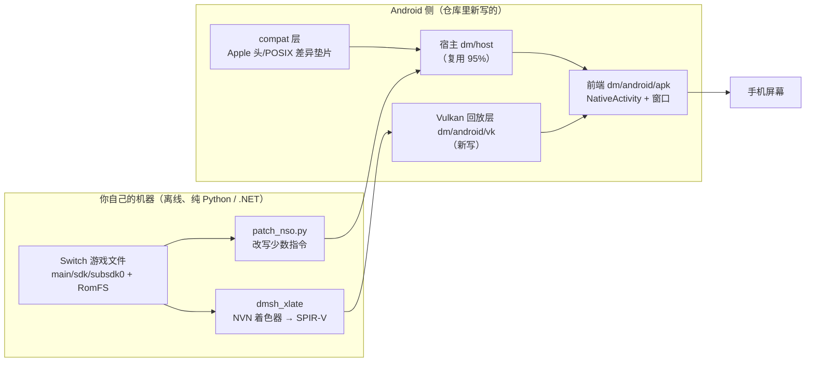

# 安卓移植：流程与进度全景（便于与其他项目横向对比）

> **这份文档是干什么的**：把 `d2r-mobile` 的**安卓支线**（Switch《暗黑破坏神 II：狱火重生》的
> 移植 / HLE 兼容层）从头到尾的**流程（怎么走）**与**进度（走到哪）**压成一页可对比的口径，
> 供其他移植项目（安卓、Linux、其他平台、其他游戏）拿来做**逐项对齐**。
>
> **口径来源**：全部事实取自仓库内文档与真机日志，不掺推测——
> `docs/ANDROID.zh-CN.md`（可行性）、`docs/ANDROID_PLAN.zh-CN.md`（计划 + 进度记录）、
> `docs/CROSS_MACHINE.zh-CN.md` §7（交接现状）、`.work/recon/handoff.md`（本机事实与取证数据）。
> 凡本页与上述文档冲突处，已在 §13「口径提醒」中标出。
>
> **基线**：分支 `android`，HEAD `afd7500`（2026-10-16，「M3-3e」续：分级复量把触发点收窄到"客体在 AHB 堆上的
> 原子操作"、第二台的 AHB 线暂停；其前 `0da66c0` = M3-3e、`e5468fc` = M3-3e 收尾、`d16de56` = M3-3d 收尾）。
> **自本提交起，Windows 上一切命令走项目内的 `.venv` Python**（规则 `.codebuddy/rules/windows-python-only/RULE.mdc`，alwaysApply）。
> 主线 `main` 是不含安卓的 iOS / macOS 版本。

---

## 0. 一页速览

| 维度 | 现状 |
|---|---|
| 支线目标 | 把已存在的 iOS/macOS 兼容层（宿主 + Metal 图形层 + iOS 前端）搬到 Android |
| 阶段 | **M1 完成、M2 未验收、M3 进行中**（M0 完成，M4 未开始）；**新地基 N0 / N1 / N2 / N3 / N4-a / N4-b / N4-c 已完成，N4-d 的两部分、N4-e 的第一刀、N4-f 的前半（顶点数据 / 常量缓冲都是正常的）、台账里那条 A1（真机装 Vulkan 校验层）与 N4-g、**N4-h 也都已完成**（2026-10-16，路径见 `rewrite/`；N4-g = 带层的 **B 臂**把 15 种 VUID 逐名对上（**两臂共有 15 种、只 A 0 种** ⇒ 零新增误用）、能力问到（**TF 在，但要抓 `gl_Position` 必须给游戏那份 SPIR-V 加装饰 ⇒ 与"不许改产物"冲突**）、改用**我们自己的三角形**验证 ⇒ **"顶点输出"这一层被两刀排除**；**N4-h = 把那个三角形画进**游戏的通道里** ⇒ **落屏****（序号 28 第 0/1 级从整片 152 变成整片 85，对照臂只差 conf 一行）⇒ **"通道 / 附件 / 布局 / 清 / 视口裁剪"这一层都是好的，只有游戏的绘制产不出片元** ⇒ 下一块 = **N4-i**：把游戏的输入逐个接到我们这条能落屏的管线上做二分；**N4-i 也已完成（2026-10-16）**：六档阶梯（`vb`/`state`/`vs`/`vsn`/`vso`/`both`）做二分 ⇒ **`vb`（我们的管线 + 游戏的顶点缓冲）、`vso`（游戏的顶点着色器 + 我们自己的状态）、`vso + DM_TRI_MASK_ALL` 三档都落屏**（`vso` 是整片 85）、**`state`/`vs`/`vsn` 三档不落屏** ⇒ **游戏自己的顶点着色器是好的**、责任收进"**游戏那一刻的状态 / 那条管线的声明细节**"；**顺带量到一个真 bug（旧路新路共有）**：图形管线缓存键里没有着色器（只读度量一轮 **15351 次**命中错对，修法 `DM_PIPEKEY=1` 生效但**画面不变 ⇒ 负结果**）⇒ 下一块 = **N4-j**：把状态里还没量过的字段逐项接上定案；**N4-j 也已完成（2026-10-17）**：全部字段打进自证行 + **一次只接一样**（叠在已知落屏的 `vso` 上）⇒ **`vso` + 一次接全部 = 152（3 轮）**、**`vso` + 只接"多边形模式" = 152（3 轮）** ⇒ **定案：多边形模式**，而它是一条真 bug —— **NVN 是 `POINT=0/LINE=1/FILL=2`、Vulkan 是 `FILL=0/LINE=1/POINT=2`，`gfx_state_fill()` 却把 NVN 的值裸 cast 成 `VkPolygonMode`** ⇒ 游戏每次绘制都成了 `POINT`（三角形只落顶点那几个像素、那个全屏三角形连一个都落不下，校验层还不报）；修法 `DM_POLY_MODE_NVN=1`（缺省关）把 N4-i 的 `vs` 档从 **152 翻成 85（3 轮）**；**但游戏自己的绘制仍不落屏**（修法 + brute 仍 152、查看器 0/0/0），而 **`both`（含游戏 FS）152 / `vs`（只换 FS）85** ⇒ 下一块 = **N4-k**：游戏的片段着色器那一侧；**N4-k 也已完成（2026-10-17）**：新档 `vsf`（游戏的 VS + **游戏的 FS** + 我们自己的状态 + 描述符）**152（3 轮）**、新档 `vsfull`（**我们自己的全屏三角形 VS** + 游戏的 FS）**152（3 轮）** ⇒ **与几何无关**；我们那份纯红 FS **只多 `FragmentShaderPixelInterlockEXT` ⇒ 85（3 轮）**、**只多两个输出 ⇒ 85（3 轮）** ⇒ capability 与输出个数都不是；把我们的 FS 换成**接口与游戏那份逐项相同、代码只有一句纯红**（`iface`）⇒ **152（3 轮）**、同接口 + **逐条复刻的算术**（`blit`）⇒ **152（3 轮）** ⇒ **不是代码**；绑定劈两半（只两个 UBO / 只三张 sampler2D）**都 152** ⇒ **只要片段着色器真的读一条描述符，这次绘制就一个像素都不落**；两条排除：`DM_UBO_RANGE=1`（UBO 范围收到 65536）仍 152、一轮 logcat（1.27 MB）**与驱动相关 0 条**；顺带量到一条真 bug 候选（`desc_alloc` 每帧每槽 1024 个描述符集、每次绘制要 2 个、**失败静默**）⇒ 下一块 = **N4-l**：我们这条描述符路（`vk_pipe_layout` / `desc_alloc` / `desc_write` / `vkCmdBindDescriptorSets`）；**N4-l 也已完成（2026-10-17）**：先**审出一条仪器错误**（`iface`/`blit`/`if_ubo`/`if_smp` 那 11 轮跑在 `vsfull` 档，而那一档的 `use_ps` 写死是**游戏那份 FS** ⇒ `DM_TRI_FS_VARIANT` 没生效），补上"新档 `vsfullf`"与"给我们自己的 FS 补反射"之后重做这一刀 ⇒ **`smp1`（一条 sampler2D）/ `ubo4`（一条池内 UBO）/ `ubo0`（一条 support_buffer）/ `decl`（五条只声明）/ `iface` / `capall`（8 条 capability 全加）全部 85 = 落屏**、而 **`vsfn`（游戏 FS、不绑描述符）152（2 轮）** ⇒ **"读描述符就一个像素不落"不成立、责任回到"游戏那份 FS 模块本身"**；顺带把两条真 bug 量成读数并各留修法（动态偏移个数 **3 vs 6**、描述符池 **27756 次/轮**被静默跳过），**都不是成因**） |
| 工作窗口 | 2026-10-13 ～ 2026-10-15，**97 个提交**（10-13：1 / 10-14：73 / 10-15：23） |
| 安卓侧代码量 | `dm/android/` 50 个源文件、约 **10,700 行**（C/H）；兼容层 15 个头/源 |
| 产物 | `dm.apk` **6.10 MB**（内含 `libdm.so` 6.09 MB，宿主 + 回放层全静态链入） |
| 目标机 | Redmi K90（骁龙 8 Elite / Adreno 830 / Android 16 / SDK 36 / arm64-v8a） |
| 已达成 | 改写产物在真机装载执行 → 进 `nnMain`；Vulkan 通路 + 零拷贝内存模型落地；出图与上屏链路真机通（窗口能显示主机像素）；绘制真下发（≈40 万次/轮、零失败） |
| 未达成 | **M2 验收判据「屏幕出（游戏自己的）画面」未过**：渲染目标读回仍是全零 |
| 当前卡点 | 每轮约 **10 秒**的「GPU/显示通路整体停摆」（提交在飞、GPU 却在等新活），会把交付节奏按帧率切成两半 |
| 下一步 | **⓪ 架构口径变更（2026-10-16）：图形层改为 Vulkan 原生的显式实现 —— 见 [rewrite/ANDROID_REWRITE.zh-CN.md](rewrite/ANDROID_REWRITE.zh-CN.md) 与 §6.4 / §11 第 0 条**；**该路径已走到 N4-e 的第一刀（2026-10-16）：内存、提交、可见性三块都在新地基上；"屏幕出画面"这条验收的**证据本身**先被更正（N4-a 起两臂都是 `DM_WIN_SRC=0` ⇒ 屏幕上那张是 `paint()` 测试图），再用"查看器打开"的 6 轮重新取证据 ⇒ **两臂两级亮度读数全是 0/0/0**；N4-e 又用"扫描器 + 已知色对照 + 通道探针 + 光栅化侧全放开"四步把"全零"这句话收敛到**片元在光栅化之前就没了**，顶点/几何侧的新仪表再排掉"顶点流没绑 / 几何为空" ⇒ **下一步只剩"顶点数据与着色器输出"（位置出裁剪体 / NaN）****；**N4-f 已把前半答完（2026-10-16）** —— 新开关 `DM_VTX_PROBE=1`（缺省关、**只读**）挂在既有判据行上，7 轮共 100+ 个采样点：**位置数据 NaN 0 / Inf 0 / 整片全零 0**（两种形状：UI `3×Float 步长20`、主场景 `4×ShortSNORM` 归一化压缩顶点）、**常量缓冲 NaN 0 / Inf 0**（逐槽 |max|：槽0 1~1067、槽2 ≈1、**槽3 = 1600 = 屏幕宽**、槽10 410~1070；**两臂逐项相同** ⇒ 不是新地基引入的）、分量类型与 SPIR-V 声明对上（`f88d27f131d71049` 的 Location 0/1 都是 float×4）⇒ **"顶点数据本身坏掉"这一支被排除，只剩"顶点着色器输出"这一处**（N4-g 先问 `VK_EXT_transform_feedback` 能力）；那 ~10 秒的驱动级停顿也仍未定案（N4-d 只落到线程上：`dm-guest` 4.6 kHz 睡→醒、前端被 `kgsl-events` 叫醒、我方 `vkQueueSubmit` 卡 11.7 s）；① 换设备 / 换驱动对照；② 有 `trace_processor` 的机器上读停顿窗口的 trace；③ 若仍在这台机上：试「GPU 保活」（隔 N 毫秒空提交，**已在「M3-3f」做过、负结果**）；④ **卡点 A 侧**：真机装 Validation Layers（见 §14 A1，**不依赖换设备**）——**这一条已做完**（A1：照出 16 种 VUID、修掉一条真误用、**没有一条是 draw 层面的用法错误**）。**★★ 2026-10-16（N4-g）最新**：① 带层的 **B 臂**（旧路对照）把 15 种 VUID **逐名**对上 ⇒ **A 15 / B 15 / 共有 15、只 A 0** ⇒ **新地基零新增误用**（成因必在两臂共用的代码里）；② 设备能力问到：**`VK_EXT_transform_feedback` 在（第 117/165 条）、`transformFeedback = 1`**、`VK_EXT_fragment_shader_interlock` **不在**、**`shaderClipDistance`/`shaderCullDistance` 设备都支持**、**`maxCombinedClipAndCullDistances = 8`**；③ 但 TF 抓 `gl_Position` **要求给游戏那份 SPIR-V 加 `XfbBuffer`/`Offset` 装饰**（离线：6923 份里 **0 份**有），与"不许改产物"冲突 ⇒ **本轮不走**；④ 离线核对：`gl_PerVertex` 里 **2345 份顶点着色器声明 `ClipDistance[8]`+`CullDistance[1]`（9 > 8）而"写"0 份"读"0 份** ⇒ **驱动看到的裁剪/剔除距离内容未定义**；⑤ 两刀都排掉了这一层 —— `DM_CLIPDIST`（两个核心特性，缺省关）两轮**亮度都是 0/0/0**（负结果）、新探针 `vk2_tri_probe` 的**我们自己的三角形** A（`Clip[1]+Cull[1] = 2`）与 B（**照游戏那份** `Clip[8]+Cull[1] = 9`）**都是 32640 / 65536 红像素**（特性关/开都一样）⇒ **"声明 9 个裁剪/剔除距离却从不写"不足以让图元消失**；顺带证明**我们自己的三角形落屏**（光栅化这一层是通的）。⇒ **N4-h 做完（本轮，2026-10-16）：把那个三角形画进**游戏的通道里** ⇒ **落屏**** —— 新模块 `dm/android/vk/vk_tri_game.c/.h`（+ 生成的内联 SPIR-V）+ 缺省关的开关 `DM_TRI_IN_GAME=<绘制序号>[@<color0序号>][:game]`；在 `DM_PASS_PROBE=28` 的已知色底子上、用**游戏那一刻的通道与附件**插一次我们自己的最简管线绘制 ⇒ **序号 28 第 0 级（1600×900）与第 1 级（800×450）都从整片 152 变成整片 85**（85 = 纯红 `(1,0,0)` 的 8 位三通道平均），**对照臂（只差 conf 一行）三级全是 152**、**三轮逐项一致**；插入明细里**游戏那一刻的动态视口/裁剪 = 800×450@(0,0)（与附件同尺寸）**⇒ **视口/裁剪没吃片元**；`n4h-tri-a4b`（去掉 `DM_PASS_PROBE`）里第 0 级 **85 →（1.5 秒后）0** ⇒ **附件上后来的 CLEAR 生效** ⇒ **"通道 / 附件 / 布局 / 清"那一层都好、只有游戏的 draw 产不出片元**（与 A1 的"draw 在 API 层面合法"合起来 ⇒ 责任落在"**游戏绘制的管线状态 / 着色器**"）；回归 N1/N2/N3/N4-b 判据字段 **0 项不一致**。**M2 的验收仍未过**。⇒ **下一刀 = N4-j**。**★★ 2026-10-16（N4-i）最新**：拿这条"已经证明能落屏"的管线当标尺做了**六档二分**（`DM_TRI_LADDER`，缺省关）—— ① **`vb`**（我们自己的管线 + **游戏的顶点缓冲**）**落屏**（均值 118.5 / 最小 85 / 最大 152，2 轮）⇒ 顶点流 / 属性格式 / 步长 / 偏移 / 影子地址 / 索引缓冲 / 计数这一层**通**（自证行按索引解码出**标准全屏三角形** `(-1,-1,0) (-1,3,0) (3,-1,0)`）；② **`vso`**（**游戏的顶点着色器** + **我们自己的状态**）**落屏 = 整片 85**（2 轮）⇒ **游戏自己的顶点着色器是好的**；③ `vso + DM_TRI_MASK_ALL=1`（每个附件都开写掩码）**也落屏**（3 轮）⇒ 写掩码那一项**不是**机制；④ `state`（我们的三角形 + 游戏那一刻的状态，拓扑/掩码/混合/剔除/深度）**不落屏**（3 轮）、`vs` 与 `vsn`（游戏的 VS + 游戏的**状态**，差描述符）**都不落屏**（各 3 轮）⇒ 责任收进"**游戏那一刻的状态 / 那条管线的声明细节**"。**★ 顺带量到一个真 bug（旧路新路共有）**：`vk_gfx_state` 的 `vs_key`/`ps_key`（`vk_pipe.h:85`）在回放路径上**从没被填过**（唯一的填表处 `gfx_state_fill()` 只 memset），而缓存是"整块状态哈希 + memcmp"（`vk_pipe.c:520-525`）⇒ "**谁先建管线谁赢**"：状态相同、着色器不同的绘制拿到**别人那一对的管线**；只读度量 `DM_PIPEKEY_PROBE=1` 一轮 **15351 次**命中错对，修法 `DM_PIPEKEY=1`（图形管线 84 → 169/196/170 条）**但画面不变（整片 152）⇒ 负结果**。⚠ **两个后果**：任何"状态与游戏那一刻一模一样、只换着色器"的实验都是**空实验**（`vs` 档第一版 2 轮就是这么作废的）；**N4-e 的 `DM_RASTER_BRUTE` 那一轮是在错的管线键上做的** ⇒ 本轮用 `DM_PIPEKEY=1` 重做（3 轮，序号 28 仍整片 152）⇒ 那条排除**重新成立**。**回归**：N1/N2/N3/N4-b 四个探针 ⇒ **判据字段 0 项不一致**（41/48/89/59 个共同键）。**M2 的验收仍未过**（本轮没为它跑查看器判据轮）。⇒ **下一刀 = N4-j**：先把 `vk_gfx_state` 里还没进自证行的字段（`frontFace`/`depthBiasEnable`+三系数/`a2c`/混合因子那一组）打进插入明细，再照 `DM_TRI_MASK_ALL` 那个形状**一次只接一样**地叠在**已知落屏的 `vso`** 上，定案是哪一项让绘制消失。**★★ 2026-10-17（N4-j）最新：定案了 —— 是【多边形模式】。** NVN 的 `NVN_POLYGON_MODE_FILL = 2`（`nvn.h:1059-1065`）被 `gfx_state_fill()` **裸 cast** 成 `VkPolygonMode`，而 Vulkan 的 `POINT = 2` ⇒ **游戏的每一次绘制都只把三角形光栅化成顶点那几个像素**（第 84 次绘制那个全屏三角形的三个顶点两个在裁剪体外、一个正好在角落 ⇒ **一个像素都不落**），且**校验层不报**（POINT 合法）、`DM_RASTER_BRUTE` **不碰这一项**（所以之前 6 轮"光栅化侧全放开仍 152"是"没碰到"，不是"排除"）、`vk_pipe.c:687` 只在设备不支持 `fillModeNonSolid` 时才回落 FILL（**这条 bug 只在这类设备上现形**）。**单变量读数**：`vso` 对照 85、`vso` + 一次接全部 152（3 轮）、`vso` + **只接多边形** 152（3 轮）。**修法** `DM_POLY_MODE_NVN=1`（缺省关，照苹果侧 `nvn_mtl.m:4400`）：**`vs` 档从 152 翻成 85（3 轮）**。**但画面仍未出来**：修法 + 关混合仍 152、查看器两次 0/0/0，而 **`both`（含游戏 FS）152 / `vs`（只换 FS）85** ⇒ 下一刀 = **N4-k：游戏的片段着色器那一侧**；**N4-m 也已完成（2026-10-17）**：离线把游戏那份 FS（`8e80084d3c30340a`）与我们那份已落屏的壳**按六类逐段对齐**（capability / execution mode / 装饰+成员装饰 / 常量 / `OpEntryPoint` 接口表 / 函数体 opcode 直方图）⇒ **前四类里唯一多出来的是 `NoContraction`（1 条，落在一条 `OpFAdd` 上）**，接口表**逐条相同**，剩下的差别只有**函数体的形状**（游戏那份 **38 个 Function 局部变量 + 50 次 store + 66 次 load**，我们那份全 SSA）；设备上两刀（判据：已知色底盘 152 上出现非 152 = 落屏）：**`blit`（同接口 + 照它反汇编逐条复刻的算术）3 轮全部落屏**、**`blitn`（再补 `OpIsNan`/`OpSelect` + `precise`）3 轮也全部落屏** ⇒ **函数体语义、那 4 种 opcode、那条装饰都不是原因**（⚠ N4-k 的 `blit`=152 是作废样本）；**带层一轮**：16 种 VUID 与 A1 同形，**层对这份模块只说了两句**（`pCode-08740` = `Float64` capability、`pCode-08742` = `SPV_EXT_fragment_shader_interlock`，**两句都已被 `capall` 排掉**），**没有一条落在管线创建 / 描述符与着色器匹配上**，**驱动侧 logcat 一句话都没说** ⇒ 负结果（⚠ 这一轮没有判据读数：带层把时序与资源注册整个改了 ⇒ 按无效样本记）；**两条真 bug 按规范修掉**（**缺省开 + `=0` 退回**）：动态偏移个数（`vso` 85 不变、不符 0 条；游戏 152 不变）与描述符池配额（`vso` 85 不变、池失败 **3854 → 327（末帧 841 → 0）**；游戏 152 不变、**22579 → 328（末帧 846 → 0）**）⇒ **两条都不动判据**；**回归**四探针与 `n4kregress` 比 **0 项不一致**（⚠ 提示词写的 `n4lregress` 盘上不存在）⇒ **只剩"这份确切的 SPIR-V 指令序列"这一个嫌疑**，下一刀 = **N4-n：「壳 + 我自己的 body」**（反汇编后只换 `main` 的函数体、`spirv-as` 编成我们自己的模块；**动的是从产物派生的文本，要先拿到允许**）；**M2 的验收仍未过**（两轮查看器 0/0/0、截图纯红 0.00%；⚠ 内容区从 N4-f/N4-j 的 99.63% 纯黑变成整片 `RGB(48,32,48)`，只记不判）；**N4-n 也已完成（2026-10-17，授权后只做诊断变体）**：从它那份反汇编派生两格（`.work/spv/` 只读，`spirv-val` 都干净）—— **`shellbody`**（**只换函数体**，capability/装饰/接口/常量/38 个局部变量逐条保留）**3 轮全落屏**、**`bodyout`**（**它的体一字不动**，只在 `OpReturn` 前补同样那 3 条 `OpStore`）**3 轮也全落屏**；而 **`vsfull`（它的 FS 原样）+ 关混合（`DM_RASTER_BRUTE=1`）仍是整片 152（2 轮）**、**`bodyout` + 同一个关混合仍落屏** ⇒ **壳无关、体也在跑** ⇒ **"整片 152" 的真正含义是"它写出去的值没落到附件上"，不是"片元在光栅化之前就没了"**（**更正 N4-e 的措辞**），**也不是"写黑"**（混合关掉后写黑会读成 0）⇒ 两条候选（**按分量写被写掩码挡掉** / **算出 NaN 被丢**）；**N4-o 已完成（2026-10-17，授权沿用）** —— 八格派生（追加/搬移/替换源/删除各一格）**把两条候选都排掉**：`tailred`（按分量写 + 我们的常量）**85（2 轮）**、`movetail`（**同一批指令只换位置**）**0（3 轮）** ⇒ **不是写法**；`vals`（整向量写它自己的值）**0（2 轮）**、`nanflag`/`nanflag38`/`isinf38` 全 **0** ⇒ **不是 NaN、也不是 Inf**（**它算出来的就是黑的**）；**`no38`（删掉写 `Location 2` 的 11 条）0（3 轮）** 与 **`v38`（`%38` 照写、值换常量）0（3 轮）** ⇒ **元凶是 `%38` 那一路写出去的值**，而"写第三个输出"本身不是 —— 拆掉任一侧（删它 / 值换常量 / 把 `Location 0` 的写挪到它之后）都能落屏，只有"原样 + 原位"丢 ⇒ 失衡的是「`%38` 的真实计算链值」×「`Location 0` 的写排在它之前」这一对；**两件没问成**（下一轮第一件事）：**附件格式**（插入明细只打 `color[0]/color[1]` = `VkFormat 97/37`、第 3 个没打；97 按 `vk_tex.c` = `R32_UINT` 而着色器写 float ⇒ "类型类对不上"从未核对）与 `%118/%120/%122` 的**量级** ⇒ 下一刀 = **N4-p** |

---

## 1. 项目与目标

### 1.1 母项目

`d2r-mobile` 是一个 MIT 许可的开源**兼容层**：让用户**自己购买的** Switch 版 D2R（含「术士君临」资料片，
Switch 1.0.34.0 = PC 3.3.94012）在 iPhone / iPad / Mac 上**原生执行**——不模拟 CPU，游戏自己的 aarch64
程序逐字节执行（只改写少数苹果内核下不可原样执行的指令），平台服务由自写宿主提供，图形接口在 Metal 上重实现。

### 1.2 安卓支线要什么

| 项 | 内容 |
|---|---|
| 复用原则 | **不重写游戏逻辑**，复用现有宿主；只替换「面向平台」的两侧：**前端**与**图形后端** |

> **⚠ 勘误（2026-10-16）**：这条原则**只对宿主与前端成立**。图形后端**不是"替换"，是"重写"**——
> Metal 的三条平台语义在 Vulkan 上没有对应物，见 §6.4 与 [rewrite/ANDROID_REWRITE.zh-CN.md](rewrite/ANDROID_REWRITE.zh-CN.md)。
> 原文保留，作为立项口径留档。
| 要换的两侧 | 前端：UIKit/CAMetalLayer → `NativeActivity` / `ANativeWindow`；图形：Metal 回放层 → **Vulkan 回放层** |
| 交付物 | 一个可安装的 APK（包名 `ai.d2rm.dm`）+ 设备侧只读数据（改写产物 / SPIR-V / RomFS） |
| 明确不做 | 不改游戏规则、不做 CPU 模拟、不联机、**仓库不含任何游戏内容**（游戏文件与生成物都在 `.work/`，已 gitignore） |
| 工作量重心 | 图形回放层约 **60–70%**（`nvn_mtl.m` 约 5,800 行 Metal → Vulkan） |

---

## 2. 流程总览（技术路线）



**四段流水**（每段都有自己的验收）：

1. **离线准备**：游戏文件 → 改写产物（aarch64）+ 6923 个 SPIR-V。与运行平台无关，安卓直接复用同一份。
2. **宿主底座**：装载改写产物、接管内核调用（SVC）、文件系统、线程同步、音频、存档。
3. **图形后端**：把 NVN 语义映射到 Vulkan（内存池零拷贝、命令流解释器、管线、贴图、上屏）。
4. **前端与交互**：窗口/生命周期/输入/文本/存档提示/触摸界面。

---

## 3. 阶段划分与验收判据

| 阶段 | 目标 | 验收判据（原文口径） | 状态 |
|---|---|---|---|
| **M0** | 环境就绪 | NDK 能编出原生程序并推到真机和跑起来 | ✅ 完成 |
| **探路 A** | 量化宿主复用率 | 拿到「要改哪些文件、改多少处」的清单 | ✅ 完成 |
| **探路 B** | 着色器翻译链落地 | 确认「NVN 着色器 → Vulkan SPIR-V」在本机可复现 | ✅ 完成 |
| **M1** | 无窗口跑通宿主 | APK 装上真机、画面全黑，但日志里出现游戏的 `UNIMPL` 行 | ✅ 完成 |
| **M2** | 最小 Vulkan 回放层 | 屏幕能出画面（先清屏成一个颜色，再逐步到主菜单） | ⚠️ **未验收**（链路通、画面未出） |
| **M3** | 前端 + 触摸 + 音频 | 能建角、进局、有声音 | 🔄 进行中（底层已通、玩家面功能未开始） |
| **N0~N6**（新地基，**取代旧图形层**） | 图形层改为 **Vulkan 原生的显式实现**（影子内存 + 显式可见性 + 帧批提交 + 反射绑定） | **G1~G5**（往返逐字节 / 可见性显式成立 / 4 GB 池全功能 / 一次客体提交=一次 `vkQueueSubmit` 且 `vkQueueWaitIdle` 为 0 / 两台设备都过）——判据与逐块计划见 **[rewrite/ANDROID_REWRITE.zh-CN.md](rewrite/ANDROID_REWRITE.zh-CN.md) §六 与 §十一** | ⬜ **未开工**（计划已写入 §十一；**N4 顶替 M2 的验收**） |
| **M4** | 收尾 | 手柄、云同步、诊断、性能调优（对标 iOS 60 fps / 3.8 W） | ⬜ 未开始 |

---

## 4. 进度总表（里程碑 × 硬证据）

| 里程碑 | 结论 | 硬证据（真机/离线读数） | 详见 |
|---|---|---|---|
| M0 | 工具链与真机就绪 | NDK r30/clang 21 编译并真机执行 hello | `ANDROID_PLAN` §一 |
| 探路 A | 宿主 C 复用率 **≈95%+** | 87 个编译单元：**56 个零改动通过**；29 个文件共 31 处平台差异；2 个汇编文件需改语法 | `ANDROID_PLAN` §三·探路 A |
| 探路 B | SPIR-V 已全部落袋 | 162 个着色器包 → 10847 变体 → **6923 个唯一键**；翻译 10847 成功 / 0 失败；**SPIR-V 1.3** | `ANDROID_PLAN` §三·探路 B |
| M1 | 宿主在真机跑进 `nnMain` | 装载 → 重定位（relative 60560 / abs 2109 / jump 615）→ `nnosInitialize` → 打出 `UNIMPL` | `ANDROID_PLAN` §三·M1 |
| M2-1 | Vulkan 通路 + 内存模型 | Adreno 830 / Vulkan 1.3.284 / 零拷贝类型 4·5·6 可用 / 离屏清屏回读逐像素相符 | 第 1 步 |
| M2-2 | **头号风险「统一内存」在真机验完** | 类型 6 上 CPU→GPU、GPU→CPU 双向逐字节相符 | 第 2 步 |
| M2-3 | 内存池落法定型 | 本机**无** `VK_EXT_external_memory_host` → 改由 Vulkan 铺客体地址空间；单次分配上限实测 3968 MB > 客体堆 3728 MB；惰性提交 | 第 3 步 |
| M2-回放层 | 命令流解释器 + 提交槽 + 管线 + 贴图 + view + 截图 | 真机 4179 帧无崩溃；**122 万次绘制 / 83 条管线 / 零失败**；子视图 0→33 张 | §八表 |
| M2-14步 | **离屏读回一帧写盘成功，但颜色全零** | 1600×900 合法 PNG（5,761,403 B）取回能打开；目标贴图读回**全零**、出图纹理全白 | 第 14 步 |
| M3-窗口 | 窗口最小工程 + 上屏链通 | 两张相隔 3 秒截屏里底色变化、白条位移；`APK→ANativeWindow→VkSurface→交换链→上屏` 通（1156×2510 格式 37、5 张、FIFO） | `ANDROID_PLAN` §三·M3 |
| M3-合一 | 窗口与游戏共用**一个** Vulkan 设备 | `libdm.so` 245 KB → 322 KB，屏上出现保持比例的测试图（说明上屏走的是宿主那一个设备） | 同上 |
| M3-渲染链 | 「一个像素不落」→「真的画进了目标」 | `DM_GFX_PROBE` 读回亮度 152.0 与清除色**分毫不差**（读回可信）；修默认写掩码后序号 27 从 **0 → 255** | M3 第 3 步 |
| M3-仪器 | 安卓侧补齐「等待点 + 线程现场 + 采样」 | 每条客体线程报 `stat` 状态 / `wchan` 内核等待点 / `syscall` 号+参数+sp+pc | M3 第 3 步 6/7/8 |
| M3-诊断链 | 12 轮真机排查（M3-2k → M3-3c） | 见 §5.6 时间线；结论：**「停住」= 驱动/GPU 约 10 秒不回答，会自愈** | §八 |
| M3-3d 换设备 | **卡点 B 的对照没拿到**（第二台跑不起来），拿到的是"移植假设"：第二台 **Mali-G610 MC6** 上零拷贝内存池那条路不存在 | 4 份探针（71 扩展 / Vulkan 1.1.177 / 外部句柄**不可导出**）+ `dmhost` 冒烟（`建载体缓冲失败` → 堆与别名区各 0 MB → `Break#1`）+ 第一台干净臂 **12 轮**（健康 1 / 停顿型 7 / 设备丢失型 2 / 崩溃 2）+ `vk_ops` 的 -4「前序 24 笔」流水 | `ANDROID_PLAN` §八·M3-3d |
| **新地基 N0** | **已完成（2026-10-16）**：§9.9 的四个常数各有真机读数（探针四轮，三轮完整且一致）—— **只问不接管**，游戏路径一行未动 | 新探针 `dm/android/vk2/vk2_probe.c` 第一台四轮：**块大小 960 MB**（纸面上限 = `maxMemoryAllocationSize` **1024 MB**，由"1088 MB 失败 / 1024 MB 成功"证明）、**脏位图 4 KiB 起步**（位图 128 KiB、扫一遍 0.9~2.7 ms）、**`VK2_INFLIGHT` 3 起步**（D=3 51~94 µs/提交、D=8 23~44 µs）、**暂存环 16 MiB 起步**（一池全搬 4096 MB = 156~170 ms ⇒ 24~26 GB/s）；栅栏带超时返回 `VK_TIMEOUT` 且可恢复；读数 `.work/logs/probe-8b1f1e50-vk2_probe.txt` | `ANDROID_PLAN` §八·N0 |
| **新地基 N1** | **已完成（2026-10-16）**：影子内存 + 分块后备资源 + 地址反查（`dm/android/vk2/vk2_pool.c/.h`）落地；**本块的"接管"= 让新池模块可用**，真正替换回放层是 N4 —— 回放层三处一行未动 | 第一台四轮（**29 个字段逐轮完全一致**）：**G3 成立** —— 4 GB 池按块建成 **5 块**（4×960 MB + 末块 256 MB），每块**头页与尾页都真写一遍并回读**逐字节一致（5/5）、**`g_pool_small = 0`、`g_pool_no_region = 0`**；开关 `DM_GFX2` **缺省关且可读自证**（未设⇒旧路 / 1⇒新地基）；跨块请求长度分布（抽 199998 次：**≤64 KiB 跨块率 0**、256 KiB 0.009%、1 MiB 0.072%、4 MiB 0.396%、16 MiB 1.841%）；`malloc` 池带 TBI 标记也照旧；请求 PINNED 回落 SHADOW（报计数不报红）；读数 `.work/logs/probe-8b1f1e50-vk2_pool_probe.txt`（前三轮 `…-r1/-r2/-r3.txt` 留档） | `ANDROID_PLAN` §八·N1 |
| **新地基 N2** | **已完成（2026-10-16）**：脏记账（`vk2_dirty.c/.h`，区间级三态、4 KiB 起步）+ 上传/回读窗口（`vk2_xfer.c/.h`，只等定向栅栏）落地 ⇒ **可见性显式建立**。仍"只让新模块可用"，回放层三处一行未动 | 第一台四轮（**判据字段逐轮完全一致**，六个时间字段报区间）：**G1 成立**（4/4 档往返闭环逐字节等于**独立重算**的期望，含"16 MiB 填满暂存环"与"跨块拆 2 条拷贝"两档）；**G2 成立**（不等待读 = 旧值 / **等完栅栏仍不回读 = 还是旧值** / 回读之后 = 新值；没指定栅栏 ⇒ 拒绝；等永不 signal 的栅栏 ⇒ 5.0 s 超时如实报失败）；脏位图与朴素模型**逐位一致**（1048576 页 × 20000 次随机记账）；512 MB 真搬 = 32 窗口 127~153 ms（3.3~4.0 MB/ms）；**`vkQueueWaitIdle` 计数 = 0**；N1 探针回归轮全部键值不变 | `ANDROID_PLAN` §八·N2 |
| **新地基 N3** | **已完成（2026-10-16）**：帧批提交 + 有界在飞（`dm/android/vk2/vk2_sub.c/.h`，**一槽一池一 cb 一栅栏**、取槽先轮询、满了只等最老那个槽的栅栏、带超时）落地；**本块的"接管"仍是"让新模块可用"**，回放层三处一行未动、没有任何调用方 | 第一台四轮（**判据字段逐轮完全一致**）：**G4 前两条成立** —— **一个客体提交 = 一次 `vkQueueSubmit`**（24 次空提交：探针数的 24 = `commits` 24 = `submits` 24、`submit_fail` 0；总数 152/152/152/152）、**`vkQueueWaitIdle` 计数 = 0**（模块里宏成「计数 + 报红」）；**"3 还是 4" = 3**（D=1/2/3/4/8 各 24 次带 128 MB GPU 拷贝的提交：D=3→D=4 每提交耗时变化 **-4~+26‰**、D=1 却是 7822~13587 µs 而 D≥3 稳定在 4059~4085 µs ⇒ 有界在飞本身买到吞吐；最长等待 D≥3 = 3.48~3.81 ms ≈ 一条提交自己的 GPU 活）；`wait_all` 等的是所有在飞槽（不是队列空闲）；**槽能被 N2 的搬运窗口复用**（1 MB 上传 → 回读逐字节等于独立重算的期望、回收时自动交还环）；**新量出的 N4 待办**：暂存环是单窗口的（在飞 3 槽只有 1 个能载上传窗口）⇒ 按槽分环。N2 探针回归轮 `…-n3regress.txt` 判据字段逐项相同 | `ANDROID_PLAN` §八·N3 |
| **新地基 N4-a** | **已完成（2026-10-16）**：N4 的第一步 —— 在 `mtl_pool_add/del` 上挂新地基的**选路点** + **并行的池登记**（`DM_GFX2=1`、`DM_GFX2_BACKING_MB=0` ⇒ 只登记不建后备，新增 Vulkan 占用 **0**）。**GPU 侧仍全走旧路**（`mtl_addr` 未接管）⇒ 与画面/崩溃率无关 | A/B 两臂真机各一轮（60 秒，`.work/n4-a.conf` 对 `n4-b.conf`，都 `DM_WIN_SRC=0`）：**7 个池 / 1675 MB**（512 / 10 / 400 / 1 / 710 / 2 / 40 MB）、**每个都登记成功**、**`no_region = 0`**（⇒ 新地基"池是本进程可读写的普通内存"这条唯一前提在真机游戏路径上**成立**）、`small/pool_fail/dirty_fail` 全 0、后备已建 0 MB；A/B 两臂的旧路池清单**逐条相同**（地址只差 ASLR）、红黄行**逐条相同**（⇒ 零副作用）、两臂都在同一处出现旧路已知的"出图停住" | `ANDROID_PLAN` §八·N4-a |
| **新地基 N4-b** | **已完成（2026-10-16）**：**把 GPU 侧的内存接管下来** —— `mtl_addr` 改成回**后备资源**（块缓冲 + 块内偏移）、脏标记（绑定点 / `COPY_B2B` 的源 / texel view）、`UPDATE_UB` 与 `COPY_B2B` 的**目标**标 `GPU_DIRTY`（影子从此过期）、**帧开头把 CPU 脏页搬上去**（录在 `mtl_sub_begin` 的 cb 最前面）、槽回收时交还**那一段**环（**环按槽分**，N3 量出的待办）、**初始同步**（整池一次搬完，别按一帧一段环慢慢搬）。提交与贴图仍走旧路 | **探针** `vk2_takeover_probe` 四轮判据字段一致（退出码 0）：反查形状 6 项（块缓冲 + 块内偏移、越界/池外/无后备都返回 0）、**一次 `vkQueueSubmit(3 条 cb)` 之后三段同时被占着**（N3 的单环这里只能 1 段）、接管闭环三半（写 A 标脏 ⇒ 回读 = A；**写 B 不标脏 ⇒ 帧不搬、回读仍是 A**；补标脏 ⇒ 回读 = B）、「脏→上传→清位→再触碰→再上传」不变量、**GPU_DIRTY 不被上传覆盖**、初始同步 8 MB/2 轮；**回归** N1/N2/N3 探针判据字段逐项不变（含 G3 的 `small = 0` —— 本轮给块加了 UBO 位）。**游戏路径 A 臂（`DM_GFX2=1`）三轮**：7 池 / 1675 MB 全登记、**后备已建 1675 MB**、`no_region/small/pool_fail/dirty_fail` 全 0、**初始同步 1675 MB / 53~105 轮 / 375 ms**、每帧开头上传 **36~52 KB**（个别帧 15.4 MB）、设备丢失 0 条 ⇒ **六个新基线字段第一次有真帧读数**（`.work/logs/vk2-readings.tsv` 的 N4-b 行）。**但出图停在 85 / 88 / 118（三轮同一形态）**，对照臂（旧路）两轮健康推进（318 / 1243）；**两臂截图都是「黑底 + 一条暗红带 + 白方块」⇒ 画面内容没变** ⇒ **M2 的验收「屏幕出（游戏自己的）画面」本轮仍未通过**
（⚠ **【更正 2026-10-16 · N4-d 第二部分】这两臂截图是**我们自己的测试图** —— 那份 conf 是 `DM_WIN_SRC=0`；
"画面内容没变"要用 N4-d 第二部分那 6 轮"查看器打开、两臂两级亮度读数全 0"来支撑**） | `ANDROID_PLAN` §八·N4-b |
| **新地基 N4-c** | **已完成（2026-10-16）**：接**提交侧**（`inflight_*` → `vk2_sub_*`：一槽一池一 cb 一栅栏、在飞 3、槽回收钩子；`mtl_drain/finish` → `vk2_sub_wait_all`；`mtl_wait` 按**客体给的超时**等 frame）+ **补 GPU→池的回读**（每次提交记下 GPU 直写过的段，槽回收时按该帧栅栏**字节精确**回读进影子 + 只清 GPU 位；半页竞态两条对策）+ **收口核心回放层那五处 `vkQueueWaitIdle`**（全部改走计数入口，新地基下一处也不真的等） | **探针** `vk2_takeover_probe` 增三问（回收钩子/poll 三态、往返型三半、半页竞态两条对策），**四轮判据字段逐轮一致、退出码 0**；**回归** N1/N2/N3 三个探针判据字段 **0 项不一致**（`.work/n4c_regress_diff.py` 比对）。**游戏路径 A 臂（`DM_GFX2=1`）三轮**：**心跳逐秒"等队列空闲 0"**（被定向栅栏替代 46~727）、**每帧提交 1.00**、**槽等待率 0‰（0/60，轮询回收 56）**、**每帧脏 run 4.42**、**每帧回读 ≈17 KB / 0.5 ms**（55 次/1024 KB/累计 28 ms）、半页竞态撞上 0、设备丢失 0 ⇒ **六个新基线字段全部有真帧读数**。**但出图停在 115 / 122 / 96**，**对照臂（旧路）本轮也停在 72**（两臂同一形态）；**截图仍是"黑底 + 一条暗红带 + 一个白方块"** ⇒ **M2 的验收仍未通过**（⚠ **【更正 2026-10-16 · N4-d 第二部分】同上一行：那张是 `paint()` 测试图**）。
顺带修掉一个自己引入的真 bug（`mtl_wait` 曾把客体的超时换成模块的 5 s 上限，现场读数 5005 ms） | `ANDROID_PLAN` §八·N4-c |
| **新地基 N4-d（第一部分）** | **已完成（2026-10-16）**：把"我方自己的失败"变成**带时间戳**的读数（`vk_diag_line` 每秒那一行挂上"我方超时 / 提交到 frame X、完成到 frame Y / ReadTexels 读到 N 次"）+ `ReadTexels` 判据行挪到"每 60 次提交 + 第 1 次"的独立行（两臂都打）+ **修掉两个读数问题**（`reaped_max` 只在"真等栅栏"的路更新 ⇒ 轮询回收主路上虚低，第一次跑报"提交到 79、完成到 3"；"一次性提交"在新地基下等的是定向栅栏、台账名却还叫"等空闲"） | **A 臂 5 轮 + B 臂 2 轮**：**两臂都出现同三种形态**（~10~12 s 停顿 / 设备丢失 `-4` / 我方定向栅栏超时）—— A：a2 上屏等上一帧栅栏 10800 ms、a4 上屏 11311 ms + 一次性提交等定向栅栏 5057 ms、a/a3/a5 设备丢失（回读拷贝提交失败 `-4` ×2）；B（旧路）：b1 三站点 11894~12109 ms、b2 第一条 `-4` 落在 **`vkQueueWaitIdle`** 上（其后 143 条上传失败）⇒ **不是 N4-c 引入的**；`ReadTexels 读到 GPU 写过的贴图` **六轮全是 0** ⇒ 渲染目标写回池**不做**；**`atrace` 一次**：停顿后我方主/前端线程自旋（3 s 内 14229 条）而显示/GPU 通路阻塞率 **×3.6**（41.6→151.6 条/秒：`sde_encoder_helper_wait_for_irq` / `_sde_encoder_cesta_update` / `adreno_hwsched_wait_ack_completion` / `gmu_f2h`）⇒ **不是"整条通路一起睡"**；**M2 的验收仍未过**（截图 17777 B 与 N4-b/N4-c 同形，且与参照影片任何时间点都不匹配）。待办：① atrace 的 stop 推迟 10 s 复验（排边界效应）；② 水位线三个数差 1 的口径待对齐 | `ANDROID_PLAN` §八·N4-d |
| **新地基 N4-d（第二部分）** | **已完成（2026-10-16）**：① **一条更正（本轮最要紧）**：N4-a ~ N4-d（第一部分）两臂 conf 全是 `DM_WIN_SRC=0`（查看器显式关）⇒ 屏幕上那张是 `paint()` 的**测试图**（带 1156×650 = 16:9、白条 133×180 @ y=270 与 `main_apk.c:592` 逐位吻合）⇒ **那三轮"画面没变 / M2 未过"的截图证据作废**（原文已留 + 批注）；② **把查看器打开重跑 6 轮**（A′=DM_GFX2=1 / B′=旧路 × 第 0/1 级）⇒ **两臂两级亮度读数全是 `均值 0.0 / 最小 0 / 最大 0`**、读成功的三张截图 99.611% 纯黑（`vb-s45` 读回失败回落测试图又长出红带）；③ **水位线口径定案**（`Z == X+1`、`K == X − Y + δ`；真机 95 个采样全自洽）；④ **atrace 三份**（stop 推迟 10 s）+ **线程命名**（`dm-*` / `dm-g<handle>`）⇒ 停顿期间 **`dm-guest` 4.6 kHz 睡→醒、阻塞 caller 0 条**、**前端被 `kgsl-events` 叫醒**（2394 次/10 s）、我方 `vkQueueSubmit` 卡 11.7 s、**三份 + 六轮无一自愈** | 6 个查看器轮（`.work/logs/n4-shot-va{,0}-s20.log` / `va-s45` / `vb{,0}-s20` / `vb-s45`，含逐 2 秒的 `查看器：… 亮度` 行）、水位线短轮 `.work/logs/n4-n4d-va1.log`、atrace 三份 `.work/trace/at_stall-n4d-at2-{1,2,3}.txt`（33.3 / 32.2 s，我方 26 万条事件；抬升 ×6.2 维持 13.0 / 14.5 s）+ 命名后第四份 `at_stall-n4d-at3-1.txt`、截图 `.work/logs/n4b-{va-s20,va-s45,vb-s20,vb-s45}.png`、`tid` 映射 `.work/trace/tids-n4d-at*-*.txt`；新红行 `【红】回读拷贝 等定向栅栏超时（5000 ms）：VkResult 2`（`fence_timeouts`）按"见证不是原因"记档 | `ANDROID_PLAN` §八·N4-d（第二部分） |
| **N4-e（第一刀）** | **已完成（2026-10-16）**：不再靠肉眼看屏幕，改成"**用我们自己的写入当刻度**"一层层收 —— ① **扫描器**（`DM_NVN_SHOT_SCAN`，一次扫全部已知贴图逐张逐级）：**A′/B′ 两臂 @出图 40 逐项相同**（139 张、≥256×256 的 26 张、读 33 次、成功 20 / 失败 13），20 次成功里**只有序号 27 的第 1/2 级是整片 255（纯白）**、其余全 0/0/0；@60 一轮 192 张 / 167 次 / **成功 13 / 失败 154（`读回不支持格式 138`）**。② **两个对照**证明读回链通：`DM_GFX_PROBE=7` ⇒ 序号 7 = **136.0**（与预算值逐位命中）、`=28` ⇒ 28 三级 = **152.0**。③ **通道探针**（新开关 `DM_PASS_PROBE`）：`:end` ⇒ 152 ⇒ **附件/视图/布局/存储那一层成立**；不带 `:end` ⇒ **仍是整片 152** ⇒ **游戏 3.9 万次绘制一个像素都没落下**。④ **光栅化侧逐条排除**：`DM_NO_DEPTH_TEST=1`、`DM_PASS_AREA=2`、**`DM_RASTER_BRUTE=1`（剔/混/写掩码/视口裁剪全放开）** 三种全放开的组合下**序号 28 仍是整片 152** ⇒ **片元在光栅化之前就没了**。⑤ **顶点/几何侧新仪表**（绑上/没绑上（按流）/顶点数 0/索引数 0）⇒ 两轮：**没绑上的 2682~2762 次全部是第 4 条流**、**顶点数 0 的 0 次**、索引数 0 的 19~23 次 ⇒ "顶点流没绑 / 几何为空"都不成立 | 读数 `.work/logs/n4-shot-n4e-{scan-a40,scan-b40,probe28-a40,probe7-a40}.log` + `n4-n4e-{passprobe28,passprobe28open,nodepth,passarea2,brute,vtx,vtx2,vtx3}.log`（每轮都带**开关自证行**，逐轮核对 `.work/n4e_chk_sw.py`）；抽表 `.work/n4e_scan_report.py`；**M2 的验收仍未过**（且"画面"这一问已被收窄到"顶点数据与着色器输出"） | `ANDROID_PLAN` §八·N4-e |
| **N4-f（前半：顶点数据 / 常量缓冲）** | **已完成（2026-10-16）**：新开关 `DM_VTX_PROBE=1`（**缺省关、只读**：不改状态 / 不标脏 / 不提交）挂在**既有判据行**（前 8 次绘制 + 每 2048 次）那一点上，读**影子里的**顶点数据与常量缓冲 —— 位置属性（Location 0，缺则取着色器声明里第一条真的绑了的）的 NVN 格式 / 步长 / 偏移 / 流 / 影子地址 + 按格式解码前 4 个顶点；顶点阶段**所有**有地址的常量槽各读前 64 字节。**A 臂 5 轮 + B 臂 2 轮**：**位置数据 NaN 0 / Inf 0 / 整片全零 0**（形状两种：UI `3×Float 步长20`、主场景 `4×ShortSNORM 步长28/24/20`，顶点数 3~14550）；**常量缓冲 NaN 0 / Inf 0**、逐槽 \|max\| **两臂逐项相同**（槽0 1~1067、槽2 ≈1、**槽3 = 1600 = 屏幕宽**、槽10 410~1070）；**分量类型与 SPIR-V 声明对上**（`f88d27f131d71049` 的 Location 0/1 都是 float×4，NVN 给 `3×Float` 第 4 分量补 1，两侧一致）。⚠ 仪器自己出过一次错并当场更正：第一版只查"第一个非零常量槽"（`常量[0][0]` 的前 4 个 `-0.00125,0,0,0` **不像**变换矩阵）⇒ 改成**扫全部槽**。⇒ **"顶点数据本身坏掉"这一支被排除**；**画面仍是全零**（截图轮 `DM_WIN_SRC=28` 781 次读成功、亮度全 0，`n4b-n4f-shot-a.png`）。 | `ANDROID_PLAN` §八·N4-f |
| **A1（台账 §14）真机装 Vulkan 校验层** | **已完成（2026-10-16）**：层的 `libVkLayer_khronos_validation.so`（**27,684,688 字节**，Khronos `android-binaries-1.4.363.0.zip`）进 APK 的 `lib/arm64-v8a/`（`build_apk.cmd` 新增**缺省关**的 `DM_VKLAYER=1` 可选段），用 `adb shell setprop debug.vulkan.layers VK_LAYER_KHRONOS_validation` 启用 —— **不用 root、不改一行代码**（清单里 `android:debuggable="true"` 本来就有）。自证：logcat `added global layer … from library '/data/app/…/lib/arm64/libVkLayer_khronos_validation.so'` + `Loaded layer`。**一轮 60 秒照出 218 条 Error / 16 种 VUID**；**当场点出一条真误用并已修 + 复验**：`SPIR-V Capability DrawParameters` 归 `VkPhysicalDeviceVulkan11Features::shaderDrawParameters` 管，而 `vk_device.c` 从没挂过这个结构，**游戏的顶点着色器 1839 份都在用 `gl_BaseInstance`**（离线 `.work/spv` 的 `BuiltIn 4425`）⇒ 修后层**不再报它**（按 capability 逐项对比：`DrawParameters` 2 → 0）。**对卡点 A 最要紧的是一条负结果**：**16 种 VUID 里没有一条是"draw 层面的用法错误"**（顶点缓冲绑定 / 管线与通道兼容性 / 描述符 / 顶点属性都不报）⇒ **我们的 draw 在 API 层面合法** ⇒ 与 N4-e/N4-f 的"几何是自己算没了"一致。剩 15 种真误用（SPIR-V 自身不合法、内存类型、aspectMask、信号量、clip/cull 超上限…）已逐条列档。 | `ANDROID_PLAN` §八·A1 / §七·第 6 条；`TOOLS` §G |
| **N4-g** | **已完成（2026-10-16）**：① **带层的 B 臂**（旧路对照）配新脚本 `.work/vuid_species_diff.py` **按 VUID 名**分堆 ⇒ **A 15 种 / B 15 种 / 共有 15 种、只 A 0 种、只 B 0 种** ⇒ **新地基零新增误用**（15 种里唯一落在"顶点输出那一层"的是 `maxCombinedClipAndCullDistances-00710`）；② **能力**（新探针 `vk2_cap_probe`）：**165 个扩展**、**`VK_EXT_transform_feedback` 在（第 117 条）、`transformFeedback = 1`、`geometryStreams = 1`**、`VK_EXT_fragment_shader_interlock` **不在设备上**、**`shaderClipDistance`/`shaderCullDistance` 设备都支持**、**`maxCombinedClipAndCullDistances = 8`**；③ **TF 本轮不走**（离线：`.work/spv` 6923 份里 **0 份**带 `XfbBuffer`/`Offset` 装饰 ⇒ 要用它抓游戏 `gl_Position` 必须改产物，与"不许改产物"冲突）；④ **离线核对**（NDK 自带 `spirv-dis`）：主路径 `f88d27f131d71049` 的 `gl_PerVertex` 成员 2/3 = `ClipDistance`/`CullDistance`，**全部取值链 9 条没有一条点到它们**；全库 **2345 份顶点着色器声明 `Clip[8]`+`Cull[1]`（9 > 8）而"写"0 份"读"0 份**；⑤ **两刀**：`DM_CLIPDIST`（两个核心特性，缺省关）两轮**亮度都是 0/0/0**；**新探针 `vk2_tri_probe`** 的**我们自己的三角形** A（`Clip[1]+Cull[1] = 2`）与 B（**照游戏那份** `Clip[8]+Cull[1] = 9`）**都是 32640 / 65536 红像素**（特性关/开都一样）⇒ **"声明 9 个裁剪/剔除距离却从不写"不足以让图元消失**；顺带证明**我们自己的三角形落屏**（光栅化这一层是通的）；⑥ 回归：N1/N2/N3/N4-b 各一轮 + `vk2_sub_probe` 三轮 ⇒ **非时间判定键全一致**、`VK2_INFLIGHT_CHOSEN` 三轮都是 3（⚠ `VK2_D3_TO_D4_GAIN_PM` 某档测成 ≈0 时给天文数字，**判据别读它**）。**M2 的验收仍未过**（两轮查看器打开、亮度 0/0/0） | 读数 `.work/logs/{probe-8b1f1e50-vk2_cap_probe.txt, vkjson-8b1f1e50.json, vuid-diff-vk-a2-vk-b1.txt, logcat-vk-b1.txt, clipdist-use.txt, dis-f88d27f131d71049.txt, tri-spv.txt, probe-…-vk2_tri_probe[-clipdist].txt, n4-shot-n4g-clip-a{0,1}.log, n4b-n4g-clip-a{0,1}.png, …-vk2_{pool,xfer,sub,takeover}_probe-n4gregress.txt, …-vk2_sub_probe-n4gsub{1,2,3}.txt}` | `ANDROID_PLAN` §八·N4-g；仪器事实 `TOOLS` B¹² |
| **N4-h** | **已完成（2026-10-16）**：把"我们自己的三角形"画进**游戏的通道里** ⇒ **落屏**。新模块 `dm/android/vk/vk_tri_game.c/.h`（+ 生成的内联 SPIR-V `vk_tri_game_spv.h`，`.work/n4h_tri_spv.py` 生成并自证）+ **缺省关**的开关 `DM_TRI_IN_GAME=<绘制序号>[@<color0序号>][:game]`；接进 `nvn_vk.c` 三处（`pass_begin` 清"这一段还没插过"的标志 / **游戏绘制录完之后** `if (wrote)` 插一次 / 心跳一格**只在开关开时出现**），`vk_pipe.c` 只多一个 `vk_pipe_note_external_gfx()`（让"图形管线"那一格 +1 —— 提示词要的那条自证）。**自证三处**：启动头 `配置：DM_TRI_IN_GAME=@28` + 开关自证两行；插入明细（第 1 次插入 = 游戏第 84 次绘制、通道 color0 = 序号 28、**附件 800x450、3 个颜色附件、VkFormat 97/37**、**游戏那一刻的动态视口/裁剪 = 800×450@(0,0)**、图形管线累计 10 条**含我们这条**）+「我们自己的图形管线已建（VkResult 0）」；心跳 `自绘 插入 2 次 / 管线 1 条`（三轮逐项一致）。**判据**：对照臂（不设开关，2 轮有效）序号 28 三级 = **整片 152**（与 N4-e 逐项相同）；实验臂（3 轮 `n4h-a1/a1b/a1c`）**第 0/1 级都是 `均值 85.0 / 最小 85 / 最大 85`**、第 2 级仍 152 ⇒ **落屏**（⚠ 判据只覆盖第 0/1 级；`n4h-a0b` 是崩溃轮，剔除）。**顺带四条**：① 游戏那一刻的视口/裁剪 **= 附件尺寸** ⇒ 视口/裁剪没吃片元；② **只有序号 28 变了**（与"只写附件 0"一致）；③ `n4h-tri-a4b`（去掉 `DM_PASS_PROBE`）里第 0 级 **85 →（1.5 秒后）0** ⇒ **附件上后来的 CLEAR 生效**；④ `n4h-tri-a3` 截图上查看器内容区 **25.71% 是已知色（上屏链路通）**，但**"红色上屏"被时序躲过**（存活窗口 ~1~2 秒）⇒ 不作判据。**回归**：N1/N2/N3/N4-b 各一轮 ⇒ **判据字段 0 项不一致**（41/48/89/59 个共同键；⚠ 比对脚本本轮把 `_MB` 的"可用内存"与两类已知抖动单列 —— 原样列出、只是不计入判据）。**本轮没改新地基任何模块**（`vk2_*.c` 一行未动）。**M2 的验收仍未过** | 读数 `.work/logs/{n4-n4h-a{0,0b,0c,1,1b,1c}.log, n4-shot-n4h-tri-a{3,4,4b}.log, n4b-n4h-tri-a{3,4,4b}.png, tri-ingame-spv.txt, …-vk2_{pool,xfer,sub,takeover}_probe-n4hregress.txt}`；conf `.work/n4h-tri-a{0,1,2,3,4}.conf`（`.work/n4h_confs.py`） | `ANDROID_PLAN` §八·N4-h；仪器事实 `TOOLS` B¹³ |
| **N4-i** | **已完成（2026-10-16）**：拿 N4-h 那条"已经证明能落屏"的管线当标尺做**六档二分**（`DM_TRI_LADDER=<档>`，缺省关：`vb` = 我们自己的管线 + **游戏的顶点缓冲** / `state` = 我们的三角形 + **游戏那一刻的状态** / `vs` = **游戏的顶点着色器** + 我们的片段着色器 / `vsn` = 同 `vs` 但**不绑描述符** / `vso` = **游戏的 VS + 我们自己的状态** / `both` = 原地重放）。**新模块自带形状判据**（只在"三角形族拓扑 + 数量 ≥ 3"的绘制上插，不满足不消费"每段通道插一次"的标记）。**判据读数**（`DM_PASS_PROBE=28` 的已知色 152 上出现非 152 = 这一档仍落屏）：`vb` **落屏**（均值 118.5 / 最小 85 / 最大 152，2 轮）+ `vb+DM_TRI_DECL_DS` **落屏**（2 轮，那一刻 `depth_fmt = 0` ⇒ 那批无区分力）；**`vso` 落屏 = 整片 85（2 轮）**、`vso+DM_TRI_MASK_ALL` **落屏**（3 轮）；`state` **不落屏**（3 轮）、`vs`（键修正后）/`vsn` **都不落屏**（各 3 轮）⇒ **游戏的顶点着色器是好的**、责任收进"**状态 / 声明细节**"。**★ 顺带量到真 bug（旧路新路共有）**：**图形管线缓存键里没有着色器** —— `vk_gfx_state` 的 `vs_key`/`ps_key` 在回放路径上从没被填过（`gfx_state_fill()` 只 memset），缓存却按整块状态字节 memcmp（`vk_pipe.c:520-525`）⇒ 状态相同、着色器不同的绘制拿到**别人那一对的管线**；只读度量 `DM_PIPEKEY_PROBE=1` 一轮 **15351 次**命中错对（明细给出两对键），修法 `DM_PIPEKEY=1`（图形管线 84 → 169/196/170）**但画面不变 ⇒ 负结果**；⚠ 后果：**"状态与游戏那一刻相同、只换着色器"的实验是空实验**（`vs` 第一版 2 轮作废）、**N4-e 的 `DM_RASTER_BRUTE` 那一轮是在错的管线键上做的** ⇒ 已用 `DM_PIPEKEY=1` 重做（3 轮，仍 152）。**顺带**：第 84 次绘制那份 VS（`c9468c9400b8df6f`）是**纯直通**（`gl_Position = 顶点属性`、`support_buffer` 声明但没读、`res.json` 全空）、那一刻通道**没有深度附件**、游戏状态是 拓扑 TRIANGLE_LIST / 掩码[0] 0xf / 混合开（ONE→ONE）/ 深度关 / **剔除 BACK**；**离线**：全库 6923 份 `.spv` 里 **4189 份带 `OpKill`**（全是片元 = 92%）。**回归**：N1/N2/N3/N4-b ⇒ **判据字段 0 项不一致**。**M2 仍未过** | 读数 `.work/logs/n4-n4i-{vb1,vb2,vb3, vs3,vs4,vs5, vsn1,vsn2,vsn3, st1,st2,st3, vso1,vso2, vsom1,vsom2,vsom3, vbds1,vbds2, pkp1, pkf1,pkf2,pkf3, pkb1,pkb2,pkb3}.log`（作废的 `vs1`/`vs2` 也留档）+ 离线 `n4i-kill-scan.txt` / `tri-ladder-spv.txt` / `n4i-apple-attr.txt` / `n4i-vs84.txt` / `n4i-fs-<键>.txt` / `n4i-devcheck.txt` + 回归 `…-vk2_{pool,xfer,sub,takeover}_probe-n4iregress.txt`；conf `.work/n4i-lad-*.conf` / `n4i-pk-*.conf`（`.work/n4i_confs.py`） | `ANDROID_PLAN` §八·N4-i；仪器事实 `TOOLS` B¹⁴ |
| **N4-j** | **已完成（2026-10-17）**：**定案"哪一项让绘制消失" = 多边形模式**。装置 = 把 `vk_gfx_state` 的**全部**字段摊成一行自证（`gfx_state_desc`：拓扑 / 逐目标掩码 / 采样 / `a2c` / 混合（en 位图 + 目标 0 的六个系数与两个 op）/ 深度 / 模板 / 剔除 + 前向面 + 多边形 / 偏置），再照 `DM_TRI_MASK_ALL` 的形状**一次只接一样**地叠在**已知落屏**的 `vso` 上（`DM_TRI_GAME_ALL` / `DM_TRI_*_GAME` / `DM_TRI_FRONT=<vk 值>`，全部缺省关、心跳只在开时多一格）。**判据读数**（已知色 152 上出现非 152 = 仍落屏）：`vso` 对照 **85**；`vso` + **一次接全部** ⇒ **152（3 轮）**（⇒ 字段表覆盖机制）；`vso` + **只接多边形模式** ⇒ **152（3 轮）** ⇒ **责任落在这一项**（自证行：游戏 `多边形 2` / 我们 `多边形 0`）。**★ 真 bug（旧路新路共有）**：NVN 是 `POINT=0 / LINE=1 / FILL=2`（`nvn.h:1059-1065`）、Vulkan 是 `FILL=0 / LINE=1 / POINT=2`，而 `gfx_state_fill()` 是 `out->poly = (VkPolygonMode)(po.mode <= 2 ? po.mode : 2)` —— **裸 cast** ⇒ 游戏每次绘制都成了 `VK_POLYGON_MODE_POINT` ⇒ 三角形只落顶点那几个像素（那个全屏三角形连一个都落不下）⇒ **一个像素都不落且校验层不报**；`vk_pipe.c:687` 只在设备不支持 `fillModeNonSolid` 时回落 FILL ⇒ **只在这类设备上现形**；`DM_RASTER_BRUTE` **不碰 polygonMode** ⇒ 之前 6 轮"光栅化侧全放开仍 152"是"没碰到这一项"。**修法** `DM_POLY_MODE_NVN=1`（缺省关，照苹果侧 `nvn_mtl.m:4400`）：**`vs` 档从 152 翻成 85（3 轮）**。**仍未出画面**：修法 + 关混合（brute）仍 152（2 轮）、查看器两次 0.0/0/0；**`both`（含游戏 FS）152（3 轮）vs `vs`（只换 FS）85（3 轮）** ⇒ **下一步 = N4-k：游戏的片段着色器那一侧**。**回归**：N1/N2/N3/N4-b 四探针 **判据字段 0 项不一致** |
| **N4-k** | **已完成（2026-10-17）**：把"游戏的片段着色器那一侧"接着二分 ⇒ **不是代码、是"这一段真的读了描述符"**（不读描述符就落屏、读一条就一个像素不落） | 判据链（`DM_PASS_PROBE=28` 的已知色 152 上出现非 152 = 仍落屏）：`vso`（我们的 FS、**不读描述符**）**85**；**新档 `vsf`**（游戏的 VS + **游戏的 FS** + 我们自己的状态 + 描述符）**152（3 轮）**；**新档 `vsfull`**（**我们自己的全屏三角形 VS** + 游戏的 FS）**152（3 轮）** ⇒ **与几何无关**；我们的纯红 FS **只多 `FragmentShaderPixelInterlockEXT` ⇒ 85（3 轮）**、**只多两个输出 ⇒ 85（3 轮）**；`iface`（**接口与游戏那份逐项相同**、代码只有一句纯红）**152（3 轮）**、`blit`（同接口 + 复刻算术）**152（3 轮）** ⇒ **不是代码**；绑定劈两半（只两个 UBO / 只三张 sampler2D）**都 152** ⇒ **只要片段着色器真的读一条描述符，这次绘制就一个像素都不落**。排除：`DM_UBO_RANGE=1` 仍 152（3+3 轮）、logcat（1.27 MB）**0 条**驱动消息。诊断仪器 `DM_PIPE_DUMP=1`（最终结构体：复现 `polygonMode 2`、修法后 `0`）。**回归** N1/N2/N3/N4-b 判据字段 **0 项不一致**（41/48/89/59 个共同键）。**真 bug 候选（未验证）**：`desc_alloc` 每帧每槽 2×512 = 1024 个描述符集、每次绘制 2 个、**失败静默**。**M2 的验收仍未过** | `ANDROID_PLAN` §八·N4-k / `TOOLS` B¹⁶ |
| **N4-l** | **已完成（2026-10-17）**：先**审出一条仪器错误**（N4-k 的 `iface`/`blit`/`if_ubo`/`if_smp` 共 11 轮跑在 `vsfull` 档，而那一档的 `use_ps` 写死是**游戏那份 FS** ⇒ `DM_TRI_FS_VARIANT` **没生效**，读数只是"又一次 vsfull"），再补两个窟窿（新档 **`vsfullf`** = 我们的三角形 + **我们的 FS** + 描述符照绑；**我们自己的 FS 以前没有反射** ⇒ 布局里一条绑定都没有，现在照 `load()` 补 `vk_spv_force_set`+`vk_spv_scan`）后重做这一刀 ⇒ **"读描述符就一个像素不落"不成立**：`smp1`（一条 sampler2D）/ `ubo4`（一条池内 UBO）/ `ubo0`（一条 support_buffer）/ `decl`（五条都声明、一条不读）/ `iface` / `capall`（游戏那份 8 条 capability 全加）**全部 85 = 落屏**；而 **`vsfn`（游戏 FS、不绑描述符）152（2 轮）**、`vsf` 152、`vsfull` 152（2 轮）⇒ **责任回到"游戏那份片段着色器模块本身"** | 阶梯格读数 `n4-n4l-{base1,smp1a,ubo4a,ubo0a,decla,ifacea,laya,capalla,capallb}.log`（判据：`DM_PASS_PROBE=28` 底盘 152 上出现非 152 = 仍落屏）；"游戏 FS"三档 `n4-n4l-{vsfna,vsfnb,vsfa,vsfulla,vsfullb}.log`；**两条真 bug 的量**：动态偏移 **push 3 / 布局要 6**（每轮 14~596 次，`DM_DYN_OFFSET_FIX=1` 后 0 条仍 152）、描述符池 **27756 次/轮分配失败**（≈262/帧、末帧 850，`DM_DESC_POOL_BIG=1` 后 331/轮、末帧 0 仍 152）；游戏路径四格 `n4-n4l-game{a}` / `-game-pool{a,b}` / `-game-botha` 三个都是整片 152（`-game-dyna` 出图 0 = 无效样本）；离线 `n4l-fs-variants.txt` / `n4l-cap-variants.txt` | `ANDROID_PLAN` §八·N4-l；仪器事实 `TOOLS` B¹⁷ |
| **N4-m** | **已完成（2026-10-17）**：给"游戏那份片段着色器模块"上**带校验层的一轮**，并把它与"我们自己那份壳"**逐段分开** ⇒ **每一层可静态比较的差别都排掉了，责任收窄到"这一份确切的 SPIR-V 指令序列"**。① **离线两刀**（`.work/n4m_fs_diff.py`，按六类摊开）：capability / execution mode / 常量 / `OpEntryPoint` 接口表**没有一项是游戏那份独有的**（接口表 4 条与 `iface`/`blit` 逐条相同），唯一多出来的是 **`NoContraction`（1 条）**；剩下的差别只有**函数体形状**（游戏 **38 个 Function 局部变量 + 50 store + 66 load**，我们全 SSA；`glslc -O0` 与 `-O3` 产出逐条相同 ⇒ 形状在 GLSL 里做不出来）。② **设备两刀**（`vsfullf`；判据：已知色底盘 152 上出现非 152 = 落屏）：**`blit`（同接口 + 照它反汇编逐条复刻的算术）3 轮全部落屏**（第 0/1 级读到 0.0）、**`blitn`（+`OpIsNan`/`OpSelect` + `precise`）3 轮也全部落屏** ⇒ 函数体语义 / opcode 集合 / 那条装饰都不是原因（⚠ N4-k 的 `blit`=152 是作废样本）。③ **带层一轮**（A1 配方）：16 种 VUID 与 A1 同形，**层对这份模块只说了两句** —— `pCode-08740`（`Float64` capability 声明了但设备没有 `shaderFloat64`）+ `pCode-08742`（`SPV_EXT_fragment_shader_interlock` 声明了但设备没这个扩展），**两句都已被 N4-l 的 `capall` 单变量排掉**；**没有一条落在"管线创建 / 描述符与着色器匹配"上**；**驱动侧 logcat 一句话都没说** ⇒ 负结果（⚠ 这一轮**没有判据读数**：带层把时序与资源注册整个改了 —— 阶梯一次没插、扫描只认到 93 张已知贴图（常态 139））。④ **两条真 bug 按规范修掉**（`nvn_vk.c`，从"缺省关的 A/B 开关"改成**缺省开 + `=0` 退回**）：动态偏移个数（`vso` **85 不变**、不符 **0 条**，旧行为 69~164 条；游戏绘制 **152 不变**、不符 0 条）与描述符池配额（`vso` **85 不变**、池失败 **3854 → 327（末帧 841 → 0）**；游戏绘制 **152 不变**、**22579 → 328（末帧 846 → 0）**）⇒ **两条都不动判据** | `ANDROID_PLAN` §八·N4-m；仪器事实 `TOOLS` B¹⁸；读数 `n4-n4m-blit{a,b,c}` / `blitn{a,b,c}` / `vsfull-lay`（+`logcat-n4m-vsfull-lay.txt`）/ `vsofix{1,1b,2}` / `gamefix{1,2}` / `n4-shot-n4m-shot{a,b}.log` + `n4b-n4m-shot{a,b}.png`；离线 `n4m-fs-diff.txt` / `n4m-fs-variants.txt` / `n4m-logcat-scan.txt` |
| **N4-n** | **已完成（2026-10-17，授权后只做诊断变体）**：**「壳 + 我自己的 body」⇒ 落屏；「它自己的 body + 我的三条 store」⇒ 也落屏** ⇒ **卡点不在壳、也不在"体让片元消失"，而在"它写出去的值"。** ① **派生两格**（`.work/n4n_shellbody.py`；`.work/spv/` 里的游戏产物**只读**，两份都 `spirv-val` 干净）：**`shellbody`** = 只换函数体（`OpLabel` 之后 182 条指令 → 3 条 `OpStore`），capability / extension / execution mode / 全部装饰 / `OpEntryPoint` 接口表 / 常量 / 类型链 / 38 个 `OpVariable(Function)` **逐条保留**（只删一条悬空装饰 `%237 NoContraction`）；**`bodyout`** = **它的体一字不动**，只在 `OpReturn` 前补**同样那 3 条 `OpStore`** ⇒ 两格**写出去的值逐位相同**，唯一变量 = "那 222 条指令在不在"。② **判据**（`vsfullf`、两条修法 `=0`、与 N4-m 的 `blit`/`blitn` 同基座）：**`shellbody` 85/85（3 轮）**、**`bodyout` 85/85（3 轮）** = 都落屏；**`vsfull`（它的 FS 原样）+ `DM_RASTER_BRUTE=1`（关混合）仍是整片 152（2 轮）**、**`bodyout` + 同一个关混合仍 85** ⇒ 该开关本身不阻止落屏。③ ⇒ **壳无关** + **体在跑**（我们那三条 store 在体之后执行且生效 ⇒ 片元存在）+ **"整片 152" = 它写出去的值没落到附件上**（**更正 N4-e「片元在光栅化之前就没了」的措辞**）+ **不是"写黑"**（关混合后写黑会读成 0）。④ 两条候选各配一格读数（下一轮）：**按分量写被写掩码挡掉** / **算出 NaN 被硬件丢掉** | 读数 `n4-n4n-shell2{a,b,c}` / `-bodyout{a,b,c}` / `-vsfullbrute{a,b}` / `-bodybrutea`（`-b` 空跑剔除）/ `-vsfbrute{a,b}`（旁证）/ `-shella/b/c`（**空跑**：conf 漏 `DM_TRI_IN_GAME=@28`，剔除）；离线 `n4n-shellbody.txt`；器械 `.work/n4n_shellbody.py` / `n4n_inspect.py` / `n4n_confs.py` | `ANDROID_PLAN` §八·N4-n；仪器事实 `TOOLS` B¹⁹ |
| **N4-o** | **已完成（2026-10-17，授权沿用 N4-n）**：**N4-n 的两条候选都被排掉，元凶收进"写 `Location 2`（`%38`）那一路的真实值 × 它排在 `Location 0` 之后"这一**对组合**。** ① **八格派生**（`.work/n4o_variants.py`，`.work/spv/` 只读、八份 `spirv-val` 全 0）：追加（`tailred` 按分量写 + 我们的常量 / `vals` 整向量写它自己的值 / `nanflag` isnan 标志 / `nanflag38`、`isinf38` 把 `%118/%120/%122` 的 NaN/Inf 标志搬到可读的 `%34`）、**搬移**（`movetail`：同一批 12 条指令原样搬到 `OpReturn` 前，产物 5480 B 与源一样）、**替换源**（`v38`：`%38` 照写、值换 `(0,0,0,0)`）、**删除**（`no38`：删掉写 `Location 2` 的 11 条）。② **判据**（`vsfullf`、底盘 152、两条修法 `=0`）：`vsfull` **152（3 轮）**；`tailred` **85（2 轮）**、`movetail` **0（3 轮）** ⇒ **(a) 按分量写不成立**；`vals` **0（2 轮）**、`nanflag` **0（3 轮）**、`nanflag38` **0（3 轮）**、`isinf38` **0（2 轮）** ⇒ **(b) NaN 不成立，连 Inf 也不是**（**它算出来的就是 `(0,0,0,·)` 的黑**）；`no38` **0（3 轮）**、`v38` **0（3 轮）** ⇒ **元凶是 `%38` 那一路写出去的"值"**，而"写第三个输出"这件事本身不是。③ ⇒ **拆掉任一侧都能落屏**（删掉它 / 值换常量 / 把 `Location 0` 的写挪到它之后），只有"原样 + 原位"丢。④ **两件没问成**：附件格式（插入明细只打 `color[0]/color[1]` = `VkFormat 97/37`，**第 3 个没打**；按 `vk_tex.c` 97 = `R32_UINT` 而着色器写 float ⇒ **"类型类对不上"从未核对过**）、`%118/%120/%122` 的**量级** | 读数 `n4-n4o-{tailred{b,c},vals{b,c},nanflag{a,b,c},movetail{a,b,c},no38{a,b,c},v38{a,b,c},nanflag38{a,b,c},isinf38{a,c}}`；**作废** `-tailreda` / `-valsa` / `-isinf38b`（出图 0、无判据行）；离线 `n4o-variants.txt`；回归 `…-vk2_{pool,xfer,sub,takeover}_probe-n4oregess.txt`（与 `n4mregress` 比 **0 项不一致**）；器械 `.work/n4o_variants.py` / `n4o_confs.py` / `n4o_regress.py` / `n4o_fmt.py` | `ANDROID_PLAN` §八·N4-o；仪器事实 `TOOLS` B²⁰ |
| **新地基 N4-o 之后的 N5 ~ N6** | **未开工**（N5 仍暂缓：第二台不使用；**下一步 = N4-p**：① 把**三个附件的声明格式全打出来**并与附件的真实格式比（97 = `R32_UINT` vs float 输出这一层从未核对）；② 把 `%118/%120/%122` 的**量级**读出来（已排掉 NaN/Inf，剩下"有限但极端"这一档）⇒ 这两件事决定"这是驱动的多输出编译缺陷，还是格式声明错了"） | 逐块计划、每块判据、"新基线六个字段"与"开工前要确认的三件事"见 `rewrite/ANDROID_REWRITE.zh-CN.md` §十一；§9.7 的接管点表已有批注⑥（N4-b）/⑦（N4-c） | `ANDROID_REWRITE` §十一 |
| M4 | 未开始 | — | — |

**M3 任务清单的勾选状态与进度不一致**：`front_run` / `front_text_input` / 触摸 / 音频 /
`front_save_failed` / 生命周期 / 验收 共 7 项**都还是 `[ ]`**（底层已通，玩家面功能确实没开工，
因此"未开工"是真的，只是清单没反映"底层已通"这一层进展）。

---

## 5. 逐阶段流程明细

### 5.1 M0 —— 环境就绪（完成）

- Windows 机器 + PowerShell；Android Studio / SDK / NDK 统一装到**纯 ASCII 路径** `C:\Android\Sdk`
  （用户名含中文会踩坑：`hactool` 读 `HOME` 转 UTF-16 失败）。
- 组件：`platform-tools`（adb 1.0.41）、`platforms;android-36`、`build-tools;36.0.0`、
  `cmake;3.31.6`、`ndk;30.0.16248370`（clang 21）。
- 真机：开开发者选项 + USB 调试，`adb devices` 认到；编一个最小原生程序推上去跑通。
- **本机没有 Python、没有 Gradle**：所以 APK 不用 Gradle 打，走 `aapt2 link` → 手工把 `lib/arm64-v8a/*.so`
  **不压缩**写进包 → `zipalign -p 4` → `apksigner sign`；清单写 `android:hasCode="false"` ⇒ **整条链零 Java**。

### 5.2 探路 A —— 宿主复用率量化（完成）

先做**不改功能的移植可行性量化**，再决定投入：

| 结果 | 数量 |
|---|---|
| 参与编译的编译单元 | 87 |
| **直接编过、零改动** | **56** |
| 有平台差异的 C 文件 | 29 个文件 / 共 **31 处** |
| 需改语法的汇编 | 2 个（`nvn_thunks.S` 1047 处、`nvn_entry.S` 6 处，Mach-O 语法 → AArch64 ELF） |

31 处差异分两类：**Apple 专有头不存在**（17 处：`TargetConditionals.h` / `mach/*` / `CommonCrypto` /
`sys/sysctl.h` / `sys/clonefile.h`）与 **macOS 专有 API/结构**（14 处：`st_mtimespec` / `clock_gettime_nsec_np` /
`pthread_get_stack*_np` / `F_GETPATH`）。每处都有机械对应物（见 `docs/ANDROID.zh-CN.md` §六对照表）。

> **横向对比价值**：这是"先量再动"的最典型一步——用一次编译就把"图形层才是重头"这个结论量化出来了。

### 5.3 探路 B —— 着色器链落地（完成）

```
Switch 原版着色器包 → dmsh_xlate（.NET，Ryujinx 库）→ SPIR-V（Vulkan 目标）
                                              →【苹果侧才是】spirv-cross → MSL → metallib
```

- 162 个着色器包（vs 43 / ps 96 / cs 21 / ds 1 / hs 1）→ 10847 变体 → 去重后 **6923 唯一键**。
- 翻译 **10847 成功 / 0 失败**；产出 6923 个 `.spv`（魔数全对）+ 6923 个 `.res.json` 反射。
- 产物 **SPIR-V 1.3**，与目标机的 Vulkan 1.3.284 直接兼容 ⇒ **运行时零翻译、进新场景不用现编**。

### 5.4 M1 —— 无窗口跑通宿主（完成）

流程：新增 `dm/android/` 骨架 → 写 `front_android.c` 最小实现 → 给宿主补 `__ANDROID__` 分支 →
编译 → 加载改写产物 → 跑 `nnMain`。

| 项 | 落地方式 |
|---|---|
| 汇编语法（1053 处） | 改**生成器** `gen_protos.py`：两个平台宏分支（`@PAGE/@PAGEOFF` ↔ `:lo12:`、符号前导下划线） |
| `mcontext_t` 差异（31 处） | 新增 `dm/host/dm_uctx.h`，寄存器访问统一成 `DM_UC_PC/LR/SP/FP/X` 宏 |
| xattr 参数个数 | `hle_fs.c` 加安卓分支（Bionic 4/5/2 参 vs macOS 6/6/3 参） |
| `dispatch`（GCD） | `hle_lifecycle.c` 用两条普通线程顶替；音频只用到信号量，由兼容层提供 |
| `AudioToolbox` | 加安卓分支：AudioUnit 全空操作，一律走**静音接收端**（M1 先不出声） |
| 兼容层 `dm/android/compat/` | 12 个头 + 1 个 `.c`，用 `-include` 强制包含 ⇒ 宿主层从 **31 文件 / 1090 行错误** 降到 **0** |
| 编译 | NDK 工具链 + ninja → **0 错误**，产出 `libdmhost_android.a`（约 9.0 MB / 88 个目标文件） |

**验收读数**：`nnosInitialize` → `UNIMPL nnosGetDefaultUserExceptionStackForApplication`（验收点）→
`nninitInitializeSdkModule` → 大量 SVC 占位返回成功。

**M1 期间欠下的账**（明记账，未还）：MD5/SHA1/SHA256 是定长零输出的占位实现；
mach-o 段查找一律返回找不到；安卓 SIGSEGV 拿不到 ESR 读写位（暂按"读"）；构建暂时 `-w` 关警告。

### 5.5 M2 —— 最小 Vulkan 回放层（链路通，验收未过）

**第 1～3 步是"先验证最贵假设"**：先离屏问清「Vulkan 能不能用」「清屏对不对」「内存怎么摆」。

| 步骤 | 关键读数 |
|---|---|
| 1 通路 + 内存模型 | 堆 15 GB；类型 0–2 DEVICE_LOCAL、**3 带 HOST_CACHED**、4/5 HOST_COHERENT、**6 全有**；队列族 0 标志 0x19f；离屏 256×256 清屏回读逐像素相符 |
| 2 零拷贝双向验证 | 类型 6 上两条 64 KB：CPU 写→GPU 读（`vkCmdCopyBuffer` 比对全中）、GPU 写（`vkCmdFillBuffer` 0xAB）→CPU 读全中 ⇒ **头号风险「统一内存」在真机结案** |
| 3 落法定型 | 真机 165 个设备扩展里**没有** `VK_EXT_external_memory_host` ⇒ 苹果那句 `newBufferWithBytesNoCopy` 无对应物 ⇒ 改成**由 Vulkan 零拷贝内存来铺客体地址空间**（heap 4 GB 容量 / 实到 3728 MB、alias 512 MB、stack 256 MB 普通 mmap） |

两条硬边界（已处理）：单次分配上限 **3968 MB**（超了必须报红并**如实下调**报给客体的上限，否则最后 128 MB
会落在没换轨的普通内存上）；载体缓冲不能用 `STORAGE_BUFFER`（撞 `maxStorageBufferRange`，改成只给传输位并逐级退档）。

**回放层功能进度**（每实现一块就从 `gfx_stub_android.c` 删掉对应空实现）：

| 能力 | 状态 | 真机读数 |
|---|---|---|
| 设备与队列（窗口/交换链留到 M3） | ✅ | 两条队列：客体 #0、前端（取图/上屏）#1 |
| 内存池登记 + 地址反查 | ✅ | 真实池子 #1…#7 全部登记，零报红 |
| 命令流解释器（提交槽 8 个轮转 + 栅栏） | ✅ | 4179 帧无崩溃 |
| 贴图/采样器/View | ✅ | 采样器槽从 handle 精确解码；子视图 0→33 张、命中 3.4 万次 |
| Program（SPIR-V → 管线） | ✅ | 122 万次绘制 / 83 条管线 / 零失败 |
| 最小命令集（RT / 清屏 / Draw / DrawIndexed / Present） | ✅ | 每轮约 40 万次绘制 |
| 离屏读回一帧写盘（自带最小 PNG） | ✅ | 1600×900 PNG 5,761,403 B，取回能打开 |
| **M2 验收：屏幕出游戏画面** | ❌ | **渲染目标读回全零**（逐级读第 0/1/2 级、33 张全是亮度均值 0.0） |

**第 14 步的结论（M2 验收的实际卡点）**：GPU 上还没有写出颜色内容；卡点在**渲染链路本身**，不在"看不见"。
为把范围钉死，先做两个**不改代码**的对照：`DM_GFX_PROBE` 把目标清成已知蓝再读回，亮度 152.0 与清除色
经伽马换算后**分毫不差** ⇒ **读回链路可信、"全零"是真的**；`DM_NO_DEPTH_TEST=1` 仍全零 ⇒ 深度测试不是那道门。

**M3 第 3 步继续往里拆，一次修掉七类坑**（这是整个支线里"症状一个、根因七个"的典型）：

| # | 症状 | 根因 | 修法 | 验证 |
|---|---|---|---|---|
| 1 | 34 万次绘制、目标全零、零报错 | 安卓侧**没有 NVN 默认状态**：影子零初始化 → 写掩码 0（一个通道都不写）、深度范围 `[0,0]` | 加 `state_defaults()`（照苹果侧逐项对齐），第一次 `mtl_exec` 生效 | 目标序号 27：**0 → 255** |
| 2 | 成片"目标未下发" | 通道只在清除时开，`SET_RT → 屏障 → 绘制` 流的绘制被整片丢掉 | 绘制路径补 `pass_begin()` + 补写动态视口/裁剪 | 被丢弃绘制 **48% → 31%** |
| 3 | UBO 拿不到缓冲地址（写空白） | **常量槽号不是 res.json 直接给的那个数**：`fp_c3` → 槽 `号−3`；`c1`/驱动段不是普通 UBO | 按规则解析 + 造两块 64 KB 特殊常量段 | 写空白消失；绑定计数 6/6/3 → **1094/3367/695** |
| 4 | 查看器一开就崩、前端停止刷新 | 两个线程共用一条 `VkQueue` 且**没有外部同步** | 加 `vk_queue_lock/unlock` | 见 #5 |
| 5 | 修完 #4 后两端一起停住 | 取图像**不能长占队列锁**（交换链可能长时间无可用图像） | `vkAcquireNextImageKHR` 带 100 ms 超时 | 待长跑复验 |
| 6 | 客体现场"卡在哪"看不出来 | 安卓侧**没注册等待点转储** | `nvn_vk.c` 补同名同义一件（在飞槽/栅栏/正在录制/通道开否/提交与出图计数） | 第一次用就读出"卡在录制中、通道开着" |
| 7 | 转储尾巴被切 | 看门狗打完现场就 `_exit`，而安卓 stderr 是管道（落盘靠另一条线程） | 退出前给日志 400 ms（仅安卓分支） | — |
| 8 | 线程现场只有"等待状态"，PC/回溯全 0 | `thr_bt` 用的是 mach 的 `thread_suspend/get_state`，安卓没有、又不报错 ⇒ 静默打零 | 加安卓分支：按 `/proc/self/task/<tid>/` 报 `stat` 状态 + `wchan` + `syscall` 号/参数/sp/pc | 立刻把"客体停住"定性为**纯用户态空转** |

### 5.6 M3 —— 前端 + 触摸 + 音频（进行中）

**已通的三块（都还没有玩家面功能）**：

| 块 | 内容 | 关键读数 |
|---|---|---|
| 窗口最小工程 | `dm/android/apk/`：一个 `NativeActivity`、零 Java、`hasCode="false"`；脚本 `build_apk.cmd` / `install_apk.cmd` | 截屏底色变化 + 白条位移 ⇒ 整链通 |
| 数据怎么读 | app 域是 `u:r:untrusted_app:s0`，`/data/local/tmp` 是 `shell_data_file` ⇒ **读得到、写不进**；软链也不行 | 正解：`DM_ROOT=/data/local/tmp/dm` + `DM_SAVE`/`DM_TEMP` 指到 `/sdcard/Android/data/ai.d2rm.dm/files/{save,temp}` |
| 权限集（只有两条） | `INTERNET`（装完即生效）+ `MANAGE_EXTERNAL_STORAGE`（用户去系统设置点） | A/B 实测：授权后能写 `/sdcard/d2rm`，**任何权限都到不了 `/data/local/tmp`**；窗口里橙色矩形就是申请按钮，"按钮的有无 = 权限状态" |
| 窗口与游戏合一设备 | 窗口的 Vulkan 归宿主：`vk_device_set_window()` 在 `vk_device_init()` 之前把窗口交过去 | `libdm.so` 245 KB → 322 KB；屏上出现保持比例的测试图 ⇒ 上屏走的是宿主那一个设备 |

**M3 的 12 轮真机排查（这一节是"流程"的核心，每轮都是一次单变量实验）**：

| 轮次 | 做了什么 | 结论（含被否掉的假设） |
|---|---|---|
| M3-2k | 缓冲区贴图（texel buffer）落地 | 先确认 `tid 701` 确实是 `target 10`，再走**正解**（不取巧按 2D 贴图代替） |
| M3-2l | 顶点属性那条判据 | 里面藏着**两个独立的错**（两个 opcode 写反、指针没解引用）；探针 3 秒自证 → 告警 1 → 0 |
| M3-2m | 渲染区取证 + "画面在第几级" | 第 0 级逐张读全零；改**逐级**读仍全零（50 帧 × 33 次 = 0 次有内容）；途中"有内容"是**行距错位**读到的陈旧堆字节 |
| M3-2n | 读回那条并发崩溃 | 修好；顺带踩到一次**看起来像游戏卡死的锁序反转**（上传抢了读回的锁 ⇒ 启动就停住、出图 0 次） |
| M3-2o | 上传改用**自己的命令缓冲** | 消掉一处真隐患；**设备丢失没有跟着消失** |
| M3-2p | 管线缓存落盘（优化清单第 1 项） | 与卡点无关，但服务了性能；照出一条真机事实：**MIUI 退到后台直接 SIGKILL**（钩子跑不到）⇒ 持久化必须**前台定期写** |
| M3-2q | `HOST_CACHED`（优化清单第 2 项） | **否掉**：能导出 fd / mmap / 双向，但同机 A/B CPU 时间**无可测差异**，且要越过缓冲声明的类型位（规范外用法）⇒ 维持类型 4，开关留着复验 |
| M3-2r | 里程碑 B：客体停住的形状 | **"主线程在等一个从未被派发的任务图"**；新仪器：SleepThread 时长、每线程最近 16 次 svc 环、沿 x29 取调用链 |
| M3-2s | "谁写 `this+0x3328`" | 三张位图（`+0x3320/24/28`）、"上膛"点 `main+0x1636f50`、唯一的置位点 `main+0x15f0e6c`；留一处"说不通"的矛盾 |
| M3-2t | 三张位图的**时间序列** | **甲否掉、乙成立**（上膛确实写满、完成后被下一次上膛清 0）⇒ 任务图机制是好的；顺带改口径：**看门狗转储 ≠ 停住** |
| M3-2u | 按需取现场（`touch dump.trigger`） | 「停住」可稳定复现，且**只在"查看器 + 逐级扫描同时读回"时出现**（A/B/C 三臂） |
| M3-2v | 读回路径的锁账本 | **把我们自己的锁排除**：读回锁/队列锁无人持有、8 槽全空、驱动栅栏全就绪、无 >300 ms 等待 |
| M3-2w | 等待站点账本 + 栈扫描 | 主线程卡住时**"0 层"**（不在任何站点上）；推翻上一轮那条 `usleep` 帧链（驱动帧上 x29 不可信 + **PAC**）；栈扫描方法自证有效 |
| M3-2x | **点名完成** | 先照出**仪器自己的假阴性**（可执行段表只有 64 槽，真机有 455~460 个 ⇒ 丢掉的正是 `libc.so` 与 `libvulkan.so`）；修后五轮：**主线程停住时等的是驱动**（读回等队列空闲 10519 ms / 一次性提交等空闲 10051 ms / 建图形管线 10790 ms / 贴图内存分配 10268 ms），同刻前端也在等栅栏 10074 ms，心跳断约 11 秒后**自愈** ⇒ **"停住"= 驱动约 10 秒不回答，不是永久挂死** |
| M3-2y | A/B/C/**D（全关）**四臂八轮复量 | **停顿不是诊断造成的**，而是**每次启动落在"健康 / 生病"两种状态之一**：健康 ≈1234 op/帧、无 >1 秒等待；生病 ≈100 op/帧、每条 2~11.6 秒停顿。**量任何帧预算前先判这一轮是哪一种**，否则读数差 13 倍 |
| M3-2z | 追到系统级 | 病态时同一时刻 **SystemUI 也卡 10 秒**（`Davey! duration=10018ms`、`waitForever: fence(kgsl-timeline-...)`）、**composer HAL 调用 9.49 秒**、`Slow swap buffers`；而**把 app 停掉、清 logcat、等 60 秒 ⇒ 一条都没有** ⇒ **那 ~10 秒的系统级停摆是我们引起的** |
| M3-3a | 归属 + ftrace | 加"读回 / 上传"标签后：arm D 那 10 秒是**上传**，但 arm A 有一轮是**读回** ⇒ **两条路都会中**；换仪器：`atrace` 在 shell 下**能吐文本 ftrace**；读数四条：我方两线程各有 ~10 秒离 CPU 且**同一瞬间结束**、**整条 GPU/显示通路一起睡又一起醒**、**全是 S 态无 >0.5 秒 D 态**、**恢复瞬间 = `gmu_f2h` 中断 + GPU/GMU 时钟与总线重编程** |
| M3-3b | 常驻上传环（优化清单第 5 项） | **否定**：`DM_UP_RING`（缺省关）6 次启动里 3 病 2 健康 1 崩溃，那 10 秒照旧 ⇒ "每趟上传新建对象"不是原因；正面读数：驱动级电源/总线投票**少约 3 倍**（`rpmh_write_batch` 442→159、`gpu_cc_cx_smmu_gdsc` 13→0），但帧率看不出收益 |
| M3-3c | 把前端上屏路**整个摘掉**（`DM_WIN_NOSUB=1`） | 那 10~12 秒照旧，落点全在**客体侧** ⇒ **触发点在客体侧的提交路或驱动/GMU 自己**；两条"到头了"：**没有 root/su**（`adb root` 被拒、`su` 不存在、`dmesg` 被拒）⇒ dmesg 封死；170 MB 原文再挖一层 ⇒ 停摆前 `kgsl_hwsched` 是"**正常等新活**"，我方线程最后一批阻塞**全是读文件** ⇒ **提交早已发出、只是没人执行** |

### 5.7 M4 —— 收尾（未开始）

清单：手柄（Android `InputDevice`）、存档云同步（替换 `cloud_ios.m`）、诊断与崩溃处理、
性能调优（对标 iOS 的 60 fps / 3.8 W）。

---

## 6. 当前卡点（两种、口径要分开）

### 6.1 卡点 A：渲染目标读回全零（M2 验收未过）

- 绘制在发（≈40 万次/轮、图形管线 78~84 条、**零失败**、两条告警已清零），但**能读的颜色目标全是零**。
- 已排除：读回链路本身（`DM_GFX_PROBE` 读回与清除色分毫不差）、深度测试、行距错位、顶点属性判据、
  描述符回退成空白（UBO 槽号规则、SSBO、texel buffer 三处都已修，真机计数全部归零）。
- **⚠ 证据更正（2026-10-16 · N4-d 第二部分）**：N4-a ~ N4-d（第一部分）三轮用来判"画面"的截图**全是
  `paint()` 测试图**（那几轮 conf 都是 `DM_WIN_SRC=0`）。**"目标全零"这条结论本身仍然成立**，而且现在有
  正经读数：查看器打开后 `查看器：序号 28 第 0/1 级 … 亮度 均值 0.0 / 最小 0 / 最大 0`（两臂 × 两级 6 轮）。
- 状态：**尚未结案**，但已被 10 秒停摆盖住优先级（停摆会把帧率切成两半，量帧预算无意义）。
- **下一步要问的那句话（2026-10-16 口径）**：不再问"为什么只有那条暗红带"（那条带是我们的测试图），
  改问 **"为什么序号 28 的第 0/1 级一个非零字节都没有"**。三条现成线索（本轮校正过）：
  ① **拿查看器当扫描器**（`DM_WIN_SRC=<序号>` 逐张跑 20 s、读 `查看器：… 亮度`）回答"有没有哪张颜色目标不是全零"
  —— 现在只量了序号 28 的两级；② **把"没有渲染目标"的真实条数量出来**（`【查】… 影子 ncolor=0、开通道=1、
  程序=有` 每轮只报 1 条；新地基下"无目标绘制"每帧 ≈ 有目标的 **1.07** 倍、旧路 **0.25** 倍）；
  ③ **附件 / 目标的存储归属** —— 新地基下 GPU 到底往哪块内存写（`vk2` 后备 / 池内存 / 独立 VkImage），
  这决定"读回全零"是"真没写"还是"写到别处"。
  **已不再是线索**：「M2 第 14 步」那两条告警（描述符回退成空白 / 顶点属性分量类型不符）在**当前 6 轮日志里
  出现 0 次**（`贴图写空白` / `拿不到缓冲地址` / `分量类型` 逐轮全 0）。
- **★ 2026-10-16（N4-e 第一刀）把这三条全问完了，问题收窄到一处**：① 扫描器（`DM_NVN_SHOT_SCAN`）一次扫
  **全部**已知贴图逐张逐级 ⇒ **A′/B′ 两臂 @出图 40 逐项相同**，20 次读成功里**只有序号 27 的第 1/2 级是整片
  255（纯白）**、其余全 0；@60 那轮 167 次读里 **154 次读不回来**（`读回不支持格式 138`）⇒ 判据只许写
  "能读回来的除 27 第 1/2 级外全 0，读不回来的那一档没有读数"。② 存储归属**已排除**：
  `DM_GFX_PROBE=7/28` 的已知色 **136.0 / 152.0 逐位命中**（读回链通），`DM_PASS_PROBE=28:end` 把已知色
  **放进通道里**也是 **152** ⇒ 附件/视图/布局这一层成立。③ **不带 `:end` 的通道探针**（通道从已知色开始、
  游戏往上画）**仍是整片 152** ⇒ **游戏 3.9 万次绘制一个像素都没落下**；④ 再用
  `DM_NO_DEPTH_TEST=1` / `DM_PASS_AREA=2` / **`DM_RASTER_BRUTE=1`（剔/混/写掩码/视口裁剪全放开）**
  逐条排除光栅化侧 ⇒ **片元在光栅化之前就没了**；⑤ 顶点/几何侧新仪表 ⇒ **没绑上的全是第 4 条流、
  顶点数 0 的绘制 0 次** ⇒ **只剩"顶点数据与着色器输出"**（位置出裁剪体 / NaN）。
- **★ 2026-10-16（N4-f）把前半答完："顶点数据本身"与"常量缓冲"都是正常的**：新开关 `DM_VTX_PROBE=1`
  （**缺省关、只读** —— 不改状态 / 不标脏 / 不提交）挂在**既有判据行**那一点上，读**影子里的**字节（新地基的池
  就是本进程可读写的普通内存，旧路的池也是 mmap 回来的普通内存 ⇒ **两臂都能读**）。**A 臂 5 轮 + B 臂 2 轮**：
  **位置数据 NaN 0 / Inf 0 / 整片全零 0**（形状两种：UI `3×Float 步长20`、主场景 `4×ShortSNORM` 归一化压缩顶点，
  样例 `(0, 0.980132, 0.042787, 0.207434)`）、**常量缓冲 NaN 0 / Inf 0**（逐槽 |max| **两臂逐项相同**：
  槽0 1~1067、槽2 ≈1、**槽3 = 1600 = 屏幕宽**、槽10 410~1070）、**分量类型与 SPIR-V 声明对上**
  （`f88d27f131d71049` 的 Location 0/1 都是 float×4；NVN 给 `3×Float` 时第 4 分量补 1，Vulkan 与 NVN 同语义）
  ⇒ **"顶点数据本身坏掉"这一支被排除，只剩"顶点着色器输出"**（N4-g 先问 `VK_EXT_transform_feedback` 能力）。
  画面仍是全零（截图轮 `DM_WIN_SRC=28`：781 次读成功、亮度 0/0/0，`n4b-n4f-shot-a.png` 17718 字节）。
  读数 `.work/logs/n4-n4f-vtx-{a,a2,a3,a4,a5,b1,b2}.log`，结论 `ANDROID_PLAN` §八·N4-f。
- **★ 2026-10-16（A1）真机装上 Vulkan 校验层：卡点 A **不是**"API 用法错误"** —— 层（Khronos 1.4.363，
  `libVkLayer_khronos_validation.so` 27,684,688 字节）进 APK 的 `lib/arm64-v8a/`，`adb shell setprop
  debug.vulkan.layers VK_LAYER_KHRONOS_validation` 启用（**不用 root、不改代码**），一轮 60 秒照出
  **218 条 Error / 16 种 VUID**。**对本卡点最要紧的是一条负结果**：**没有一条是"draw 层面的用法错误"**
  （没有"顶点缓冲未绑定 / 管线与渲染通道不兼容 / 描述符未绑定 / 顶点属性与着色器声明不匹配"）⇒
  **我们的 draw 在 API 层面合法**，**几何是自己算没了**（与 N4-e 的"片元在光栅化之前就没了"、N4-f 的
  "顶点数据 / 常量缓冲都正常"完全一致）。顺带**修掉一条真误用并复验**：`shaderDrawParameters` 从未启用，
  而 1839 份着色器在用 `gl_BaseInstance`（修后层不再报它），但**画面没变** ⇒ 按"一次只改一个变量"记成负结果。
  其余 15 种（SPIR-V 自身不合法 / 绑内存的类型与 dedicated / `vkCmdCopyImage` 的 aspectMask / 信号量重复
  signal / clip-cull 超上限…）已逐条列档。读数 `.work/logs/logcat-vk-a1.txt`（2.45 MB）与 `logcat-vk-a2.txt`
  （修后），结论 `ANDROID_PLAN` §八·A1、配方 `TOOLS` §G。
- **★ 2026-10-16（N4-g）"顶点输出"这一层被两刀排除**：① **带层的 B 臂**（旧路对照，`.work/vklayer-b.conf`
  与 A1 的 A 臂 conf **只差一行**）配新脚本 `.work/vuid_species_diff.py` **按 VUID 名**分堆 ——
  **A 15 种 / B 15 种 / 两臂共有 15 种、只有 A 臂 0 种** ⇒ **新地基没有引入任何一条新的用法错误**；
  15 种里**唯一落在"顶点输出那一层"的是 `RuntimeSpirv-maxCombinedClipAndCullDistances-00710`**（A×20 / B×20）。
  ② **离线核对**（NDK 自带 `spirv-dis` + `.work/clipdist_use.py`）：那 00710 的形状是译文器**无条件**产出的
  （`Declarations.cs:454-476` ⇒ `gl_PerVertex` 永远带 `ClipDistance[8]` + `CullDistance[1]`，合计 9 > 设备上限 8），
  而 **2345 份顶点着色器一份都不读也不写**（`Translator.cs:262-268` 只在 `ClipDistancesWritten != 0` 时才补 0 存储）
  ⇒ **驱动看到的是"9 个内容未定义的裁剪/剔除距离"**。③ 两刀：**`DM_CLIPDIST`**（把 `shaderClipDistance` /
  `shaderCullDistance` 挂进特性链，缺省关）两轮**亮度都是 0/0/0**；**新探针 `vk2_tri_probe`** 的
  **我们自己的三角形**（A = `Clip[1]+Cull[1] = 2`、B = **照游戏那份** `Clip[8]+Cull[1] = 9`，
  两份都不写、其它完全相同）**两格都是 32640 / 65536 红像素**（= 半屏 49.8%；特性关/开都一样）
  ⇒ **"声明 9 个裁剪/剔除距离却从不写"不足以让这台 Adreno 830 的图元消失**；顺带证明
  **我们自己的三角形能在这一层落屏**（**光栅化本身是通的**）。④ 画面仍是全零（两轮查看器都打开、
  亮度 0/0/0），**M2 的验收仍未过**。⇒ 嫌疑回到**其余两臂共有的 14 条**（`pCode-08737` 的 SPIR-V 自身不合法、
  `ImageViewCreateInfo-usage-08931` / `-image-04441`、`vkCmdCopyImage-aspectMask-00142/00143`、
  `vkQueueSubmit-pSignalSemaphores-00067`、交换链 `compositeAlpha`…）与**"游戏那些绘制自己的管线 / 状态"**；
  **下一刀 = N4-h**（把三角形画进游戏的通道里）。读数 `.work/logs/{probe-…-vk2_cap_probe.txt,
  vuid-diff-vk-a2-vk-b1.txt, clipdist-use.txt, probe-…-vk2_tri_probe[-clipdist].txt, n4b-n4g-clip-a{0,1}.png}`，
  结论 `ANDROID_PLAN` §八·N4-g、仪器事实 `TOOLS` B¹²。
  ⚠ **一条要留档的路线判定**：`VK_EXT_transform_feedback` **能力在**，但要用它抓游戏的 `gl_Position`
  必须给游戏那份 SPIR-V 加 `XfbBuffer`/`Offset` 装饰 ⇒ **要重开这条路得先拿到"允许给产物加装饰"这一句**。
- **★ 2026-10-16（N4-h）把"通道 / 附件 / 布局 / 清 / 视口裁剪"这一层钉成"好的"，只剩"游戏的绘制本身"**：
  新模块 `dm/android/vk/vk_tri_game.c/.h`（+ 生成的内联 SPIR-V `vk_tri_game_spv.h`）+ **缺省关**的开关
  `DM_TRI_IN_GAME=<绘制序号>[@<color0序号>][:game]`：在 `DM_PASS_PROBE=28` 的已知色底子上，用**游戏那一刻的
  通道与附件**插一次**我们自己的最简管线绘制**（全屏三角形 + 纯红，无顶点缓冲/描述符/常量，剔除/混合/深度全关）。
  **对照臂**（不设开关，2 轮有效）序号 28 三级 = **整片 152**（与 N4-e 逐项相同）；**实验臂**（3 轮）**第 0 级
  与第 1 级都变成整片 85**（85 = 纯红 `(1,0,0)` 的 8 位三通道平均）、第 2 级仍 152 ⇒ **落屏**。
  顺带：插入明细里**游戏那一刻的动态视口/裁剪 = 800×450@(0,0)（与附件同尺寸）** ⇒ **视口/裁剪不是原因**；
  **只有序号 28 变了**（与"写掩码只开附件 0"一致）；`n4h-tri-a4b`（去掉 `DM_PASS_PROBE`）里第 0 级
  **85 →（1.5 秒后）0** ⇒ **附件上后来的 CLEAR 生效**。⇒ **本卡点现在的形状**：**通道 / 附件 / 布局 / 清 /
  视口裁剪 全是好的；游戏的 CLEAR 生效、游戏的 DRAW 一个片元都不落**（这与 A1 的"draw 在 API 层面合法"
  合起来 ⇒ 责任落在"**游戏绘制的管线状态 / 着色器**"这一侧）。读数
  `.work/logs/n4-n4h-a{0,0c,1,1b,1c}.log` / `n4-shot-n4h-tri-a{3,4,4b}.log` / `n4b-n4h-tri-a{3,4,4b}.png`，
  结论 `ANDROID_PLAN` §八·N4-h、仪器事实 `TOOLS` B¹³。另记一条"没拿到的证据"：**"红色上屏"被时序躲过** ——
  红的存活窗口只有 ~1~2 秒（就是上面那个清），第 20 / 30 秒两次截屏都在窗口之外（纯红 0.00%）；
  而 `n4h-tri-a3` 截图上查看器内容区 **25.71% 是已知色** ⇒ **上屏链路本身是通的**。
- **N4-i（2026-10-16，六档阶梯二分）：本卡点又收窄了一层，而且顺带挖出一个真 bug。**
  ① **真 bug（旧路新路共有）：图形管线缓存键里没有着色器** —— `vk_gfx_state` 的 `vs_key`/`ps_key` 在回放路径上
  **从没被填过**（唯一的填表处 `gfx_state_fill()` 只 `memset`），而缓存按整块状态字节 `memcmp`（`vk_pipe.c:520-525`）
  ⇒ 状态相同、着色器不同的绘制拿到**别人那一对的管线**；只读度量 `DM_PIPEKEY_PROBE=1` 一轮 **15351 次**命中错对，
  修法 `DM_PIPEKEY=1`（图形管线 84 → 169/196/170 条）**但画面不变 ⇒ 负结果**（对本卡点不是成因）；
  ⚠ 它同时把 **N4-e 的 `DM_RASTER_BRUTE` 那一轮**判成"在错的管线键上做的" ⇒ 本轮用 `DM_PIPEKEY=1` 重做（3 轮，
  序号 28 仍整片 152）⇒ **那条排除重新成立**。② **阶梯读数**：`vb`（我们的管线 + 游戏的顶点缓冲）**落屏**
  （均值 118.5 / 最小 85 / 最大 152，2 轮）⇒ 顶点流/属性/索引/计数这一层**通**；**`vso`（游戏的顶点着色器 +
  我们自己的状态）落屏 = 整片 85** ⇒ **游戏自己的顶点着色器是好的**；`vso+DM_TRI_MASK_ALL` **也落屏** ⇒
  写掩码那一项不是机制；`state` / `vs` / `vsn` **不落屏** ⇒ **本卡点现在的形状**：责任收进
  "**游戏那一刻的状态 / 那条管线的声明细节**"（具体哪一项**没定案**，见下）。③ 另一条独立的负结果：
  离线扫全库 **4189 / 4556 份片段着色器带 `OpKill`**（92%）—— "杀片元"在游戏里是常态，而它在**光栅化之后**
  （N4-e 那些"把光栅化侧放开"的开关碰不到它）。读数 `ANDROID_PLAN` §八·N4-i、仪器事实 `TOOLS` B¹⁴。
  **下一刀 = N4-j**：先把 `vk_gfx_state` 里还没进自证行的字段打进插入明细，再**一次只接一样**地叠在
  **已知落屏的 `vso`** 上（哪一项一接上就从"整片 85"变成"整片 152"，责任就落在那一项上）。
- **★ N4-j（2026-10-17）："哪一项让绘制消失"定案 = 多边形模式；NVN 的 `FILL=2` 落成了 Vulkan 的 `POINT=2`。**
  ① **装置**：把 `vk_gfx_state` 的**全部**字段摊成一行自证（新的"状态全表（游戏那一刻 / 我们这条管线）"），
  再照 `DM_TRI_MASK_ALL` 的形状**一次只接一样**（`DM_TRI_GAME_ALL` / `DM_TRI_*_GAME` / `DM_TRI_FRONT=<vk 值>`）。
  ② **读数**（已知色 152 上出现非 152 = 仍落屏）：`vso` 对照 **85**；`vso` + **一次接全部** ⇒ **152（3 轮）**
  ⇒ 字段表**覆盖**机制；`vso` + **只接多边形模式** ⇒ **152（3 轮）** ⇒ **责任落在这一项**；自证行同时给出
  **游戏 `多边形 2` / 我们 `多边形 0`**。③ **真 bug**：`nvn.h:1059-1065` 是 `POINT=0 / LINE=1 / FILL=2`，
  Vulkan 是 `FILL=0 / LINE=1 / POINT=2`，而 `gfx_state_fill()` 那一行是
  `out->poly = (VkPolygonMode)(po.mode <= 2 ? po.mode : 2)` —— **裸 cast** ⇒ 游戏每次绘制都成了
  **`VK_POLYGON_MODE_POINT`** ⇒ 三角形只落顶点那几个像素（那个全屏三角形的三个顶点两个在裁剪体外、
  一个正好在角落）⇒ **一个像素都不落，校验层也不报**；`vk_pipe.c:687` 只在设备不支持 `fillModeNonSolid` 时
  回落 FILL ⇒ **这条 bug 只在支持该特性的设备上现形**（这台 Adreno 830 支持）；`DM_RASTER_BRUTE` **不碰
  `polygonMode`** ⇒ N4-e / N4-i 那 6 轮"光栅化侧全放开仍 152"是"没碰到这一项"，不是"排除"。
  ④ **修法** `DM_POLY_MODE_NVN=1`（缺省关，照苹果侧 `nvn_mtl.m:4400`：只有 LINE → LINE、其余一律 FILL）：
  **`vs` 档 + 修法 ⇒ 整片 85（3 轮）**，而同样的 conf 不带修法在 N4-i 是 **152（3 轮）** ⇒ 那一格被**翻过来**。
  ⑤ **本卡点现在的形状**：**多边形模式是必要的一项、但不是全部** —— 修法 + `DM_RASTER_BRUTE`（关掉混合）
  仍整片 152（2 轮）、查看器两次读数 0.0/0/0；而 **`both` 档（游戏的 VS + **游戏的 FS** + 描述符 + 顶点缓冲）
  + 修法 ⇒ 152（3 轮）**、`vs` 档（只差把 FS 换成我们那份）⇒ 85（3 轮）⇒ **两者只差片段着色器模块这一样**
  ⇒ **下一个责任点 = 游戏的片段着色器那一侧**（离线核那份 `8e80084d3c30340a`：`OpKill` 0 / `SampleMask` 0 /
  `EarlyFragmentTests` 0，不是"故意杀片元"）。⑥ **一条读数陷阱**（写进 `TOOLS` B¹⁵）：那一刻混合是
  **ONE→ONE** ⇒ "落屏但写黑"在已知色底盘上读出来**仍是 152**，判这一格必须叠 `DM_RASTER_BRUTE` 关混合。
  **M2 的验收仍未过**。读数 `ANDROID_PLAN` §八·N4-j、仪器事实 `TOOLS` B¹⁵。
  ⑦ **N4-k（2026-10-17）把"片段着色器那一侧"收成一句**：`vsf`（游戏的 VS + **游戏的 FS** + 我们自己的状态 + 描述符）
  **152（3 轮）**、`vsfull`（**我们自己的全屏三角形 VS** + 游戏的 FS）**152（3 轮）** ⇒ 与几何无关；
  我们那份纯红 FS **只多 interlock capability 85（3 轮）** / **只多两个输出 85（3 轮）** ⇒ 都不是；
  `iface`（接口与游戏那份逐项相同、代码只有一句纯红）**152（3 轮）**、`blit`（同接口 + 复刻的算术）**152（3 轮）**
  ⇒ **不是代码**；绑定劈两半（只 UBO / 只采样图）**都 152** ⇒ **只要片段着色器真的读一条描述符，这次绘制就一个像素都不落**
  （而查看器自己的上屏管线读描述符是好的 ⇒ 责任在**我们这条描述符路**，不是驱动读不了描述符）。
  `DM_UBO_RANGE=1`（UBO 范围收到 65536）与一整轮 logcat 都排除掉（前者仍 152、后者 0 条）。
  ⇒ **下一个责任点 = `vk_pipe_layout` / `desc_alloc` / `desc_write` / `vkCmdBindDescriptorSets` 这一层**（N4-l）。
  读数 `ANDROID_PLAN` §八·N4-k、仪器事实 `TOOLS` B¹⁶。
  ⑧ **★ N4-l（2026-10-17）把 ⑦ 那条结论推翻了 —— 它是仪器错误**：⑦ 里 `iface`/`blit`/`if_ubo`/`if_smp` 那 11 轮
  conf 是 `DM_TRI_LADDER=vsfull` + `DM_TRI_FS_VARIANT=…`，而 **`vsfull` 档的 `use_ps` 写死是游戏那份 FS**
  ⇒ **变体一行都没生效**（离线审表 `.work/n4l_audit_insert.py`；当时的自证行也不打"这一档实际用的那一份"）。
  补两个窟窿后重做（新档 **`vsfullf`** = 我们的三角形 + **我们那份 FS** + 描述符照绑；**我们自己的 FS 以前没有反射**
  ⇒ 布局里一条绑定都没有）：**`smp1`（一条 sampler2D）85、`ubo4`（一条池内 UBO）85、`ubo0`（一条 support_buffer）85、
  `decl`（五条都声明、一条不读）85、`iface` 85、`capall`（游戏那份 8 条 capability 全加）85（2 轮）**
  ⇒ **读描述符无害**；而 **`vsfn`（游戏 FS、**不绑**描述符）152（2 轮）**、`vsf` 152、`vsfull` 152（2 轮）
  ⇒ **责任回到"游戏那份片段着色器模块本身"**（且与描述符无关）。
  顺带把两条真 bug 量成读数并各自留了修法开关：**动态偏移个数 `push 3 / 布局要 6`**（游戏路径每轮 14~596 次）、
  **描述符池耗尽 27756 次/轮**（≈262 帧次 = 被静默跳过的绘制）⇒ `DM_DYN_OFFSET_FIX=1` / `DM_DESC_POOL_BIG=1`
  各自把那一格清零，**画面仍整片 152** ⇒ **都不是成因**。
  读数 `ANDROID_PLAN` §八·N4-l、仪器事实 `TOOLS` B¹⁷。
- **★ N4-m（2026-10-17）：游戏那份 FS 的每一层"可静态比较的差别"都排掉了 —— 只剩"这份确切的指令序列"。**
  ⑨ **离线**（`.work/n4m_fs_diff.py`，按六类摊开游戏那份 `8e80084d3c30340a` 与我们已经落屏的 `blit`/`iface`）：
  capability（10 条 vs 1 条，已被 `capall` 排掉）、execution mode（都是 `OriginUpperLeft`）、
  **`OpEntryPoint` 接口表 4 条逐条相同**（`gl_FragCoord` + 3 个 Output）、常量 14 条语义逐条对上、
  装饰除 **`NoContraction`（1 条，落在一条 `OpFAdd` 上）** 外逐项相同；**差别只剩函数体形状** ——
  游戏那份是**未优化**的译文器产物（**38 个 Function 局部变量 + 50 次 store + 66 次 load**），我们那份全 SSA；
  而 `glslc -O0` 与 `-O3` 产出**逐条相同** ⇒ **形状在 GLSL 里做不出来**（要复现只能手写 SPIR-V）。
  ⑩ **设备两刀**（`vsfullf`，判据同前）：**`blit`（同接口 + 照它反汇编逐条复刻的算术、glslc 编出来）3 轮全部落屏**
  （第 0/1 级读到 0.0、第 2 级仍 152）、**`blitn`（再补 `OpIsNan`/`OpSelect` + `precise` ⇒ 2 条 `NoContraction`）
  3 轮也全部落屏** ⇒ **函数体语义 / 那 4 种 opcode / 那条装饰都不是原因**（⚠ 顺便更正：N4-k 的 `blit`=152 是
  作废样本，"复刻算术也不落屏"从来没成立过）。
  ⑪ **带层一轮**（A1 配方）：16 种 VUID 与 A1 同形，**层对这份模块只说了两句** —— `pCode-08740`
  （`Float64` capability 声明了但设备没有 `shaderFloat64`）与 `pCode-08742`（`SPV_EXT_fragment_shader_interlock`
  声明了但设备没这个扩展），**两句都已被 `capall` 单变量排掉**；**没有一条落在"管线创建 / 描述符与着色器匹配"上**；
  **驱动侧 logcat 一句话都没说** ⇒ **负结果**。⚠ 这一轮**没有判据读数**（带层把时序与资源注册整个改了：
  阶梯一次没插、扫描只认到 **93** 张已知贴图，常态 139）⇒ 按"无效判据样本"记。
  ⑫ **两条真 bug 按规范修掉**（`nvn_vk.c`，**缺省开 + `=0` 退回**）：动态偏移个数（`vso` **85 不变**、不符 **0 条**；
  游戏绘制 **152 不变**、不符 0 条）与描述符池配额（`vso` **85 不变**、池失败 **3854 → 327（末帧 841 → 0）**；
  游戏绘制 **152 不变**、**22579 → 328（末帧 846 → 0）**）⇒ **两条都不动判据**。
  ⑬ **本卡点现在的形状**：责任收窄到 **"这一份确切的 SPIR-V 指令序列"**（`8e80084d3c30340a`）
  ⇒ 下一刀 = **「壳 + 我自己的 body」**（反汇编后只替换 `main` 的函数体、`spirv-as` 编成我们自己的模块；
  **动的是从产物派生的文本，必须先拿到允许**）。**M2 的验收仍未过**（两轮查看器 0/0/0、截图纯红 0.00%）。
  读数 `ANDROID_PLAN` §八·N4-m、仪器事实 `TOOLS` B¹⁸。
- **★★ N4-n（2026-10-17，授权后只做诊断变体）：卡点不在"壳"、也不在"体让片元消失"，而在"它写出去的值"。**
  ⑭ **派生两格**（`.work/n4n_shellbody.py`；`.work/spv/` 里那份**只读**、两份产物都 `spirv-val` 干净）：
  **`shellbody`** = 只换函数体（`OpLabel` 之后 182 条指令 → 3 条 `OpStore`），capability / extension /
  execution mode / **全部装饰** / `OpEntryPoint` 接口表 / 常量 / 类型链 / **38 个 `OpVariable(Function)` 逐条保留**
  （只删一条悬空装饰 `OpDecorate %237 NoContraction`）；**`bodyout`** = **它的体一字不动**，只在 `OpReturn` 前补
  **同样那 3 条 `OpStore`** ⇒ **两格写出去的值逐位相同**，唯一变量 = "那 222 条指令在不在"。
  ⑮ **判据**（`vsfullf`；底盘 152 上出现非 152 = 落屏；与 N4-m 的 `blit`/`blitn` 同基座）：
  **`shellbody` 85/85（3 轮）**、**`bodyout` 85/85（3 轮）** = 都落屏；
  **`vsfull`（它的 FS 原样）+ `DM_RASTER_BRUTE=1`（关混合）仍整片 152（2 轮）**、
  **`bodyout` + 同一个关混合仍 85** ⇒ 那个开关本身不阻止落屏。
  ⑯ **三条结论**：**壳无关**（N4-m 排掉的那一层确实不是原因）；**体在跑**（我们那三条 `OpStore` 在体**之后**执行
  且生效 ⇒ 片元存在）；**"整片 152" = 它写出去的值没落到附件上** —— **这条更正 N4-e「片元在光栅化之前就没了」
  的措辞**（当时只有"152"这一个读数，无法区分"没画"与"画了但没写进去"）。
  而且**不是"写黑"**：关混合之后写黑会读成 0，而它仍是 152。
  ⑰ **两条候选（下一轮各一格）**：(a) 它**按分量**写（尾部是 `OpAccessChain %_ptr_Output_float %38 %int_1..3`
  —— 而我们那三条是**整向量**写）⇒ 被那一刻的**写掩码**挡掉 / (b) 它算出来的值是 **NaN**
  （它自己有 3 处 `OpIsNan` + 3 处 `OpSelect` 守卫）⇒ 被硬件/驱动在写出去那一步丢掉。
  **M2 的验收仍未过**（本轮没拍截图）。读数 `ANDROID_PLAN` §八·N4-n、仪器事实 `TOOLS` B¹⁹。
- **★★ N4-o（2026-10-17，授权沿用 N4-n）：N4-n 的两条候选都被排掉 —— 元凶是"写 `Location 2` 那一路的值 × 它排在 `Location 0` 之后"这一对。**
  ⑱ **八格派生**（`.work/n4o_variants.py`；`spv/` 只读、八份 `spirv-val` 全 0）：四种手术各一格 ——
  **追加**（`tailred` = 按分量写 + 我们的常量；`vals` = 整向量写它自己的值；`nanflag` / `nanflag38` / `isinf38`
  把 NaN/Inf 标志搬到**可读的** `%34` 上）、**搬移**（`movetail` = 同一批 12 条指令原样搬到 `OpReturn` 前，
  产物字节数都与源相同 5480 B）、**替换源**（`v38` = `%38` 照写、值换 `(0,0,0,0)`）、**删除**（`no38` = 删掉写
  `Location 2` 的 11 条）。
  ⑲ **判据**（`vsfullf`；底盘 152 上出现非 152 = 落屏；两条修法 `=0`）：`vsfull` **152（3 轮）**；
  **`tailred` 85（2 轮）+ `movetail` 0（3 轮）⇒ (a)「按分量写被写掩码挡掉」不成立**；
  **`vals` 0（2 轮）+ `nanflag` 0（3 轮）+ `nanflag38` 0（3 轮）+ `isinf38` 0（2 轮）⇒ (b)「NaN 被丢」也不成立，
  连 Inf 都不是** —— 而且 `vals` 的读数说明**它算出来的就是 `(0,0,0,·)` 的黑**；
  **`no38` 0（3 轮）+ `v38` 0（3 轮）⇒ 元凶是 `%38` 那一路写出去的"值"**（"写第三个输出"这件事本身不是）。
  ⑳ **机制形状（只是读数，不是定案）**：拆掉任一侧都能落屏 —— 删掉那一路 / 把它的值换成常量 / 把 `Location 0`
  的写挪到它之后；只有"原样 + 原位"丢。⇒ 失衡的是「`%38` 的真实计算链值」×「`Location 0` 的写排在它之前」。
  ㉑ **两件没问成（下一轮第一件事）**：**附件格式**（插入明细只打 `color[0]/color[1]` = `VkFormat 97/37`，
  **第 3 个没打**；按 `vk_tex.c` 的映射 **97 = `R32_UINT`**、37 = `R8G8B8A8_UNORM`，而两份着色器写的都是 float
  ⇒ **"着色器输出类型类 vs 附件格式"这一层从来没被核对过**）；**`%118/%120/%122` 的量级**（只排掉 NaN/Inf，
  剩下"有限但极端"那一档没读；代码形状是 `%110 = max(r,g,b)` → `%116 = 1/(1-%110)` → `%x = c*%116`）。
  **M2 的验收仍未过**（本轮所有格都带探针，没跑"查看器打开"的判据轮）。读数 `ANDROID_PLAN` §八·N4-o、
  仪器事实 `TOOLS` B²⁰。

### 6.2 卡点 B：每轮约 10 秒的 GPU/显示通路停摆（当前主战场）

**形状**（真机 + ftrace 读数）：我方线程在驱动里的调用（读回等队列空闲 / 一次性提交等空闲 / 建图形管线 /
贴图内存分配 / 上传）**一次性挂住约 10 秒**；与此同时**整条 GPU/显示通路（`kgsl-events`、`kgsl_hwsched`、
`gmu_f2h`、`crtc_commit`、`mFrameBuffer`、SystemUI）一起睡、一起醒**（结束时刻落在同一 20 毫秒内）；
全是 S 态、无 >0.5 秒 D 态、CPU 大部分 idle、频率正常 ⇒ **不是热/省电/降频/我方烧 CPU**；
恢复瞬间是 `gmu_f2h`（GMU 固件→主机中断）→ `kgsl_hwsched` → 整套 GPU/GMU 时钟与总线重编程。

**⚠ 形状被细化（2026-10-16 · N4-d 两部分的 `atrace` 读数，共 4 份 trace）**：现在更准的说法是
**"通路在**被反复驱动**、却没做完"**，而不是"一起睡、一起醒" —— 停顿窗口里：我方事件量 **×6.2**、
显示 / GPU 通路的**阻塞率反而上升 ×2.3~2.8**（`sde_encoder_helper_wait_for_irq` / `_sde_encoder_cesta_update`）、
**客体主线程 `dm-guest` 以 4.6 kHz 睡→醒且 `sched_blocked_reason` 0 条**、**前端线程被 `kgsl-events`
（GPU 完成事件）叫醒 2394 次/10 s**、并且**我方自己的 `vkQueueSubmit` 有一次卡了 11.7 s**（嵌套站点）。
⇒ 下一步要查的是"**驱动侧为什么不返回**"，而"通路是不是整体睡着"这条已被否掉（M3-3a 起就在往这个方向收）。

**已排除面（谁被否掉、依据）**：

| 被否掉的东西 | 依据 |
|---|---|
| 我们自己的锁（读回锁 / 队列锁 / 8 个槽位与驱动栅栏） | M3-2v 逐个读过：无人持有、无人等、槽全空、栅栏全就绪、无 >300 ms 等待 |
| 宿主里我们写的每一处 `usleep` / `nanosleep` | M3-2w 全部记账（含对驱动的调用），六轮里主线程一次都没落在上面；M3-2x 修掉仪器假阴性后点名：只落在我们自己的**看门狗/音频**线程上 |
| 客体的 `SleepThread` | 同上；客体线程的 `nanosleep` 都是 `SleepThread` |
| 任务图机制（里程碑 B） | M3-2t 时间序列：上膛写满、派发逐位取走、完成后被清 ⇒ 机制是好的 |
| 诊断开关（查看器 / 逐级扫描） | M3-2y 四臂八轮：**含两路全关的 D 臂轮轮都有**那 10 秒 ⇒ 不是诊断造成的 |
| 我们已有的上传/读回用法侧优化 | M3-3b：常驻上传环把驱动级投票削掉约 3 倍，那 10 秒照旧 |
| 前端上屏路 | M3-3c：`DM_WIN_NOSUB=1` 把上屏路上的 GPU 调用全摘掉，10~12 秒照旧 |
| 内核不可中断挂住 / 降频 / 热 | ftrace：全是 S 态、频率 556 MHz~1.99 GHz 正常、CPU 大部分 idle |
| `dmesg` 这条路 | 本机**无 root / su**，`klogctl: Permission denied` ⇒ 封死 |
| perfetto 拿 kgsl 原子 | MIUI SELinux 不让 `traced_probes` 读 vendor 事件的 `format` ⇒ 拿不到（且**perfetto 对不存在的原子名也不报错**，"没报错"不能当证据） |

**轮次要分三类**（不要合成一个数）：**健康** / **停顿型** / **设备丢失型**（`VkResult -4` + 上百条上传失败；
两者**可分**——有一条是"设备丢失但没有那 10 秒"）。健康轮的判据是 `出图` 的 op/帧 与有无 >1 秒等待。
**2026-10-16 补充（「M3-3d」第一台干净臂 12 轮）**："健康"确实还在，但**低频** —— 干净臂（`DM_WIN_SRC=0`、扫描关、
看门狗不写）12 轮里 **健康 1 / 停顿型 7 / 设备丢失型 2 / 崩溃 2**；健康那一轮 1154 帧 / 70 秒、op/帧 **1276.5**、零 >1 秒长等、
图形管线 85，与「M3-2y」的健康读数同形（生病轮 op/帧 96~107、图形管线 77~80）。⇒ "先判类"照旧要做，
且**别把健康轮当成随手可得**（前三批 8 轮一次都没出现）。

**判据口径（务必照此，否则会把"没停"读成"停了"）**：看**心跳里的出图数** + 前端那条"**连续 8 秒没有新出图**"
的卡死报告；**看门狗转储 ≠ 停住**（它量的是引擎拍，出图只在 `pregame` 期间算进展 ⇒ "出图在推进 + 拍 0"照样判死）。

### 6.3 已知仪器坑（排查类项目可直接抄）

| 坑 | 说明 |
|---|---|
| 帧链在驱动帧上不可信 | 驱动不一定维护 x29；`mtl_wait+0x214` 看着像"卡在等栅栏"，反汇编却是**不等待分支**的返回地址 |
| Android arm64 返回地址带 **PAC** | 签名位在高 16 位 ⇒ `dladdr` 全失败，回溯里出现 `0x24c6fca47ce57c` 形状的"垃圾地址"；先 `& 0x0000ffffffffffff` 再符号化 |
| 别在采样信号处理器里 unwind | `_Unwind_Backtrace` 会把被采样线程**卡住**（实测"新增样本 0"）；读自己的栈（`memcpy` 2 KB）是安全的 |
| 读别的线程要趁"没被打断" | `/proc/self/task/<tid>/syscall` 在线程被信号打断时变成 `running`（没有 sp 字段）⇒ **先扫栈、再发信号**；并按名字**无条件扫主线程** |
| 有上限的表会把假阴性伪装成结论 | 可执行段表 64 槽 vs 真机 455~460 段，丢掉的恰好是 `libc.so` 与 `libvulkan.so` ⇒ "栈里没有 libc 帧"是假的。**凡有上限的表，都要把"满了"写进读数** |
| 采样判据要含 `nanosleep` 轮询 | 只认"状态 R 且 `syscall` 报 running"会在两次半拍上都漏掉轮询式等待（睡的半拍 S、看的半拍 R） |
| 改日志正文 = 改统计口径 | 改串之后按旧串数会读出"0 条"，差点把"没修好"记成"修好了"；改正文时把读它的脚本一起改，或新旧串都数一遍 |
| 两个读回诊断别同时开 | 同时开会在约 20 秒内冻住（**注意：这条已被 M3-2y 改写为"不保证必现"，7 次里 5 次冻**） |
| 加锁前先列"谁持着什么调进来" | 上传抢读回的锁 ⇒ 锁序反转 ⇒ 真机表现是"启动就停住、出图 0 次"，看着像游戏卡死 |
| **判类器的优先级会把"有据可查的失败"盖成"崩溃"** | `ab_run.py` 原来是 `if crash or 心跳<=1: 崩溃轮`，而第二台那种"`nnosInitialize` 之后 0.4 秒就死、只留 1 条心跳"的轮**必然**落进去 ⇒ "内存换轨失败"这条原因被盖掉。**判据要按"证据强度"排序**：崩溃签名 → 有据可查的失败（换轨【红】/越出 alias 区）→ 再退回"心跳太少"（M3-3e） |
| **app 可写区的目录别用 shell 建** | `adb shell mkdir` 建出来的 `/sdcard/Android/data/<pkg>/files/logs` 属主是 shell、组 `ext_data_rw`、0770，app 打不开（errno 13）⇒ 日志文件不存在 ⇒ 跑轮脚本拉到空文件后**静默判成"崩溃轮"**。让 **app 自己建**（`mv` 掉旧目录即可）（M3-3e） |
| **`adb devices` 变空有两种原因** | USB 整段掉线 **与** 设备重启在 adb 上长得一样（都"空约 1 分钟后自恢复"）⇒ 判"有没有重启"只看 `/proc/uptime` 与 `ro.boot.bootreason`（`.work/uptime.py`），别拿设备表当证据（M3-3e：第一台掉两次其实没重启，第二台是真重启） |
| **同一台上试尺寸要"一个进程一档"** | 尺寸阶梯里的一次失败会把**同一个进程之后的小分配也带坏**（第一台 512 MB 失败后，紧接着 64 MB 也分不出来，rc=-129）⇒ 量上限要用**新进程 + 单尺寸**，别用一条阶梯从头走到尾（M3-3e，探针里已把默认阶梯缩到 1/64/256 MB） |
| **"按拍做点什么"的臂，必须把"这一拍做成了没有"写进日志** | GPU 保活臂第一版把栅栏建成**未信号**，而"复用命令缓冲"的判据是 `vkGetFenceStatus() == VK_SUCCESS` ⇒ **第一拍就判成"上一笔没做完"、之后永远跳过**，一次提交都没发出去；那一批读数看着像"臂有效"（健康率还更高），其实是**臂根本没跑**。修法：栅栏建成 `VK_FENCE_CREATE_SIGNALED_BIT`，并且命令缓冲里放**一条真命令**（真·空缓冲在**惰性提交**的 Adreno 上可能被挂着不执行、栅栏永不信号）（M3-3f） |
| **臂要能自证"它在跑"** | 同一件事的正面做法：每 N 拍打一行"已提交 / 跳过 / 失败"并带累计（`保活：第 N 拍…累计发 X、跳过 Y、失败 Z`）——这样"停摆期间它到底在不在发"这种问题**不用猜**（M3-3f 就是靠这一行读到"停顿期间 280 发 / 0 跳过"）（M3-3f） |

### 6.4 架构级结论（2026-10-16 新增口径）：推翻「同种架构可照搬」

**6.1 / 6.2 这两个卡点，加上设备丢失、启动崩溃、第二台跑不起来，不是五个待排的 bug，而是同一个地基在五个
位置上的开裂。** 那个地基是三条来自 iOS 的假设：

| 假设 | iOS 上为什么成立 | 安卓上拿什么替代 | 被什么证伪 |
|---|---|---|---|
| ①「指针即缓冲」：客体地址空间整体换成 GPU 内存 | Metal `newBufferWithBytesNoCopy`（统一内存） | 没有 `VK_EXT_external_memory_host`（两台实测都无）⇒ `mmap(MAP_FIXED)` 压回客体地址（`vk_region.c`） | Mali 上甲案不存在；AHB 替身在原子访问（`LDADDAL`）上 SIGBUS + 内核 panic；4 GB 池带 STORAGE 建不出来（`g_pool_small`）；池子出换轨范围就报红（`g_pool_no_region`） |
| ②「CPU 写完 GPU 即可见」 | 统一内存 + 命令缓冲隐式依赖 | **无替代**：全目录 **0 处** flush/invalidate，`nvn_vk.c` 对池内存「CPU 写 → GPU 读」**零定向屏障** | 卡点 A 的形状：40 万次绘制、83 条管线、零失败，能读的颜色目标全零 |
| ③「Metal 的小提交节奏可逐 op 平移」 | 小提交便宜、提交间隐式排序 | 8 槽轮转 + 队列锁 + 大量 `vkQueueWaitIdle`（`mtl_drain/finish`、上传 `one_end_on`、读回 `grab_ser_locked`） | 生病轮 op/帧 96~107、每轮 2~4 条 10.1~11.8 秒长等；ftrace：**提交早已发出、只是没人执行**；恢复瞬间 = `gmu_f2h` + GMU 时钟/总线重编程 |

**由此要改的两条旧口径**：

- §6.1 那句「卡点 A 已被 10 秒停摆盖住优先级」不再成立 —— 卡点 A 现在有一个**从未被排除过**的候选原因：
  可见性从未建立（假设 ②）。此前 19 轮的告警清零（绑定号、UBO 槽号、texel buffer、深度测试、行距）
  **都建立在"GPU 已经看到 CPU 写的数据"这个前提上**。
- §6.2 的「已排除面」要补一句：**已排除的每一项都是在前提 ② 之上做的**；这个前提本身在安卓上从未被验证。

取代它的那一套（安卓原生：影子内存 + 分块后备资源 + 显式屏障 + 帧批提交，含实现规格、旧→新接管点、
验收闸门 G1~G5）见 **[rewrite/ANDROID_REWRITE.zh-CN.md](rewrite/ANDROID_REWRITE.zh-CN.md)**。

**不推翻的**：安卓可行；宿主复用 ≈95%；SPIR-V / 改写产物 / RomFS / 触摸逻辑全部成立（探路 A / B 的读数不变）。

---

## 7. 可对比的硬指标（对齐用）

| 类别 | 指标 | 读数 |
|---|---|---|
| 规模 | 安卓侧源文件 / 行数 | 50 个 / ≈10,700 行（C/H） |
| 规模 | 宿主复用率 | 87 编译单元中 **56 个零改动**；31 处平台差异 |
| 产物 | APK / 内嵌 so | 6,103,442 B / 6,093,984 B |
| 产物 | 工具链产物 | SPIR-V 6923 个（SPIR-V 1.3）；改写产物 4 个变体（`r41-android` 为实际使用的那份） |
| 数据 | 设备侧游戏资源 | RomFS ≈8.3 GB（`adb push` 实测 32.8 MB/s，约 5 分钟） |
| 真机 | 出图/绘制 | 每轮 ≈40 万次绘制、图形管线 78~84、零失败；提交槽 8 个轮转 |
| 真机 | 帧率 | 健康 13~22 帧/秒（受诊断开关影响；「M3-3d」干净臂那一轮 1154 帧 / 70 秒 = 16.5）；生病 ≈0.8~1.4 帧/秒（52~92 帧 / 70 秒） |
| 真机 2 | 第二台设备指纹（换设备对照） | Redmi `pearl` / **MT6896** / **Mali-G610 MC6** / Android 15 / SDK 35 / Vulkan **1.1.177** / 71 扩展 / 无动态渲染 / **外部句柄不可导出**（零拷贝甲案不成立） |
| 真机 | 停顿 | 每轮约 10 秒、会自愈、可重复出现；恢复瞬间 = `gmu_f2h` + GPU/GMU 时钟与总线重编程 |
| 真机 | 内存 | 客体堆 3728 MB、alias 512 MB、单次分配上限 3968 MB；零拷贝类型 4（曾验过 6） |
| 环境 | 提交 | 97 个提交 / 3 天（10-13 ~ 10-15） |
| 环境 | 一轮真机实验成本 | 启动→停住→判死 ≈40 秒；一批 3 轮约 2 分钟；单轮日志 1~2 MB（开时间序列时） |

---

## 8. 工作方法与纪律（这套方法是本项目最大的可迁移资产）

### 8.1 方法论

| 原则 | 具体做法 |
|---|---|
| **先量后改** | 任何"给等待/卡顿加护栏"的动作都排在"点名是谁在等"之后；M3-2x 的下一轮清单明确写"不是给 `usleep` 加，是给驱动调用加" |
| **仪器必须先自证** | 每次读数先问"这台仪器会不会骗我"：假阴性（64 槽表）、静默打零（安卓 `thr_bt`）、行距错位、"没报错 ≠ 可用"（perfetto 原子名）、"看门狗转储 ≠ 停住" |
| **单变量 A/B 臂** | 关心什么就把别的都关掉：A/B/C/D 四臂（含两路全关）八轮，才敢说"停顿不是诊断造成的" |
| **判据写进文档** | 每轮都明确"拿什么当判据"，并**改掉过期的口径**（M3-2t 一次改掉三条） |
| **样本纪律** | 已知的启动崩溃轮要**剔掉**（M3-3b 12 次启动里 3 次撞上）；不保证必现的实验要写清复现率（5/7、8/10） |
| **留痕放"留档"而不是结论** | 被推翻的假设（帧链、`HOST_CACHED`、常驻上传环、诊断开关）都保留原文并加更正批注，省得下一个人重走 |
| **正面读数和负面读数同等重要** | "投票变少 3 倍但那 10 秒照旧"与"我们引起的"这类结论，都直接决定下一步排序 |

### 8.2 工具面（可复用）

- **`atrace` 文本 ftrace**：比 perfetto 便宜得多，能拿到 `prev_state`、`sched_blocked_reason` 的 `caller=`、
  `cpu_frequency`、`clk_set_rate`，还有一条能把 trace 时钟对到墙钟的 `realtime_ts=`。
- **按需转储口**：app 内 `touch files/dump.trigger`（或屏上点左下角）⇒ 一秒内打进现场，**进程不退出**、可重复取。
- **参数走文件而不是环境变量**：Android 上不能给 app 传 env，于是参数放
  `/sdcard/Android/data/<pkg>/files/dm.conf`（每行 `key=value`）⇒ **推上去重启 app 即生效，不用重新装机**。
- **屏上 HUD**：一行数字（T+秒 / 出图 / 拍 / 阶段 / 查看器读数），冻住时定格 ⇒ 人肉版监控。
- **反汇编（本机无 Python 时）**：NDK 自带 `llvm-objcopy` 把 `main.patched.bin` 包成 ELF + `llvm-objdump -d`，
  54 MB 输入 → 488 MB 文本约 25 秒；**地址随每次构建变化，必须重新 `nm`**。

### 8.3 Windows 作业规范（踩过的坑）

- **命令入口：一律走项目内的 `.venv` Python**（2026-10-16 起）—— 规则文件 `.codebuddy/rules/windows-python-only/RULE.mdc`（alwaysApply）；
  解释器 `d:/yiyi/d2r-mobile/.venv/Scripts/python.exe`（3.10.11；**PATH 上没有 `python` / `py`**，裸写会 `CommandNotFoundException`），
  一切命令写成 `.venv\Scripts\python.exe -X utf8 <脚本>`；不再用 PowerShell 的管道 / 重定向 / `Out-File` / `Get-Content` / `Select-String`，也不再用 cmd 的 `>`。
- 仓库 `.cmd` 是 **UTF-8 无 BOM**，而本机 cmd 代码页是 **936** ⇒ 直接跑会被中文注释拆行，
  **先 `chcp 65001` 再 call**（现在这一步由 Python 的 `subprocess.run(["cmd","/c","chcp 65001 >nul && call …"])` 完成）；
  提交消息由 Python 直接写成 UTF-8 无 BOM 文件，**别经 PowerShell 转写**（会二次编码）。
- Python 一律带 `-X utf8`（等价 `PYTHONUTF8=1`）+ `PYTHONIOENCODING=utf-8`（否则 GBK 会中途 `UnicodeEncodeError`，生成被截断的表）；
  文件读写一律显式 `encoding="utf-8"`，读外部工具产物加 `errors="replace"`。
- **"用 cmd 的 `>` 重定向"这条路已作废**：写文件、过滤日志、拼文本全部在 Python 里做；长任务必须带进度显示（ninja / curl / adb 自带）。
- 路径一律纯 ASCII；工具链路径集中在 `dm/android/apk/toolchain.cmd` **一处**决定（换机器不改仓库文件）。
- `cmd` 脚本纪律：`if 条件 (set A & set B)` 必须加括号；`rem` 行里的 `&`/`|`/`>`/`<` 会被当命令分隔；
  `if` 条件里不要写 `%VAR:STR=REPL%`；括号块里不要放 `for /f`。
- 装包：MIUI 拒绝 `adb install -r` ⇒ `adb push` + `adb shell pm install -r`；
  `adb shell input keyevent` 被拒 ⇒ 要退后台得显式启动桌面。

### 8.4 删除类操作的约定（本支线的协作约定，可参考）

凡需要确认的删除命令**不逐次问**，先追加登记到 `.work/recon/pending_rm.md`（含体积、为什么可删、怎么恢复、日期），
继续做别的事；等一句「执行待删清单」再批量执行并把结果写回该文件的「执行记录」。
该文件同时维护一张**"明确不要删"**表（游戏文件、改写产物、设备上的 `/data/local/tmp/dm/*`、其中 `save.work`
是事务式存档的工作目录不是垃圾）。重命名/移动不算删除。

---

## 9. 复用 / 改写 / 新增清单（对比时的对照表）

### A. 原样复用（几乎零改动）

`patch_nso.py`（改写器）・`dm/gfx/tools/`（翻译链前段）・`hle_svc.c`/`hle_thread.c`/`hle_table.c`（内核调用、线程同步、C 库直通）・
`hle_touch.c`/`hle_hid.c`/`hle_swkbd.c`/`dm_textinput.c`・`hle_codec.c`（Opus 软解，SDK 自带 libopus）・
`dm_cloudsync.c`（云同步核心，本身不碰 iCloud）・`dm_*.c`（游戏内功能绝大多数）・`dm/ios/tools/*.py`（资源生成）・
`third_party/libdeflate`、`bcdec`。

### B. 改写（逻辑照搬，替换平台调用）

| 位置 | 现在（Apple） | 换成（Android） |
|---|---|---|
| `hle_audio.c` | CoreAudio `AudioUnit` | AAudio / Oboe（**静音路径可保留**，M1 就靠它） |
| `hle_fs.c` | `clonefile()`、`getxattr/setxattr` | `copy_file_range` + 替代表（注意 Bionic 的**参数个数不同**） |
| `crash.c` / `diag.c` / `memstat.m` | mach、`OSCacheControl`、信号栈 | `/proc`、`backtrace` 或弱化 |
| `dm_gamepad.m` | GameController | `InputDevice` |
| `dm_touch_controls.c` / `dm_touch_game_state.c` | 纯 C（只是目录归 iOS） | 挪进共用层，逻辑不变 |
| `dm_metal_cache_guard.c` | 纯 C | 逻辑不变，改接 Vulkan |

### C. 新增 / 重写（Android 专有）

| 位置 | 内容 | 现状 |
|---|---|---|
| `dm/android/vk/*` | **Vulkan 回放层**（本项目最大工作量） | 24 个文件（16 `.c` / 8 `.h`），主通路已通 |
| `dm/android/apk/*` | 前端：窗口、上屏、输入、文本、存档提示、生命周期 | `main_apk.c` 61 KB + 清单 + 三个 `.cmd` |
| `dm/android/compat/*` | Apple 头/POSIX 差异垫片（`-include` 强制包含） | 15 个文件 |
| `dm/android/front_android.c`、`gfx_stub_android.c`、`main_android.c` | 前端接口与"未实现"桩（每实现一块删一处） | 在库 |
| `nvn_builtin.h` | 4 个内嵌计算着色器：MSL → GLSL / SPIR-V | 待做 |
| 安卓打包 | 替换 `gen_embed.py` / `ios_metal.py` / `project.yml` | 已用 aapt2 链绕过 Gradle |
| 云同步 | 替换 `cloud_ios.m` | 未开始（M4） |

**平台对应表（摘要）**：Metal→Vulkan；`CAMetalLayer`→`ANativeWindow`/`VkSwapchainKHR`/`AHardwareBuffer`；
`CAMetalDisplayLink`→`Choreographer`；UIKit→`NativeActivity`；CoreAudio→AAudio/Oboe；GameController→`InputDevice`；
iCloud→Drive/自建；mach `vm_*`→`/proc/self/maps`、`__builtin___clear_cache`。

---

## 10. 风险与已知限制

| 项 | 现状 |
|---|---|
| 10 秒 GPU/显示停摆 | **未解**，是当前唯一的硬骨头；已确认"提交在飞、GPU 在等新活"这个自相矛盾的形状 |
| 渲染目标读回全零 | 未结案（M2 验收判据） |
| 偶发设备丢失 | 每轮约 1 次 `VkResult -4` + 上百条上传失败；已知"谁先看见"是 `vkQueueWaitIdle`，**"谁弄丢的"未答**（-4 是粘的） |
| 启动崩溃 | 偶发（12 次启动里 3 次：`CRASH sig=11 … pc=libc.so+…`）；风险清单里另有一条"启动约 0.1 秒即崩、4 次里 1 次" |
| 偶发崩溃的排轮 | 必须剔掉崩溃轮，否则统计被污染 |
| `nvn_mtl.m` 体量 | 约 5,800 行 Metal，按 NVN 函数分批移植 |
| TBDR / 通道优化 | 苹果侧的通道合并与附件读写优化针对 Metal；Adreno（TBDR）与 Mali（TBR）架构不同，需重做 + 重调优 |
| 页大小与对齐 | 苹果按 16 KiB 页对齐内存池；安卓 4 KiB / 16 KiB 混用，需核对 |
| 性能目标 | iOS 的 60 fps / 3.8 W 靠深度 Metal 调优，**不能假定直接搬过来**；且当前连"健康的帧预算"都还没量（先判健康/生病） |
| 已知潜伏缺陷 | 安卓 `crash.c` 的 `is_write` 恒为 0，而脏页跟踪的缺页钩子先看这一位 ⇒ 被写保护的池页一旦被写会走崩溃路径（现场诊断已能读出出错指令编码，可正确判读） |
| M1 欠账 | MD5/SHA1/SHA256 占位、mach-o 段查找恒"找不到"、SIGSEGV ESR 读写位缺失、构建暂时 `-w` |
| 只验过一台设备 | 已在推进（M3-3d / M3-3e）：第二台 = MT6896 / **Mali-G610 MC6** / Android 15；但**卡点 B 的对照读数仍缺** —— 第二台目前被下一行那条挡着 |
| **第二台的 AHB 支路会让内核 panic 重启** | M3-3e 实测**五次**（`persist.sys.boot.reason.history`：kernel_panic 启动于 10:45:49 / 10:46:38 / 10:47:49，下午分级复量又两次）。分级复量把触发点收窄到"**客体在这块内存上做的第一件事**"：分配 / 取 fd / mmap / 导入 / 撤销都安全（dryrun），宿主**逐页写 + `memset`（含 `DC ZVA`）+ 读回**也安全，"CPU 访问大内存"与 `SetHeapSize` 的 `mprotect` 两条假设都被否；而**原子/独占访问**（`LDADDAL`）当场把宿主进程打成 `SIGBUS` ⇒ 这块 **GPU-only 用法位**的 AHB 映射**没有原子语义**，**AHB 支路不能用来铺客体堆**（客体一拿到堆就要用互斥/引用计数）。内核日志拿不到（无 root、`dmesg` 被 `klogctl` 拒、pstore 与 dropbox 读不了）⇒ AHB 支路**默认关**（`DM_REGION_AHB=1` 才走），**第二台的 AHB 线已暂停**（2026-10-16 用户决定，主线回第一台） |

---

## 11. 下一步（按优先级，2026-10-16 修订口径）

> **★★★ 最新（2026-10-17，N4-o）**：**N4-n 的两条候选都被排掉 —— 元凶是「写 `Location 2`（`%38`）那一路的真实值」
> × 「`Location 0` 的写排在它之前」这一对，拆掉任一侧都能落屏。**
> ① **八格派生**（授权沿用 N4-n；`.work/spv/` 只读、八份 `spirv-val` 全 0），四种手术各一格：**追加**（`tailred` = 按分量写 +
> 我们的常量；`vals` = 整向量写它自己的值；`nanflag`/`nanflag38`/`isinf38` = 把 NaN/Inf 标志搬到**可读的** `%34`）、
> **搬移**（`movetail` = 同一批 12 条指令原样搬到 `OpReturn` 前，产物与源同为 5480 B）、**替换源**（`v38` = `%38` 照写、
> 值换 `(0,0,0,0)`）、**删除**（`no38` = 删掉写 `Location 2` 的 11 条）。
> ② **判据**（`vsfullf`、底盘 152、两条修法 `=0`）：`vsfull` **152（3 轮）**；**`tailred` 85（2 轮）** 与
> **`movetail` 0（3 轮）** ⇒ **(a)「按分量写被写掩码挡掉」不成立**；**`vals` 0（2 轮）**、`nanflag`/`nanflag38` **0（3+3 轮）**、
> `isinf38` **0（2 轮）** ⇒ **(b)「NaN 被丢」也不成立，连 Inf 都不是**（而且 `vals` 说明**它算出来的就是黑的**）；
> **`no38` 0（3 轮）** 与 **`v38` 0（3 轮）** ⇒ **元凶是 `%38` 那一路写出去的"值"**（"写第三个输出"本身不是）。
> ③ **两件没问成（下一轮第一件事）**：**附件格式**（插入明细只打 `color[0]/color[1]` = `VkFormat 97/37`、**第 3 个没打**；
> 按 `vk_tex.c` 的映射 97 = `R32_UINT` 而着色器写 float ⇒ **"着色器输出类型类 vs 附件格式"从未核对**）；
> **`%118/%120/%122` 的量级**（只排掉 NaN/Inf，剩"有限但极端"这一档没读；形状是 `max(r,g,b)` → `1/(1-max)` → `c*…`）。
> ⇒ **当前第一优先 = N4-p**：把三个附件的声明格式全打出来并与真实格式比 + 读出那三个值的量级。
> 见 §6.1 ⑱~㉑ 与 `ANDROID_PLAN` §八·N4-o、仪器事实 `TOOLS` B²⁰。
>
> **★★（2026-10-17，N4-n）**：**「壳 + 我自己的 body」落屏、而且「它自己的 body + 我的三条 store」也落屏**
> ⇒ **卡点不在"壳"、也不在"体让片元消失"，而在"它写出去的值没落到附件上"。**
> ① **派生两格**（授权后只做诊断变体；`.work/spv/` 只读、两份都 `spirv-val` 干净）：`shellbody`（**只换函数体**，
> capability/装饰/接口/常量/38 个局部变量逐条保留）+ `bodyout`（**它的体一字不动**，只在 `OpReturn` 前补同样那 3 条
> `OpStore`）⇒ 两格**写出去的值逐位相同**，唯一变量 = "那 222 条指令在不在"。
> ② **判据**（`vsfullf`、与 N4-m 的 `blit`/`blitn` 同基座）：`shellbody` **85/85（3 轮）**、`bodyout` **85/85（3 轮）**
> = 都落屏；而 `vsfull`（它的 FS 原样）+ **关混合** 仍整片 **152（2 轮）**、`bodyout` + 同一个关混合仍 **85**
> ⇒ 那个开关本身不阻止落屏。
> ③ ⇒ **壳无关** + **体在跑**（我们的 store 在体之后执行且生效 ⇒ 片元存在）+ **"整片 152" = 它写出去的值没落到附件上**
> （**更正 N4-e「片元在光栅化之前就没了」的措辞**）+ **不是"写黑"**（关混合后写黑会读成 0）。
> ④ 两条候选（下一轮各一格）：**按分量写被写掩码挡掉** / **算出 NaN 被硬件丢掉**。
> ⇒ **那一刀已由 N4-o 做完（见上）**：两条候选都被排掉，责任收到「`%38` 那一路的值 × 它的位置」这一对。
> 见 §6.1 ⑭~⑰ 与 `ANDROID_PLAN` §八·N4-n。
>
> **★★（2026-10-17，N4-m）**：**游戏那份片段着色器模块的每一层"可静态比较的差别"都排掉了 ——
> 只剩"这一份确切的 SPIR-V 指令序列"。** ① **离线**（`.work/n4m_fs_diff.py`，六类摊开）：capability /
> execution mode / 常量 / **`OpEntryPoint` 接口表（4 条逐条相同）** 都没有一项是游戏那份独有的，装饰里唯一多出来的
> 是 **`NoContraction`（1 条）**；**差别只剩函数体形状**（游戏那份 **38 个 Function 局部变量 + 50 store + 66 load**
> 的未优化形态，我们那份全 SSA；`glslc -O0` 与 `-O3` 逐条相同 ⇒ 形状在 GLSL 里做不出来）。
> ② **设备两刀**（`vsfullf`）：**`blit`（同接口 + 照它反汇编逐条复刻的算术）3 轮落屏**、**`blitn`（+`OpIsNan`/
> `OpSelect` + `precise`）3 轮也落屏** ⇒ **函数体语义 / opcode 集合 / 那条装饰都不是原因**
> （⚠ N4-k 的 `blit`=152 是作废样本）。③ **带层一轮**：**层对这份模块只说了两句**（`pCode-08740` = `Float64`
> capability、`pCode-08742` = `SPV_EXT_fragment_shader_interlock`，**两句都被 `capall` 排掉**），
> **没有一条落在管线创建 / 描述符与着色器匹配上**、**驱动侧 logcat 一句话都没说** ⇒ 负结果
> （⚠ 这一轮没有判据读数：带层把时序与资源注册整个改了）。④ **两条真 bug 按规范修掉**（**缺省开 + `=0` 退回**）：
> 动态偏移个数（`vso` 85 不变 / 不符 0 条；游戏 152 不变）、描述符池配额（`vso` 85 不变、池失败
> **3854 → 327（末帧 841 → 0）**；游戏 152 不变、**22579 → 328（末帧 846 → 0）**）⇒ 两条都不动判据。
> ⑤ **回归**四探针与 `n4kregress` 比 **0 项不一致**（⚠ 提示词写的 `n4lregress` 盘上不存在）。
> ⇒ **当前第一优先 = N4-n：「壳 + 我自己的 body」**（反汇编 `8e80084d3c30340a`、**只替换 `main` 的函数体**、
> 保留全部声明/装饰/接口，`spirv-as` 编成我们自己的模块：落屏 ⇒ 问题在函数体；仍 152 ⇒ 在声明/装饰，逐条减）。
> ⚠ **这一步动的是"从游戏产物派生的文本"：必须先拿到允许**。见 §6.1 ⑨~⑬ 与 `ANDROID_PLAN` §八·N4-m。
>
> **★★（2026-10-17，N4-k；后半截已被 N4-l 更正）**：**"游戏的片段着色器那一侧"也收住了 —— 不是代码、是"这一段真的读了描述符"。**
> 判据链（已知色 152 上出现非 152 = 仍落屏）：`vso`（不读描述符）**85**；`vsf`（游戏的 FS + 我们自己的状态 +
> 描述符）**152（3 轮）**；`vsfull`（**我们自己的全屏三角形 VS** + 游戏的 FS）**152（3 轮）** ⇒ 与几何无关；
> 我们的纯红 FS 只多 interlock capability **85（3 轮）** / 只多两个输出 **85（3 轮）** ⇒ 都不是；
> `iface`（接口照抄、代码一句纯红）**152（3 轮）**、`blit`（同接口 + 复刻算术）**152（3 轮）** ⇒ 不是代码；
> 绑定劈两半（只 UBO / 只采样图）**都 152** ⇒ **只要片段着色器真的读一条描述符，这次绘制就一个像素都不落**。
> 排除：`DM_UBO_RANGE=1`（UBO 范围收到 65536）仍 152、logcat（1.27 MB）0 条驱动消息。
> ⇒ **当前第一优先 = N4-l：查我们这条描述符路**（`vk_pipe_layout` / `desc_alloc` / `desc_write` /
> `vkCmdBindDescriptorSets`），并先把"描述符池满导致静默跳过"做成每帧读数。见 §6.1 末条与 `ANDROID_PLAN` §八·N4-k。
>
> **★★★ 上一轮（2026-10-17，N4-j）**：**卡点 A 的"哪一项让绘制消失"定案 = 多边形模式** —— NVN 的
> `FILL=2` 被裸 cast 成 `VkPolygonMode`（Vulkan 的 `POINT=2`）⇒ 游戏每次绘制都只落顶点那几个像素；
> 修法 `DM_POLY_MODE_NVN=1`（缺省关）把 N4-i 的 `vs` 档从 152 翻成 85（3 轮）。**但画面仍未出来**：
> `both`（含游戏的片段着色器）152 / `vs`（只换 FS）85 ⇒ **当前第一优先 = N4-k：把游戏的片段着色器那一侧
> 接着二分**（FS 模块是 `both` 与 `vs` 之间唯一的差别）。见 §6.1 末条与 `ANDROID_PLAN` §八·N4-j。
>
> **★★ 2026-10-17（N4-l）更新：N4-k 那条结论被推翻（仪器错误），当前第一优先 = N4-m。**
> ① N4-k 的 `iface`/`blit`/`if_ubo`/`if_smp` 共 11 轮跑在 `vsfull` 档，而那一档的 `use_ps` 写死是**游戏那份 FS**
> ⇒ `DM_TRI_FS_VARIANT` **没生效**（那几轮只是"又一次 vsfull"）；② 补掉"新档 `vsfullf`（我们的三角形 + **我们那份 FS**
> + 描述符照绑）"与"**给我们自己的 FS 补反射**"两个窟窿后重做这一刀 ⇒
> **`smp1`（一条 sampler2D）/ `ubo4`（一条池内 UBO）/ `ubo0`（一条 support_buffer）/ `decl`（五条只声明不读）/
> `iface` / `capall`（游戏那份 8 条 capability 全加）全部 85 = 落屏**，而 **`vsfn`（游戏 FS、不绑描述符）152（2 轮）**
> ⇒ **"读描述符就一个像素不落"不成立，责任回到"游戏那份 FS 模块本身"**；
> ③ 顺带把两条真 bug 量成读数并各留修法（动态偏移个数 3 vs 6、描述符池 27756 次/轮被静默跳过），**都不是成因**。
> ⇒ **下一刀（N4-m）**：给"游戏那份 FS 模块"上**带校验层**的一轮（`vsfull` + A1 配方），
> 以及"壳 + 我自己的 body"那一格（**要先说清、拿到允许**）。见 §6.1 ⑧ 与 `ANDROID_PLAN` §八·N4-l。

0. ★★★ **架构口径变更：图形层改为 Vulkan 原生的显式实现**（2026-10-16，**最高优先级**）——
   推翻立项口径里关于图形层的那一半（「只换宿主与图形层里面对平台的那一侧」；**宿主那半仍成立**），
   依据是三条地基假设的逐条证伪，全部读数与规格见 **[rewrite/ANDROID_REWRITE.zh-CN.md](rewrite/ANDROID_REWRITE.zh-CN.md)**。
   施工顺序（每块自带探针、先在真机自证再接管）：**影子内存 + 分块后备资源 → 显式屏障 + 上传/回读窗口 →
   帧批提交（删掉全部 `vkQueueWaitIdle`）→ 绑定以 SPIR-V 反射为唯一真源**。
   验收闸门 G1~G5 见该文 §六；**旧路全部保留**（`DM_GFX2` 开关，缺省关，可随时退回做 A/B）。
   下面第 1 条起是旧口径下的待办：**其中第 2、3、4 条（GPU 保活 / 上传只等一段栅栏 / 破坏性取证）在新地基
   落地后多半不再需要**，动手前先对照 §六 的闸门。
   **补记（当天）**：那两支旧口径探测**已做完且都是负结果**（§11 第 3 条 / ANDROID_PLAN「M3-3f」），
   旧口径这条线**合上**，后面按本节施工顺序开工。
   **里程碑已写清（2026-10-16）**：该文 **§十一** 把这条路钉成 **N0~N6** ——
   N0 常数标定 → N1 影子 + 分块后备 + 地址反查 → N2 脏记账 + 上传/回读窗口 + 屏障 → N3 帧批提交 + 有界在飞
   → **N4 接管回放层、出画面（顶替 M2 那条一直没过的验收）** → ~~N5 两台设备都过~~（**2026-10-16 起暂缓：
   第二台不使用，见下**）→ N6 旧路退场；
   每块判据逐条对应 **G1~G5**，并立了"**新基线六个字段**"（每帧搬运字节数 / 脏 run 数 / 提交次数 /
   长等条数 / `vkQueueWaitIdle` 计数 / 槽等待率）。**开工第一件事 = N0 常数标定**（`vk2_probe` 只问不接管，第一台上做，
   第二台保持暂停到 N5）。
   **★ 设备口径变更（2026-10-16，用户决定）：第二台不使用** —— 新路径**只用第一台**（`8b1f1e50`，Adreno 830）
   调试与开发，**N1~N6 全在第一台上做** ⇒ **N5 暂缓、G5 暂不作为当前验收**（留档待将来；替代口径见
   `rewrite/ANDROID_REWRITE.zh-CN.md` §六）。那台 Mali 仍然别碰（AHB / 内存换轨会把内核带 panic，累计 5 次）。
   **✓ 补记（2026-10-16，本轮）：N0 已完成** —— `dm/android/vk2/vk2_probe.c` 写出来（自证探针，一档尺寸一个进程），
   接进 `dm/android/CMakeLists.txt` 与 `.work/probes.py` 的 `ALL`，第一台**四轮**（三轮完整、结果一致）拿到四个常数：
   **块大小 960 MB**（上限 1024 MB 已被证明）、**脏位图粒度 4 KiB 起步**、**`VK2_INFLIGHT` 3 起步**、
   **暂存环 16 MiB 起步**（一池全搬一遍 4096 MB ≈ 160 ms）。**只问不接管**：`nvn_vk.c` / `vk_tex.c` / `vk_region.c`
   一行未动、没写 `vk2_pool/dirty/xfer/sub`、没引入任何开关。读数
   `.work/logs/probe-8b1f1e50-vk2_probe.txt`，结论与"探针自身的两个错"见 `ANDROID_PLAN` §八·N0。
   **下一步 = N1**（影子 + 分块后备 + 地址反查，判据 G3）。
   **✓ 补记（2026-10-16，本轮）：N1 已完成** —— `dm/android/vk2/vk2_pool.c/.h`（影子内存 + 分块后备资源 +
   地址反查；块大小 **960 MB** 写成代码常量、块数按池大小算）与自证探针 `dm/android/vk2/vk2_pool_probe.c`
   （接进 `dm/android/CMakeLists.txt` 与 `.work/probes.py` 的 `ALL`）做出来，第一台**四轮**（四个轮次的全部关键字段
   完全一致）：**G3 成立**（4 GB 池按块建成 5 块、每块头尾真写并回读逐字节一致、`g_pool_small` 与
   `g_pool_no_region` 都为 0）；`DM_GFX2` **缺省关且可读自证**；请求 PINNED 按 §9.8 回落 SHADOW。
   **仍然不接管回放层**：`nvn_vk.c` / `vk_tex.c` / `vk_region.c` 一行未动，没写 `vk2_dirty` / `vk2_xfer` /
   `vk2_sub`，**一个游戏轮都没跑**（六个新基线字段仍留空）。读数
   `.work/logs/probe-8b1f1e50-vk2_pool_probe.txt`，结论与两条更正见 `ANDROID_PLAN` §八·N1。
   **下一步 = N2**（脏记账 + 上传/回读窗口 + 显式屏障，判据 G1/G2）。
   **✓ 补记（2026-10-16，本轮）：N2 已完成** —— `dm/android/vk2/vk2_dirty.c/.h`（区间级三态位图、4 KiB 起步、
   半页竞态只报计数）+ `vk2_xfer.c/.h`（上传窗口：逐 run 影子→**暂存环 16 MiB**→`vkCmdCopyBuffer`→**每个 run
   后一条屏障**→置 CLEAN；回读窗口：**等定向栅栏**→拷回→memcpy，**不许 `vkQueueWaitIdle`**）落地，自证探针
   `vk2_xfer_probe.c` 第一台**四轮**（判据字段逐轮完全一致）：**G1 成立**（4/4 档，含"16 MiB 正好填满暂存环"
   与"跨块 959.5 MiB 起 1 MiB ⇒ 拆 2 条拷贝"）；**G2 成立**（不等待读 = 旧值、**等完栅栏仍不回读 = 还是旧值**、
   回读之后 = 新值；没指定栅栏 ⇒ 拒绝；等永不 signal 的栅栏 ⇒ 5.0 s 超时如实报失败）；脏位图与朴素模型**逐位
   一致**；512 MB 真搬 32 窗口 127~153 ms（3.3~4.0 MB/ms）。**仍然不接管回放层**（回放层三处一行未动、没写
   `vk2_sub`、**一个游戏轮都没跑**）。读数 `.work/logs/probe-8b1f1e50-vk2_xfer_probe.txt`
   （N1 探针在 N2 代码上的回归轮 `…-n2regress.txt` 全部键值不变），结论与"探针自己的两个 bug"见
   `ANDROID_PLAN` §八·N2。**下一步 = N3**（帧批提交 + 有界在飞 + `vkQueueWaitIdle` 归零，判据 G4）。
   **✓ 补记（2026-10-16，本轮）：N3 已完成** —— `dm/android/vk2/vk2_sub.c/.h`（§9.6：`vk2_slot` = 一槽一池
   一 cb 一栅栏；`vk2_sub_begin()` 先轮询 `vkGetFenceStatus`、满了**只等最老那个槽的栅栏**（带超时）、
   **绝不等队列空闲**；`vk2_sub_commit()` = 收尾 + `vkResetFences` + **一次 `vkQueueSubmit`**；
   `vkQueueWaitIdle` 在这个编译单元里**宏成「计数 + 报红」**）+ 自证探针 `vk2_sub_probe.c` 落地，
   第一台**四轮**（**判据字段逐轮完全一致**）：**G4 的前两条判定性成立** ——
   **一个客体提交 = 一次 `vkQueueSubmit`**（24 次空提交里探针数的 24 = 记账 `commits` 24 = `submits` 24、
   `submit_fail` = 0；全程 取槽/提交/`vkQueueSubmit`/回收 = **152/152/152/152**）、**`vkQueueWaitIdle` 计数 = 0**；
   **"3 还是 4"由读数定下来 = 3**（D=1/2/3/4/8 各 24 次、每次 128 MB 的 GPU 拷贝：D=3→D=4 的每提交耗时变化
   **-4~+26‰**（四轮全部 < 5%），而 D=1 = **7822~13587 µs**、D≥3 = **4059~4085 µs** ⇒ 有界在飞本身买到吞吐；
   最长等待 D≥3 = **3.48~3.81 ms** ≈ 一条提交自己的 GPU 活）；`vk2_sub_wait_all()` 等的是**所有在飞槽**；
   **提交槽能被 N2 的搬运窗口复用**（1 MB 上传 → 回读**逐字节等于独立重算的期望**、回收时自动把环交还）；
   顺带量出一条 **N4 待办**：**暂存环是单窗口的**（在飞 3 个槽只有 1 个能载上传窗口）⇒ N4 按槽分环。
   **仍然不接管回放层**（三处一行未动、无调用方、**一个游戏轮都没跑**）；N2 的探针在 N3 代码上重跑一轮
   （`…-n3regress.txt`）**判据字段逐项相同**。读数 `.work/logs/probe-8b1f1e50-vk2_sub_probe.txt`
   （前三轮 `…-r1/-r2/-r3.txt`；旧规则版四份 `…-pre-r1~-pre-r4.txt` 留档；`…-dry.txt`/`…-dry2.txt` 是探针
   自己两个坑的现场），结论见 `ANDROID_PLAN` §八·N3。**下一步 = N4**（接管回放层、出画面，顶替 M2 的验收）。
   **▶ 开工（2026-10-16，本轮）：N4 的第一步 N4-a 已完成** —— 在 `mtl_pool_add/del` 上挂新地基的**选路点**
   （`DM_GFX2=1` 才动，缺省关）+ **并行的池登记**（本轮给 `DM_GFX2_BACKING_MB=0` ⇒ **只登记不建后备**，
   新增 Vulkan 占用 0），A/B 两臂真机各一轮 60 秒（`.work/n4-a.conf` 对 `.work/n4-b.conf`，都 `DM_WIN_SRC=0`）：
   **7 个池 / 1675 MB**（512 / 10 / 400 / 1 / 710 / 2 / 40 MB）、每个都登记成功、**`no_region = 0`** ⇒ 新地基的
   **唯一前提**（池是本进程可读写的普通内存）在**真机游戏路径**上成立；两臂的旧路池清单与红黄行**逐条相同**
   （⇒ 并行登记零副作用），两臂都在同一处出现旧路已知的"出图停住"。**GPU 侧仍全走旧路**（`mtl_addr` 未接管）
   ⇒ 本步与画面/崩溃率无关，G1~G4 与六个帧字段仍"待 N4-b/c"。读数 `.work/logs/n4-n4a.log` / `n4-n4b.log`，
   结论见 `ANDROID_PLAN` §八·N4-a。**下一步 = N4-b**（`mtl_addr` → `vk2_addr` + 上传窗口接进提交路径）。
   **✓ 补记（2026-10-16，本轮）：N4-b 已完成** —— **把 GPU 侧的内存接管下来**：`mtl_addr` 改成回**后备资源**
   （块缓冲 + 块内偏移；跨块/池外/无后备仍是 0）、脏标记（绑定点 / `COPY_B2B` 的源 / 缓冲区贴图视图）、
   `UPDATE_UB` 与 `COPY_B2B` 的**目标**标 `GPU_DIRTY`（影子从此过期）、**帧开头把 CPU 脏页搬上去**
   （录在 `mtl_sub_begin` 的 cb 最前面）、槽回收时交还**那一段**环（**环按槽分**，N3 量出的待办）、
   以及**初始同步**（整池一次搬完 —— 一帧一段环要两百多帧，那两百多帧里游戏读到的是没搬上去的部分）；
   顺带修了一个**真 bug**：上传切片过去按 64 对齐而清位按页 ⇒ 尾部不足一页的字节会被**误标 CLEAN 却从没上传**
   （探针的初始同步抓到：搬 7.99 MB 而不是 8 MB、回读头尾对不上）。**探针** `vk2_takeover_probe`（八问）
   四轮判据字段一致、退出码 0；**回归** N1/N2/N3 探针判据字段逐项不变。**游戏路径 A 臂（`DM_GFX2=1`）三轮**：
   7 池 / 1675 MB 全登记、**后备 1675 MB**、`no_region/small/pool_fail/dirty_fail` 全 0、
   **初始同步 1675 MB / 53~105 轮 / 375 ms**、每帧开头上传 36~52 KB（个别帧 15.4 MB）、设备丢失 0 条
   ⇒ **六个新基线字段第一次有真帧读数**（`.work/logs/vk2-readings.tsv` 的 N4-b 行）。
   **但出图停在 85 / 88 / 118（三轮同一形态）**，对照臂（旧路）两轮健康推进（318 / 1243）；
   **两臂截图都是「黑底 + 一条暗红带 + 白方块」⇒ 画面内容没变** ⇒ **M2 的验收仍未通过**。
   下一步 = **N4-c**：接**提交侧**（`inflight_*` → `vk2_sub_*`）+ **GPU→池那一半**（旧路 GPU 写的是池内存本身、
   CPU 后来读得到；新地基下 `COPY_B2B` 的目标是后备资源、CPU 读影子 = 旧值 —— 这是"出图停住"的第一嫌疑）。
   读数 `.work/logs/n4-n4b-a.log` / `n4-n4b-a2.log` / `n4-n4b-a3.log`（B 臂 `n4-n4b-b.log`）、
   截图 `.work/logs/n4b-a1.png` / `n4b-b1.png`，结论见 `ANDROID_PLAN` §八·N4-b。

   **✓ 补记（2026-10-16，本轮）：N4-c 已完成** —— **接提交侧 + 补 GPU→池的回读**：
   ① 提交侧换成 `vk2_sub_*`（一槽一池一 cb 一栅栏、在飞 **3**；`mtl_sub_begin/commit` 用它的槽与 cb、
   队列锁由它内部用同一把锁拿；`g_fence` 跟 `vk2_sub_last_frame()`）；② **槽回收钩子**
   （`vk2_sub_set_reap_hook`：模块"观察到栅栏 signal"的那一刻先调它 —— GPU 完成后的副作用 / **往返型回读** /
   描述符池与时间戳，**必须在这一刻**因为栅栏句柄会被下一个提交重用）；③ **GPU→池的回读**：录制期把
   `COPY_B2B` / `UPDATE_UB` 的**目标**逐段记进本槽（64 段上限，超了并成上界），回收时按**那次提交自己的栅栏**
   **字节精确**回读 + 只清 GPU 位（**不扫全池** —— 扫全池会把还没被 GPU 写到的页提前回读 + 置 CLEAN，
   那一次写就丢了）；④ **半页竞态两条对策**（帧开头上传**跳过**还带 GPU 脏的页 + 回收时字节精确回读，
   语义 = "GPU 写过的区间以 GPU 为准、区间之外的 CPU 字节保住"）；⑤ **收口五处 `vkQueueWaitIdle`**
   （全改走 `vk_idle_wait` 计数入口；`mtl_drain/finish` → 等全部在飞槽；`vk_tex.c` 的一次性提交用它自己的
   定向栅栏；读回 / 对照清除的"排空队列"整个不需要 —— 同队列按序完成 + 屏障 + 自己的栅栏就是凭据）；
   ⑥ 顺带修掉一个**自己引入的真 bug**：`mtl_wait` 曾把客体自己的超时换成模块的 5 s（现场读数 5005 ms）
   ⇒ 现在 `vk2_sub_wait_timeout(frame, 客体超时)` 按客体给的超时等。**探针**（增三问，共 11 问）
   **四轮判据字段逐轮一致**；**回归** N1/N2/N3 **判据字段 0 项不一致**。**游戏 A 臂三轮**：
   **等队列空闲 = 0**、**每帧提交 1.00**、**槽等待率 0‰**、**每帧脏 run 4.42**、**每帧回读 ≈17 KB / 0.5 ms**、
   半页竞态 0、设备丢失 0 ⇒ **六个新基线字段全部有真帧读数**。**但出图停在 115 / 122 / 96**、
   **对照臂（旧路）本轮也停在 72**、**截图仍是"黑底 + 一条暗红带 + 一个白方块"** ⇒ **M2 的验收仍未通过**。
   **下一步 = N4-d**（把 N4 做到底）：第一嫌疑换成"那 ~10 秒驱动级停顿仍把一轮打死"（A/B 同一形态）——
   先按「M3-2z / M3-3a」的 `atrace` 形状取证，把"停顿是不是出图停住的唯一原因"分开。
   读数 `.work/logs/probe-8b1f1e50-vk2_takeover_probe.txt`、`n4-n4c-a{,2,3}.log`、`n4-n4c-b.log`，
   截图 `.work/logs/n4b-n4c-a{1,3}.png`，结论见 `ANDROID_PLAN` §八·N4-c。
   **▶ 开工（2026-10-16，本轮）：N4-d 的第一部分已完成** —— 把"**我方自己的失败**"变成**带时间戳**的读数：
   `vk_diag_line`（宿主每秒一条）挂上 `**我方超时** 回读拷贝 N / 取槽 M；**提交到 frame X、完成到 frame Y**
   （在飞 K）；ReadTexels 读到 GPU 写过的贴图 N 次`，并把 `ReadTexels` 那条判据行从"每 300 次提交"挪到
   **每 60 次提交 + 第 1 次**的独立行（两臂都打）。**顺带修掉两个读数问题**：① `vk2_sub` 的 `reaped_max`
   只在"真等栅栏"那几条路更新、而游戏轮的主路是**轮询回收** ⇒ 水位线虚低（第一次跑就报"提交到 79、
   完成到 3"，那是读数错）；现在在 `slot_reap()` 里统一更新（三轮验证 完成到 85 / 102 / 77）；
   ② 新地基下"一次性提交"等的是**它自己的定向栅栏**，台账站点名却还叫"等空闲" ⇒ 与心跳"等队列空闲 0"
   自相矛盾（已按 `use_fence` 分开）。**A 臂 5 轮 + B 臂 2 轮**读数：**两臂都出现同三种形态**
   （~10~12 s 停顿 / 设备丢失 `-4` / 我方定向栅栏超时），B 臂那条 12.1 s 停顿的三个站点 11894~12109 ms，
   B 臂设备丢失第一条 `-4` 落在 `vkQueueWaitIdle` 上 ⇒ **不是 N4-c 引入的**；`ReadTexels 读到 GPU 写过的
   贴图` **六轮全是 0** ⇒ 渲染目标写回池**不做**。**`atrace` 抓到一次停顿**（出图冻在 90）：停顿后
   **我方主/前端线程在自旋**（3 s 内 14229 条事件）而**显示 / GPU 通路的阻塞率反而 ×3.6**（41.6→151.6 条/秒）
   ⇒ **不是"整条通路一起睡"**。**M2 的验收仍未过**（本轮截图与 N4-b/N4-c 同形：黑底 + 一条暗红带 + 白方块，
   且与参照影片的任何时间点都不匹配）。读数 `.work/logs/n4-n4d-{a,a2,a3,a4,a5,b1,b2}.log`、
   截图 `.work/logs/n4b-n4d-a5shot.png`、trace `.work/trace/at_stall-n4d-at1.txt`，
   结论见 `ANDROID_PLAN` §八·N4-d。**下一步 = N4-d 的第二部分**：`atrace` 的停止**推迟约 10 s** 复验
   （排除停止动作的边界效应）+ 把"停顿期间谁在自旋 / 谁在等"落到**具体线程**上，然后才谈画面。
   **✓ 补记（2026-10-16，本轮）：N4-d 的第二部分已完成** —— ① **★ 一条更正**：N4-a 起两臂所有 conf 都是
   `DM_WIN_SRC=0`（查看器显式关，那是「M3-3d」的"最干净臂"）⇒ 前端帧落到 `paint()` **测试图**
   （带 1156×650 = 16:9、白条 133×180 @ y=270，与 `main_apk.c:592` 逐位吻合）⇒ **N4-b / N4-c / N4-d（第一部分）
   三轮"画面没变、M2 未过"的截图证据作废**（原文已留 + 批注；**"画面内容没变"这条结论本身仍然成立**，
   要用下面的 6 轮读数支撑）。② **把查看器打开重跑 6 轮**（A′ = `DM_GFX2=1` / B′ = 旧路，各测第 1 级
   800×450 与第 0 级 1600×900）：**两臂两级的亮度读数全是 `均值 0.0 / 最小 0 / 最大 0`** ⇒
   **游戏自己那张目标（序号 28）里一个非零字节都没有，且不是新地基引入的**（与「M2 第 14 步」旧路一致）；
   读成功的三张截图 99.611% 纯黑、**红带 0 行**；`vb-s45` 因设备丢失后读回失败（`跳过 4869`）回落到测试图
   又长出红带（同一臂两种形态 = 判定性证据）。③ **水位线口径定案**（把 `vk2_sub_frame()` 打进心跳/判据行）：
   `begin` 只给 frame、`commit` 成功后才置 `in_flight`，`slot_reap()` 先推 `reaped_max` 后清 `in_flight`
   ⇒ `Z == X+1`、`K == X − Y + δ`（真机 95 个采样全自洽；"差 1"是采样口径，不是队列不动）。
   ④ **atrace 三份**（停止推迟 10 s，`.work/n4d_atrace2.py`）：我方事件量 ×6.2 维持 13.0 / 14.5 s、
   显示/GPU 通路阻塞率反而 ×2.3~2.8、第 2 份有嵌套站点 `vk：提交命令缓冲 11735 ms`；**加了线程命名**
   （宿主 `dm-*`、客体 `dm-g<handle>`；**更正**：跑 `android_main` 的是框架线程 `Thread-N`，不是 `tid == pid`）
   ⇒ 停顿期间 **`dm-guest` 以 4.6 kHz 睡→醒（阻塞 caller 0 条）**、**前端被 `kgsl-events` 叫醒 2394 次/10 s**
   ⇒ **GPU 还在报事件，只是它等的那条栅栏不来**；**三份 + 六轮没有一次自愈**。
   ⑤ **下一步换了问题**：不再问"为什么只有那条红带"（作废），改问
   **"为什么序号 28 第 0/1 级一个非零字节都没有"** —— 三条现成线索：① 拿查看器当扫描器
   （`DM_WIN_SRC=<序号>` 逐张读亮度，"有没有哪张目标不是全零"）；② 把"没有渲染目标"的真实条数量出来
   （A′ ≈ 1.07 vs B′ ≈ 0.25）；③ 附件 / 目标的**存储归属**（GPU 往哪块内存写）。
   **已不再是线索**：描述符回退成空白 / 顶点属性分量类型不符（当前 6 轮日志 0 次）。
   读数 `.work/logs/n4-shot-va{,0}-s20.log` / `va-s45` / `vb{,0}-s20` / `vb-s45`、`n4-n4d-va1.log`、
   `.work/trace/at_stall-n4d-at2-{1,2,3}.txt`（+ 命名后第四份 `at_stall-n4d-at3-1.txt`）、
   截图 `.work/logs/n4b-{va-s20,va-s45,vb-s20,vb-s45}.png`，结论见 `ANDROID_PLAN` §八·N4-d（第二部分）。
   **✓ 补记（2026-10-16，本轮）：N4-e 的第一刀做完 —— "画面在哪"收进"光栅化之前"** ——
   ① **扫描器**（`DM_NVN_SHOT_SCAN=<帧>:<路径>`，现成开关）：**A′/B′ 两臂 @出图 40 逐项相同**
   （139 张已知贴图 / ≥256×256 的 26 张 / 读 33 次 / **成功 20、失败 13**），20 次成功里**只有序号 27 的
   第 1/2 级是整片 255（纯白）**、其余全 0/0/0；@60 那一轮 192 张 / 读 167 次 / **成功 13、失败 154**
   （`【黄】读回不支持格式 138`）⇒ **判据只许写"能读回来的除 27 第 1/2 级外全 0；154 次读不回来的那一档
   没有读数"**（不许写成"所有目标都空"）。② **两个对照**（`DM_GFX_PROBE=7/28`）：序号 7 = **136.0**、
   序号 28 三级 = **152.0**（都与预算值逐位命中）⇒ **读回链 + 存储归属通**。③ **通道探针**（新开关
   `DM_PASS_PROBE=<序号>[:end]`）：`:end` ⇒ 28 三级 = **152** ⇒ **附件/视图/布局那一层成立**；
   不带 `:end`（通道从已知色开始、游戏往上画）⇒ **仍是整片 152** ⇒ **游戏 3.9 万次绘制一个像素都没落下**。
   ④ **光栅化侧逐条排除**：`DM_NO_DEPTH_TEST=1` 仍全 0、`DM_PASS_AREA=2` 仍全 0、
   **`DM_RASTER_BRUTE=1`（剔/混/写掩码/视口裁剪全放开）+ 已知色底子 ⇒ 仍是整片 152** ⇒
   **片元在光栅化之前就没了**。⑤ **顶点/几何侧新仪表**（心跳 + 判据行：顶点流 绑上 / 没绑上（按流）/
   一条都没、顶点数 0、索引数 0）⇒ 两轮真机：**没绑上的 2682~2762 次全部是第 4 条流**、**顶点数 0 的绘制
   0 次**、索引数 0 的 19~23 次 ⇒ **"顶点流没绑 / 几何为空"都不成立**。**下一步只剩"顶点数据与着色器输出"**
   （位置经变换后全在裁剪体之外、或出现 NaN/Inf ⇒ 一个片元都不产生）。
   读数 `.work/logs/n4-shot-n4e-{scan-a40,scan-b40,probe28-a40,probe7-a40}.log` +
   `n4-n4e-{passprobe28,passprobe28open,nodepth,passarea2,brute,vtx,vtx2,vtx3}.log`（每轮都带**开关自证行**，
   逐轮核对 `.work/n4e_chk_sw.py`），结论见 `ANDROID_PLAN` §八·N4-e。
  **仪器纪律（自己先误判再更正）**：一度以为"心跳那一行被截断"，其实是 `.work/poll.py` **显示时截行**；
  读落盘日志量字节才作数（五轮都完整、最长 643 字节；脚本 `.work/n4e_hb_len.py`）。
  **✓ 补记（2026-10-16，本轮）：N4-f 做完前半 —— "顶点数据本身"与"常量缓冲"都是正常的** ——
  新开关 `DM_VTX_PROBE=1`（**缺省关、只读**）挂在**既有判据行**（前 8 次绘制 + 每 2048 次）那一点上，读**影子里的**
  字节（新地基的池 = 本进程可读写的普通内存；旧路的池也是 `mmap` 回来的 ⇒ **两臂都能读**）：
  ① 位置属性（Location 0，缺则取着色器声明里第一条真的绑了的）的 NVN 格式 / 步长 / 偏移 / 流 / **影子地址**，
  按格式解码前 4 个顶点；② 顶点阶段**所有**有地址的常量槽各读前 64 字节。**A 臂 5 轮 + B 臂 2 轮**：
  **位置数据 NaN 0 / Inf 0 / 整片全零 0**（两种形状：UI `3×Float 步长 20`（`{float3 位置, float2 uv}`）、
  主场景 `4×ShortSNORM 步长 28/24/20`（归一化压缩顶点，样例 `(0, 0.980132, 0.042787, 0.207434)`））；
  **常量缓冲 NaN 0 / Inf 0**，逐槽 |max| **两臂逐项相同**（槽0 1~1067、槽2 ≈1、**槽3 = 1600 = 屏幕宽**、
  槽4 1.4e-45（近零非规格化）、槽10 410~1070）；**分量类型与 SPIR-V 声明对上**（离线 `.work/attr_types.py`：
  `f88d27f131d71049` 的 Location 0/1 都是 float×4；NVN 属性 0 是 `3×Float`，第 4 分量补 1 —— Vulkan 与 NVN 同语义）
  ⇒ **"顶点数据本身坏掉"这一支被排除，只剩"顶点着色器输出"**。⚠ 仪器自己出过一次错并当场更正：第一版只查
  "**第一个**非零常量槽"（`常量[0][0]` 的前 4 个 `-0.00125,0,0,0` **不像**变换矩阵），改成**扫全部槽**后五槽读数
  两臂才对上。画面仍全零（截图轮 `DM_WIN_SRC=28`：781 次读成功、**亮度 0/0/0**，`n4b-n4f-shot-a.png` 17718 字节）。
  读数 `.work/logs/n4-n4f-vtx-{a,a2,a3,a4,a5,b1,b2}.log`（每轮都带 `配置：DM_VTX_PROBE=1` + `【查】DM_VTX_PROBE=1：…`
  两条自证），抽表 `.work/n4f_report.py`，conf `.work/n4f_confs.py`，结论见 `ANDROID_PLAN` §八·N4-f。
  **下一步 = N4-g**：**先问设备能力** `VK_EXT_transform_feedback`（+ `transformFeedback` / `geometryStreams`）——
  有就抓 `gl_Position` 直接回答"经变换后在不在裁剪体里"，没有就走"离线核对 + 已知色底子上的最小三角形自证"。
  **✓ 补记（2026-10-16，本轮）：N4-g 做完 —— 带层的 B 臂把 15 种 VUID 逐名对上、能力问到了、
  TF 被"不许改产物"挡住、两条替代路各给一条读数** ——
  **① 免费的筛子**（`.work/vklayer_round.py --conf .work/vklayer-b.conf --tag vk-b1`，B 臂与 A1 的 A 臂 conf
  **只差一行**：不设 `DM_GFX2`）：层加载自证 3 条；新脚本 `.work/vuid_species_diff.py vk-a2 vk-b1` **按 VUID 名**
  分堆 —— **A 15 种 / B 15 种 / 共有 15 种、只 A 0 种、只 B 0 种** ⇒ **新地基零新增误用**
  （15 种里**唯一落在"顶点输出那一层"的是 `maxCombinedClipAndCullDistances-00710`**，A×20 / B×20；
  组 (a) 第一优先的 `vkBindBufferMemory-memory-01035/01508/02726` ×14 的原文显示它就是**我们自己的内存换轨**，
  **旧路一模一样**）。**② 能力**（新探针 `vk2_cap_probe`）：设备 **165 个扩展**、
  **`VK_EXT_transform_feedback` 在（第 117 条）、`transformFeedback = 1`、`geometryStreams = 1`**；
  `VK_EXT_fragment_shader_interlock` **不在设备上**；**`shaderClipDistance = 1` / `shaderCullDistance = 1`**；
  **`maxCombinedClipAndCullDistances = 8`**。**③ TF 本轮不走**：离线扫 `.work/spv` 6923 份 ——
  **0 份带 Xfb 装饰**（只有 1 份带 `OpExecutionMode Xfb`）⇒ 要用 TF 抓游戏的 `gl_Position`
  **必须给游戏那份 SPIR-V 加装饰**，与"不许改产物"冲突（要重开这条路得单独批准）。
  **④ 离线核对**（NDK 自带 `spirv-dis`）：主路径 `f88d27f131d71049` 的 `%gl_PerVertex` 成员
  0=Position / 1=PointSize / **2=BuiltIn ClipDistance** / **3=BuiltIn CullDistance**，而**全部取值链只有 9 条**
  **没有一条点到成员 2/3**；全库 **2345 份顶点着色器声明 `ClipDistance[8]`+`CullDistance[1]`（9 > 8）
  而"写"0 份"读"0 份**（形状来自译文器：`Declarations.cs:454-476` 无条件产出、
  `Translator.cs:262-268` 只在 `ClipDistancesWritten != 0` 时补 0 存储）⇒ **驱动看到的 9 个裁剪/剔除距离内容未定义**。
  **⑤ 单变量实验 1（`DM_CLIPDIST`，缺省关，`vk_device.c`）**：把两个核心特性挂进特性链（启动头一行自证）；
  两轮游戏**只差 conf 一行**，**亮度都是 0/0/0** ⇒ **负结果**。
  **⑥ 单变量实验 2（新探针 `vk2_tri_probe`，四格）**：A = `Clip[1]+Cull[1] = 2`（glslang 的默认形状）vs
  B = **照游戏那份** `Clip[8]+Cull[1] = 9`，两份都**不写**裁剪/剔除距离、其它**完全相同** ⇒
  **A 32640 红像素 / B 32640 红像素**（总 65536 = 半屏 49.8%），**特性关/开都一样** ⇒
  **"声明 9 个裁剪/剔除距离却从不写"不足以让图元消失**；顺带证明**我们自己的三角形落屏**（光栅化这一层是通的）。
  **⑦ 回归**：N1/N2/N3/N4-b 各一轮 + `vk2_sub_probe` 三轮 —— **非时间判定键全一致**、
  `VK2_INFLIGHT_CHOSEN` 三轮都是 3（⚠ `VK2_D3_TO_D4_GAIN_PM` 某档测成 ≈0 时给天文数字，**判据别读它**）。
  ⇒ **"顶点输出"这一层被两刀排除**；**下一个 = N4-h**：把我们自己的三角形画进**游戏的通道里**
  （`DM_TRI_IN_GAME=<绘制序号>`），把"通道/状态"与"游戏的绘制"分开。读数
  `.work/logs/{probe-…-vk2_cap_probe.txt, vuid-diff-vk-a2-vk-b1.txt, clipdist-use.txt,
  probe-…-vk2_tri_probe[-clipdist].txt, n4b-n4g-clip-a{0,1}.png}`，结论见 `ANDROID_PLAN` §八·N4-g。
  **✓ 补记（2026-10-16，本轮）：N4-h 已完成 ⇒ 把那个三角形画进**游戏的通道里**，答案是**落屏**** ——
  新模块 `dm/android/vk/vk_tri_game.c/.h`（+ 生成的内联 SPIR-V）+ **缺省关**的开关
  `DM_TRI_IN_GAME=<绘制序号>[@<color0序号>][:game]`（`@<color0序号>` 与 `DM_PASS_PROBE` 天然对齐、每段通道只插一次）；
  接进 `nvn_vk.c` 三处（`pass_begin` 清标志 / **游戏绘制录完之后**插一次 / 心跳一格**只在开关开时出现**）+
  `vk_pipe.c` 一个 `vk_pipe_note_external_gfx()`（让"图形管线"那一格 +1）。**读数是"落屏"**：
  对照臂（不设开关，2 轮有效）序号 28 三级 = **整片 152**（与 N4-e 逐项相同）；实验臂（3 轮）**第 0 级
  （1600×900）与第 1 级（800×450）都变成 `均值 85.0 / 最小 85 / 最大 85`**、第 2 级仍 152
  （85 = 纯红 `(1,0,0)` 的 8 位三通道平均）；三轮逐项一致。**顺带四条**：① 插入明细里**游戏那一刻的
  动态视口/裁剪 = 800×450@(0,0)（与附件同尺寸）** ⇒ **视口/裁剪不是原因**；② **只有序号 28 变了**；
  ③ `n4h-tri-a4b`（去掉 `DM_PASS_PROBE`）里第 0 级 **85 →（1.5 秒后）0** ⇒ **附件上后来的 CLEAR 生效**；
  ④ `n4h-tri-a3` 截图上查看器内容区 25.71% 是已知色（**上屏链路通**），而**"红色上屏"被时序躲过**（存活窗口 ~1~2 秒）。
  回归：N1/N2/N3/N4-b 各一轮 ⇒ **判据字段 0 项不一致**（41/48/89/59 个共同键）。**本轮没改新地基任何模块**。
  ⇒ **卡点 A 现在的形状**：**通道 / 附件 / 布局 / 清 / 视口裁剪 全是好的；游戏的 CLEAR 生效、游戏的 DRAW
  一个片元都不落** ⇒ 责任落在"**游戏绘制的管线状态 / 着色器**"这一侧。**M2 的验收仍未过**。
  **下一个 = N4-i**：拿这条"已经证明能落屏"的管线当标尺，把游戏的输入**逐个**接上来做二分
  （①游戏顶点缓冲 → ②游戏那一刻的常量/描述符 → ③游戏的顶点着色器 → ④游戏的状态），
  **哪一步开始"三角形不见了"，责任就落在那一项上**。读数 `.work/logs/n4-n4h-a{0,0c,1,1b,1c}.log`，
  结论见 `ANDROID_PLAN` §八·N4-h、仪器事实 `TOOLS` B¹³。
  **✓ 补记（2026-10-16，本轮）：N4-i 已完成 ⇒ 六档阶梯做二分，答案是"游戏自己的顶点着色器是好的"、
  责任收进"游戏那一刻的状态 / 那条管线的声明细节"；顺带量到一个真 bug** ——
  **① 阶梯**（`DM_TRI_LADDER=<档>`，缺省关；`vb`/`state`/`vs`/`vsn`/`vso`/`both`）：**每档一行自证**
  （接上了什么 + 游戏那一刻的状态 + 真的画了没有）+ **形状判据**（只在"三角形族拓扑 + 数量 ≥ 3"的绘制上插，
  不满足**不消费**"每段通道插一次"的标记）。**判据读数**：`vb` **落屏**（均值 118.5/最小 85/最大 152，2 轮）、
  `vb+DM_TRI_DECL_DS` **落屏**（2 轮，那一刻 `depth_fmt = 0` ⇒ 那批没有区分力）；
  **`vso`（游戏的顶点着色器 + 我们自己的状态）落屏 = 整片 85**（2 轮）、`vso+DM_TRI_MASK_ALL` **落屏**（3 轮）；
  `state` / `vs`（键修正后）/ `vsn` **都不落屏**（各 3 轮）⇒ **游戏的顶点着色器是好的**，
  责任收进"**游戏那一刻的状态 / 那条管线的声明细节**"（**具体哪一项没定案**）。
  **② ★ 真 bug（旧路新路共有）：图形管线缓存键里没有着色器** —— `vk_gfx_state` 的 `vs_key`/`ps_key`
  在回放路径上**从没被填过**（唯一的填表处 `gfx_state_fill()` 只 `memset`），而缓存按整块状态字节 `memcmp`
  （`vk_pipe.c:520-525`）⇒ 状态相同、着色器不同的绘制拿到**别人那一对的管线**；只读度量 `DM_PIPEKEY_PROBE=1`
  一轮 **15351 次**命中错对，修法 `DM_PIPEKEY=1`（图形管线 84 → 169/196/170）**但画面不变 ⇒ 负结果**。
  ⚠ **后果**：任何"状态与游戏那一刻一模一样、只换着色器"的实验都是**空实验**（`vs` 档第一版 2 轮作废）；
  **N4-e 的 `DM_RASTER_BRUTE` 那一轮是在错的管线键上做的** ⇒ 已用 `DM_PIPEKEY=1` 重做（3 轮，仍整片 152）
  ⇒ **那条排除重新成立**。**③ 顺带**：`vb` 的自证行按索引解码出**标准全屏三角形**（顶点流/属性/索引/计数这一层**通**）；
  第 84 次绘制那份 VS 是**纯直通**；那一刻通道**没有深度附件**；**离线扫全库：4556 份片段着色器里 4189 份带 `OpKill`**。
  **④ 回归**：N1/N2/N3/N4-b ⇒ **判据字段 0 项不一致**（41/48/89/59 个共同键）。**M2 的验收仍未过。**
  **下一个 = N4-j**：先把 `vk_gfx_state` 里还没进自证行的字段打进插入明细（`frontFace` / `depthBiasEnable` +
  三系数 / `a2c` / 混合因子那一组），再照 `DM_TRI_MASK_ALL` 那个形状**一次只接一样**地叠在**已知落屏的 `vso`**
  上（哪一项一接上就从"整片 85"变成"整片 152"，责任就落在那一项上）。读数 `.work/logs/n4-n4i-*.log`，
  结论见 `ANDROID_PLAN` §八·N4-i、仪器事实 `TOOLS` B¹⁴。

1. ★ **主线回到第一台（Adreno）**（2026-10-16「M3-3e」第九节，**口径变更**）—— 第二台的 AHB 线**暂停**：
   分级复量**已做完**（读数与结论见 ANDROID_PLAN「M3-3e」第八节）：分配 / mmap / 导入 / 撤销都安全、
   宿主逐页写与 `memset`（含 `DC ZVA`）都安全、`SetHeapSize` 的 `mprotect` 被否掉，而**原子/独占访问**
   （`LDADDAL`）当场把宿主进程打成 `SIGBUS` ⇒ **这块 GPU-only 的 AHB 内存没有原子语义，AHB 支路不能铺客体堆**。
   每试一档可能让那台设备重启一次（累计 5 次），用户决定**停**；第二台放着不动是安全的（装的是关闸的包）。
   ⇒ 下一步按下面第 2 / 3 / 4 条在第**一台**上推进（Validation Layers、`trace_processor`、两支 A/B 臂）。
1b. ~~**换设备 / 换驱动**跑同一套 A/B 配方~~ —— **2026-10-16「M3-3d」做了，但读数没拿到**：第二台（**Mali**）先后被
   ① MIUI 的"通过 USB 安装"未开（人工）、② 零拷贝内存池那条路在 Mali 上不存在（设计）挡住。
   ⇒ **「M3-3e」把 ⓪ ①-a 都做完了**：**⓪ 装机已验证**（`pm install -r` → `Success`，sha 一致；其后两轮 APK 判定
   `启动受阻`）；**①-a AHB / dma-buf 路线的探针做完了**（`vk_ahb_probe`，**两台**都成立，第一台当对照跑通）
   且支路已落地（`vk_region.c`，默认关）。**①-b 仍然待做**：第二台的卡点 B 对照读数还没拿到 ——
   现在挡着的不是"够不到"而是"**打开 AHB 支路会让那台设备内核 panic**"（见第 1 条与 §八·M3-3e）。
2. **有 `trace_processor` 的机器上读停顿窗口的 trace**（原计划读 `.work\trace\stall.pftrace`，7.1 MB，
   含 `sched/*` 与那些 kgsl 原子名；**注意：当前工作区没有 `.work/trace/` 目录，见 §13**）。
3. ~~若还要在这台机上做，下一刀建议是 **"GPU 保活"**~~ —— **已做完（2026-10-16「M3-3f」），两支臂都是负结果**：
   `DM_UP_NOSUB`（上传只解排布、不拷贝不提交）与 `DM_GPU_KEEPALIVE=200`（每 200 毫秒空提交）都没能让那 ~10 秒
   消失（NOSUB 10388 / 10683 ms；保活 6 个有效轮里 3 轮 10.2~10.5 秒）；保活还量到一条硬读数：
   **停顿期间队列并不闲**（同一轮里保活 280 发 / 0 跳过 / 0 失败）⇒ plan §10.1 的"喂它活"否掉。
   至此**用法侧四刀（上传环 / 摘前端 / 上传提交 / 喂空活）全是负结果** ⇒ 触发点不在我们这一侧。
   细节见「M3-3f」；**按 §11 第 0 条的新地基口径，这一条线已合上**。
4. 回到 **卡点 A（画面）**：M2 验收判据未过；渲染链路的告警已清零，仪器已可信，需要新的判据/探针去回答
   "画面写没写进能读的地方"。
5. **设备丢失**"谁弄丢的"：还差一件仪器——把"最后一次成功的提交"与"第一条 -4"之间那一小段
   （提交序号 / 出图数 / 时刻）留在日志里。
6. **M3 玩家面功能**（清单 7 项全未开工）：`front_run` 主循环、`front_text_input`（系统软键盘）、
   触摸（复用纯 C 的 `dm_touch_controls.c`，重写采集与控件渲染）、音频真出声（AAudio/Oboe）、
   `front_save_failed`（Toast）、生命周期（切后台/回前台 + `dm_audio_suspend`/`dm_gfx_suspend`）。
7. **收尾类**：文档与清理（接口描述表里已不再被调用的代码）、`pending_rm.md` 待删项（等一句「执行待删清单」）、
   优化清单第 4/6/7 项（每次绘制的重复工作、手写管线缓存表偏小、op 流纯状态并入影子——都要等帧预算量清）。
8. **外部规划文档的对照台账（§14）**：`docs/d2r-mobile-android-porting-plan.md` 里那些本项目还没试过的条目，
  已逐项落成 **§14** 的可勾选项（未做 / 未验 **13** 条）。其中与本节排序相关的是：**A1 真机装 Validation Layers**
   （不依赖换设备，直接回答卡点 A，插在本条列表第 4 条之前）、**B2/B3 设备丢失的失败路径与"前序 GPU 操作"仪器**、
   **C1/C2 那条 25% 复现的启动崩溃单独立案并与 M1 欠账合查**、**E1 第二台设备当资源任务推进**。

---

## 12. 文档与取证索引

| 位置 | 内容 |
|---|---|
| `docs/ANDROID.zh-CN.md` | 可行性分析与复用/改写/新增清单（立项口径） |
| `docs/ANDROID_PLAIN.zh-CN.md` | 上面那份的通俗版（给不写代码的人） |
| `docs/ANDROID_PLAN.zh-CN.md` | **主文档**：起点快照、总体路线、任务清单、已确认决定、风险、Windows 规范、下一步、进度记录（M2 各步 + M3-2k…M3-3c 逐轮） |
| `docs/rewrite/ANDROID_REWRITE.zh-CN.md` | **架构口径变更（2026-10-16）**：推翻「同种架构可照搬」，图形层改为 Vulkan 原生的显式实现（影子内存 + 分块后备 + 显式屏障 + 帧批提交）；含三条地基假设的逐条证伪、实现规格、旧→新接管点、验收闸门 G1~G5 |
| `docs/CROSS_MACHINE.zh-CN.md` | 换机器继续：数据在手机上、恢复步骤、§7 当前现状与下一步、跑一轮的最小闭环 |
| `.work/recon/handoff.md` | 本机事实、取证数据、反汇编配方、待删清单、**下一个窗口的施工说明** |
| `.work/recon/pending_rm.md` | 待删清单 + "明确不要删" + 执行记录 |
| `.work/logs/` | **88 个日志**（`stall_r*` / `noppre_r*` / `sem*` / `bt_r*` / `deep_r*` / `ho_r*` / `tg_r*` / `base_r*` / `r1-3` / `t1-3` / `u_*` / `v_a*` / `w_*` 等），逐轮真机取证 |
| `.work/build/cache/dm/out/` | 改写产物（**不要删**）：`r41-android`（设备实际用的那份）/ `r41-keypage` / `r41-rules` / `r41-touch` |
| `.work/spv/` | 6923 个 `.spv` + `.res.json`（`spv.tar` 平铺，必须解到 `.work/spv`） |
| `.work/data/` | 游戏文件本体（**不要删**，8.4 GB） |
| `dm/android/` | 安卓侧全部源码；`dm/android/apk/`（打包与装机脚本）、`dm/android/vk/`（回放层与探针） |

---

## 13. 口径提醒（本次分析发现的不一致，对比时请注意）

1. **`docs/ANDROID_PLAN.zh-CN.md` 顶部写着"当前阶段：M2 进行中"**——已过期，实际是 **M3 进行中**、
   M1 完成、M2 链路通但验收未过。
2. **M3 的任务清单 7 项全是 `[ ]`**，但底层（窗口、上屏、渲染回放、诊断）已经打通 ⇒
   清单只反映"玩家面功能未开工"，不反映底层进度。
3. **`.work/recon/handoff.md` 停在 `2a8ba25`（M3-2w）**，而仓库已到 `b32db34`（M3-3c）⇒
   该文件里的"本轮任务/下一步"比现状旧 7 轮；现状请以 `CROSS_MACHINE.zh-CN.md` §7（基线 `ed900fb`）
   与 `ANDROID_PLAN` §七/§八为准。（**2026-10-16 已在该文件第八节加标注**：那一节的任务已完成、
   保留为"怎么取现场"的操作手册；文末新增「八之二」，列出外部规划的对照待办。）
4. **`.work/trace/` 目录在当前工作区不存在**，但文档多处引用其中的 `stall.pftrace`（7.1 MB，M3-3a 留档）、
   `stall-ftrace.ps1`（抓取配方），另提到 `.work/` 下的 A/B 配方脚本与 `ab-E.conf`。同时 `.work/` 根下
   最新的提交消息副本是 `commit-msg-m3-2w.txt`（M3-2x 之后几轮的 `.work` 产物均不在）。
   ⇒ **要把 trace 复核列进下一步的话，得先在能跑的设备上按配方重抓**，或从当初那台机器上取回这些文件。
   **2026-10-16 实测确认**：`.work/` 里**没有** `ab-run.ps1`、也没有任何 `ab-*.conf` —— 只有 `dm.conf`，
   而它是 **M3-2w 的"A 轮复现"配置**（查看器 `DM_WIN_SRC=28` + 逐级扫描 + 看门狗 600 秒），**不能拿来做健康 / 生病对照**。
   换设备对照动手前必须先**重建**：一份"最干净的臂"（两路诊断全关）的 conf + 一个跑 N 轮取读数的脚本
   （按 `.codebuddy/rules/windows-python-only/RULE.mdc` 用 `.venv` Python 写）。
   **2026-10-16 已重建（「M3-3d」）**：`.work/ab-clean.conf`（两台共用）+ `.work/ab_run.py`（推 conf → force-stop →
   `am start` → 等 N 秒 → 拉 `latest.log` → 判类），读数落 `.work/logs/ab-readings.tsv`。
5. `dm.conf` 是"参数即配置"的落点，设备上那一份**就是某一轮的复现配方**；`DM_WATCH_STALL` 值 ≤ 0
   **不是"只记不杀"**（会回落到 15 秒判死），要完全不看只能整行不写。
6. **"不写 `DM_WIN_SRC`"不等于关查看器**（2026-10-16 实测量出，与本文多处写法相反）：
   `main_apk.c:749` 是 `g_src_ser = src ? strtoull(src,0,10) : 28;` ⇒ **缺省 28 就是开着**，日志启动头会自报
   `DM_WIN_SRC=(缺省 28)`。**干净的臂必须显式写 `DM_WIN_SRC=0`**（`DM_NVN_SHOT_SCAN` 才是"写了才开"）。
   判"这一轮是哪条臂"看启动头那两行 + 心跳里的 `查看器 读成/跳过`。
7. **"设备丢失先被谁看见"不止一个答案**（2026-10-16，「M3-3d」的 `vk_ops` 流水）：
   一次是 `vkQueueWaitIdle（一次性提交等空闲）`（上传那条路），一次是 **`vkQueueSubmit（客体：命令缓冲）`**
   ⇒ §5.6 / 「M3-2y」里"谁先看见 = `vkQueueWaitIdle`"只覆盖上传那一条路。

---

## 14. 外部规划文档的对照台账（把"该做的"钉成可勾选项，2026-10-16 记）

### 14.1 这份外部文档是什么、怎么用

`docs/d2r-mobile-android-porting-plan.md` 写于**安卓代码动手之前**（它第 5 行自己声明"不代表仓库当前已经包含
Android/Vulkan 后端"），是一份通用蓝图：阶段划分、高风险坑 01–14、L0–L8 分级测试、工作量估算、首周安排。
它**不反映本仓库现状**，所以只当"外部审阅者的检查单"用 —— 下面每一条都是它里面有、而本项目**还没做或还没验**的动作。

两个已被项目证伪 / 超越的 plan 判断（不必再对照）：

| plan 的判断 | 项目实际 | 结论 |
|---|---|---|
| Shader 转换是最大不确定性（估 3–8 周以上，§7.1 里程碑 C、§11） | 探路 B **一天结案**：10847 变体 0 失败、6923 个 SPIR-V 1.3、运行时零翻译（§5.3） | plan 高估，已超越 |
| Host 要按"文件级审计表"逐模块填 7 个字段（§4.1） | 探路 A **用一次编译量化**：87 编译单元 / 56 个零改动 / 31 处差异（§5.2） | 方法更省，已超越 |

### 14.2 台账（`- [ ]` = 未做 / 未验，`- [x]` = 已满足）

**A. 卡点 A「渲染目标读回全零」（§6.1）**

- [x] **★ A1 真机装 Vulkan Validation Layers —— 2026-10-16 做完，答案是"有帮助"，而且它当场点了一条真误用**
  （plan §7.3 把它写进验收表"开发环境中无未解决的关键 Vulkan 使用错误"、§5.1 列为工具）。
  **现状（做之前）**：真机**没有校验层**，项目代码里三处自述（`vk_tex.c:1475`、`vk_pipe.c:585`、`nvn_vk.c:1853`），
  而 `vk_pipe.c:582-586` 记下的那次事故——"绑定号 off-by-16 ⇒ 管线读的绑定从未绑过 ⇒ 几何塌陷 ⇒
  348k 次绘制、一个像素不落、零报错"——**正是校验层一眼能喊出来的形状**（当时靠人工反查才找到）。
  **怎么做成的（比台账原计划省两步）**：`libVkLayer_khronos_validation.so`（**27,684,688 字节**，
  Khronos `android-binaries-1.4.363.0.zip`，用 `.work/vallayer_dl.py --unpack` 取）放进 APK 的
  `lib/arm64-v8a/`（手打 APK 不需要 Gradle）——**清单里"`android:debuggable="true"`"这条本来就写着**（不用加），
  而"加进 `ppEnabledLayerNames` + 用 `VK_EXT_debug_utils` 收消息"这两步**也没用上**：Android 的 loader 认
  `adb shell setprop debug.vulkan.layers VK_LAYER_KHRONOS_validation`（shell 有权限、app 是 debuggable ⇒ 生效）
  ⇒ **一行代码都不用改**就装上了。构建侧只加了**一个缺省关的可选段**（`build_apk.cmd` 里 `DM_VKLAYER=1` 才把层打进包），
  常态构建逐字节不变（已用占位 .so 验过两次：**不设开关时 `3b/5` 那段根本不出现**）。
  **自证（两层）**：① `debug.vulkan.layers` 设完读回一致；② logcat 里
  `added global layer 'VK_LAYER_KHRONOS_validation' from library '/data/app/~~…/lib/arm64/libVkLayer_khronos_validation.so'`
  + `Loaded layer VK_LAYER_KHRONOS_validation` ⇒ **层真的从 app 私有目录被加载了**（这条路先量过：
  `/data/app/…/lib/arm64/` 里确有抽取出来的 `libdm.so`）。
  **读数（A 臂一轮 60 秒，`.work/logs/logcat-vk-a1.txt` 2.45 MB）**：**218 条 Validation Error / 20 条 Warning**，
  VUID 去重 **16 种**（`.work/vklayer_report.py` 归类、`.work/vklayer_msgs.py` / `vklayer_ctx.py` 抽完整消息体）：
  · **★ 真误用（已修，见下）**：`pCode-08740` 里 **`SPIR-V Capability DrawParameters was declared, but …
    (VkPhysicalDeviceVulkan11Features::shaderDrawParameters)`** —— 而 `vk_device.c` 从来只挂了 Vulkan13 + divisor
    两个特性结构 ⇒ **`shaderDrawParameters` 从未启用过**。离线核对：`.work/spv` 里 **1839 份模块带
    `OpDecorate … BuiltIn 4425`（`gl_BaseInstance`）**、0 份带 `BaseVertex(4424)` / `DrawIndex(4426)`；
    设备**支持**它（`cmd gpu vkjson`：`core11.features.shaderDrawParameters = 1`）⇒ 已挂进特性链（`DM_DRAWPARAMS` 缺省开、
    `=0` 可关），自证行 `[vk] shaderDrawParameters：设备支持 1、本轮启用 1` 已见；
  · **`pCode-08737`（24 条）= `spirv-val` 直接判我们的 SPIR-V 不合法**：
    `Capability StorageImageWriteWithoutFormat is required to write to storage image` + `OpImageWrite`（驱动宽容接受了）；
  · `pCode-08742`（20 条）`SPV_EXT_fragment_shader_interlock` 声明了但扩展没启用；`Float64` 声明了但设备不支持
    （`features.shaderFloat64 = 0`）——**离线核对：0 份模块真的声明 64 位类型 ⇒ 只是"声称"，不是成因**；
  · `maxCombinedClipAndCullDistances-00710`（40 条）：顶点着色器 **ClipDistance 8 + CullDistance 1 = 9 > 设备上限 8**；
  · `vkBindBufferMemory-memory-01035/01508/02726`（各 28 条）：**内存类型不合 / dedicated allocation 上绑了别的 buffer**；
  · `VkImageCreateInfo-imageCreateMaxMipLevels-02251`（39）、`VkImageViewCreateInfo-usage-08931`（40）/`-image-04441`（20）、
    `vkCmdCopyImage-aspectMask-00142/00143`（各 40）、`vkQueueSubmit-pSignalSemaphores-00067`（16）、
    `vkCreateDevice-ppEnabledExtensionNames-01387`（4）、`VkSwapchainCreateInfoKHR-compositeAlpha-01280`（4）、
    `UNASSIGNED-vkAllocateMemory-maxMemoryAllocationSize`（2，N0 已知那档）。
  **★ 对卡点 A 最有价值的一条是"负结果"**：**这 16 种里没有一条是"draw 层面的用法错误"**（没有"顶点缓冲未绑定"、
  "管线与渲染通道不兼容"、"描述符未绑定"、"顶点属性与着色器声明不匹配"）⇒ **我们的 draw 调用在 API 层面是合法的**
  ⇒ 与 N4-e/N4-f 的收窄一致（**几何是自己算没了，不是"没绑上"**）⇒ 下一步只剩"顶点着色器输出"（**N4-g**）。
  **修完 `shaderDrawParameters` 之后画面没变**（查看器 `DM_WIN_SRC=28` 仍是 `亮度 0/0/0`）—— 按"一次只改一个变量"
  记成**负结果**（很可能 Adreno 对未启用的 `gl_BaseInstance` 给 0，而这局只用 base 0），**不据此下任何成因结论**。
  **意外读数**：带层的那一轮**出图 1453 帧**（平时 72~107）⇒ 层的插桩把时序整个改了、**那一轮没停住**（"停顿"与
  "速度/时序"相关的一个新线索，只记不上判据）。
  **器械与脚本**：`.work/vallayer_probe.py`（开工前能力调研）、`vallayer_get.py` / `vallayer_dl.py`（取层）、
  `vallayer_head.py`（HEAD 探测）、`vklayer_drytest.py`（占位验证打包段）、`vklayer_round.py`（一轮：带层出包 → 装机 →
  设属性 → 抓 logcat → 跑 → 拉日志 → **清属性回退**）、`vklayer_off.py`（退回常态）、`vklayer_peek.py`（实时看）、
  `vklayer_report.py`（按 VUID 归类）、`vklayer_msgs.py` / `vklayer_ctx.py`（完整消息体）、
  `vklayer_vuid_check.py`（离线核 capability）、`vklayer_builtin_check.py`（离线核 BuiltIn）、`vklayer_fp64_check.py`（离线核 64 位算术）。
  **这条不依赖换设备，是卡点 A 当前最便宜的一刀** —— 现在已经开过刃了。
- [ ] **A2 按 plan 坑 07 的清单逐项对照**（plan §7.2 坑 07：绑定编号 / Uniform 布局 / Buffer 对齐 / 纹理格式 / 采样状态）。
  已排除：绑定号（M3-2k / M3-2l）、描述符空白（UBO 名号 −3、SSBO 由 `cb_offset` 反推、texel buffer）、深度测试、
  `renderArea`（M3-2m）。**剩下"纹理格式、采样状态、Buffer 对齐"三项没有被显式点名过**。
  判据：三项各有一条真机读数，或一条"已排除"的对照记录。
- [ ] **A3 观测纪律：SPIR-V 编译成功 ≠ 渲染结果一致**（plan §7.1 里程碑 C 末段）。
  10847 条翻译全成功**不能作为卡点 A 的任何证据**；同时按 plan 的提示反查是否还有别的"槽号 / 布局规则"没解对
  （UBO 名号 −3 是一例；采样器与纹理的绑定组合、push constant 范围同类）。

**B. 卡点 B「每轮约 10 秒的 GPU/GMU 停摆」（§6.2）**

- [x] **B1 订正"GPU 保活"的定位** —— plan §10 的排查表写着"进入战斗后卡死 → 优先排查 GPU 同步 / 线程死锁 / 资源生命周期，
  **不建议**：单纯增加超时"；§7.2 坑 06 末句同义（"不要把所有同步问题都通过增加延时或等待来掩盖"）。
  动作：保活（隔 N 毫秒空提交）只作为 **A/B 臂**使用，且必须在"进入停摆前最后一批 GPU 操作"有留痕之后，
  才有资格判断它是否有效；**不得当作修复**。
  **2026-10-16「M3-3f」做完了**：前序操作留痕有 `vk_ops.c`（B3）打底；保活只当 A/B 臂跑（交替 4+4 轮，
  `DM_GPU_KEEPALIVE=200`），结论**不是修复**（6 个有效轮里 3 轮照旧 10.2~10.5 秒停顿），
  而且量到"停顿期间队列并不闲"（280 发 / 0 跳过 / 0 失败）⇒ §10.1 的"喂它活"这条猜法**被否掉**。
- [ ] **B2 写下 device-lost 的失败路径** —— plan §10.1 第 5 / 6 条（"设计明确的失败路径：哪些情况可重建设备，
  哪些必须终止当前渲染流程"；"设备丢失后不要假设原来的 GPU 资源、队列和同步对象仍可正常使用"）。
  现状：`-4` 是"粘的"（131 条上传失败），代码是"记录并继续"，等于假设资源仍可用（§10 风险表）。
  判据：三类轮次（健康 / 停顿型 / 设备丢失型）里"设备丢失型"的行为有明确定义 + 一条真机复验。
- [x] **B3 补"最后一次成功提交 ↔ 第一条 -4"的仪器** —— plan §10.1 第 1 条给的就是规格：
  记录**出错的 Vulkan 调用、设备信息、前序 GPU 操作**（与 §11 第 5 条是同一件事）。
  "前序 GPU 操作序列"才是"谁弄丢的"的线索；现状只记了"谁先看见"（`vkQueueWaitIdle`）。
  **2026-10-16「M3-3d」已做**：新增 `dm/android/vk/vk_ops.{h,c}` —— 24 笔的 GPU 操作流水环（提交序号 / 站点名 /
  出图数 / 单调毫秒），三条提交路成功时各记一笔，**第一条 `-4`** 时打印"出错调用 + 设备信息 + 前 24 笔前序操作"
  （其后每 32 条一行），流水并进 `mtl_wait_state_dump` ⇒ 看门狗 / 按需 / 崩溃现场都自带它。
  **顺带更正一条旧口径**：真机两次 `-4` 的"第一个看见者"**不止一个** —— 一次是 `vkQueueWaitIdle（一次性提交等空闲）`（上传那条路），
  一次是 **`vkQueueSubmit（客体：命令缓冲）`**。"谁弄丢的"仍未有答案，但每次 `-4` 现在自带前序 24 笔。
- [ ] **B4 低成本确认一次 AGI / 厂商 GPU 工具** —— plan §5.1 的"Perfetto、Android GPU Inspector 或厂商 GPU 工具（适用时）"。
  现状：perfetto 在本机拿不到 kgsl 原子（SELinux，M3-3a）；**AGI 抓 Vulkan 调用流不要求 root**。
  判据：能用 / 不能用都写进 §6.2 的"已排除面"，别留"还没试"。

**C. 偶发启动崩溃与 M1 欠账（§5.4、§10）**

- [ ] **C1 给那条 25% 复现的启动崩溃单独立案** —— plan §14.4"对每个问题保留最小复现步骤"、§10 表"随机闪退"一栏。
  现状：12 次启动 3 次撞上 `CRASH sig=11 … pc=libc.so+0xd6b18`（E / D 两臂都出现），被当噪声**剔掉**——
  对统计是对的，但签名固定、复现率高，会污染每一个 A/B 臂。判据：立案 + 最小复现配方 + 结论（是 / 不是 M1 欠账的下游）。
- [ ] **C2 把 M1 欠账与 C1 合查** —— plan §6.1 的"异常 / 信号 → 故障捕获、调用栈、退出路径 → 无法定位的 Native 崩溃"一栏正对应。
  重点：`crash.c` 的 `is_write` 恒为 0（脏页跟踪的缺页钩子先看这一位，项目自记的潜伏缺陷），
  以及 MD5 / SHA1 / SHA256 占位实现、mach-o 段查找恒"找不到"。
- [ ] **C3 用 LLDB / ndk-stack 抓栈** —— plan §5.1 的工具清单里有 LLDB。`lldb-server` 推到设备 + `adb forward` 抓栈，
  比继续扩自研 `crash.c` 省事。

**D. M3 未开工（plan §8 是它的检查单）**

- [ ] **D1 生命周期先写"顺序"，再动 `front_run`** —— plan §8.2 坑 11（Surface 被销毁后渲染线程不得继续向旧 Surface 提交；
  重建时按正确顺序重建与 Surface 相关的 Vulkan 对象）。与项目既有决定**强耦合**：窗口是在
  `vk_device_set_window()` → `vk_device_init()` **之前**交给宿主的（§5.6「窗口与游戏合一设备」），
  **重建必须走同一条顺序**。判据：把"销毁 → 重建 → 重新交窗口"的步骤写进 `dm/android/apk/` 的设计说明。
- [ ] **D2 线程职责与退出顺序提前定** —— plan §8.2 坑 12（"UI 线程承担过多工作"）+ §10 表"退出时卡死 → 线程 join 顺序、
  GPU 等待、音频退出"。M3 全未开工，正好提前定，别等退出路径出错再改。
- [x] **D3 存储权限与路径假设**（坑 13）—— **已解决，且比 plan 的"用系统文件选择器导入资源"更工程化**：
  `MANAGE_EXTERNAL_STORAGE` + `DM_ROOT=/data/local/tmp/dm` 只读 + `save` / `temp` 指 app 私有目录（§5.6 的 A/B 实测表）。
- [ ] **D4 对着"临时文件 + 原子替换"复核存档**（坑 14）—— 现状：`save.work` 是事务式存档工作目录、且因
  MIUI 后台即 SIGKILL 改成**前台定期写**（§8.4、M3-2p）。判据：显式验一次"写入中断不留半截文件"，
  M4 换掉 `cloud_ios.m` 时再验一次。
- [ ] **D5 补 plan 里程碑 A 的后三项**（plan §7.1：窗口旋转、Surface 销毁与重建、Activity 暂停恢复）——
  项目用"离屏清屏回读 + 零拷贝双向验证"替代了里程碑 A 的前半，但这三项**至今没验**，它们就是 D1 的题面。

**E. 换设备 / 换驱动（当前最高优先级，§11 第 1 条）**

- [x] **E1 把"第二台设备"当资源任务推进** —— plan §9 的设备策略（第一台固定主路径、第二台换 SoC / GPU、
  **不要用模拟器判定真实 GPU 后端是否可行**）。plan 把这件事写在**测试计划**里，而不是"卡住才找"；
  项目已因只有一台机连砍三刀（常驻上传环、`HOST_CACHED`、摘前端）都被否。
  **2026-10-16「M3-3d」执行：做了，且选到的是最值钱的那类对照** —— 第二台是 **MediaTek MT6896 / Mali-G610 MC6 /
  Android 15 / Vulkan 1.1.177**（**非 Adreno**，不是"又一台骁龙"）。设备指纹、4 份能力探针、9.1 GB 数据与存档
  都已备齐（`/data/local/tmp/dm/`），但**还没跑出对照读数**：① 装机（当时 MIUI 拒绝 `adb install` / `pm install`；
  **更正：同一天用户已开"通过 USB 安装"，这条应当已解除，待下一轮验证**）；② `dmhost` 冒烟在 `nnosInitialize` 后报
  `内存换轨：建载体缓冲失败`（见 E2）⇒ 够不到卡点 B（**这一条才是真正的遮挡**）。
  尺子本身已搭好（`.work/ab-clean.conf` + `.work/ab_run.py`，两台共用）。
  **2026-10-16「M3-3e」收尾**：① **装机已验证**（`pm install -r` → `Success`、装后 sha256 一致）⇒ "APK 这条路"
  那两轮的判定是**启动受阻**（修好判类器与 app 的 `logs` 目录属主之后）；② 第二台**仍然没跑出卡点 B 的对照读数**，
  而且原因换了一层：AHB 支路**能**把堆铺起来（冒烟跑到 `SetHeapSize 3728 MB`），但**那台设备内核 panic 重启了三次**
  ⇒ 支路已默认关闸（`DM_REGION_AHB=1` 才走），下一步是**分级复量**把"重启的尺寸门槛"问出来。
- [x] **E2 把 plan 坑 09 当"换设备"的验收清单** —— plan §7.2 坑 09（不同 SoC 支持的格式 / 扩展 / 性能不同：
  启动时检测实际能力，并为必要功能设计**经验证的回退路径**）。现状：扩展枚举做过（165 个扩展、
  无 `VK_EXT_external_memory_host` → 改由 Vulkan 铺客体地址空间）、mip 受限视图有钳位警告，
  但"回退路径"**未系统化**；**换设备当天它果然成了必答题（2026-10-16，「M3-3d」）**：
  `vk_region.c` 的甲案（**可导出**外部句柄 → `mmap(MAP_FIXED)` 压回客体地址）在 Mali 上**不成立**
  （不透明 fd 两种能力都没有、dma-buf 只有 IMPORTABLE），于是堆与别名区**换不到 GPU 可见内存**。
  另外两条能力缺口也已实测：**无动态渲染**（Vulkan 1.1.177 ⇒ 渲染通道那一层退回只记状态）、
  **无 `VK_EXT_vertex_attribute_divisor`**（每实例步进 >1 按 1 处理）。
  ⇒ **「M3-3e」把它做成了真的回退路径**：探针 `vk_ahb_probe` 两台各跑多轮（读数 `.work/logs/probe-*-vk_ahb_probe*.txt`），
  问的就是"导入 AHB 后能不能在同一份内存上按偏移绑多块缓冲" —— 结论是**能**（外部缓冲与普通缓冲都 `VK_SUCCESS`），
  并且**第一台也跑通**（对照）⇒ `vk_region.c` 里加了 AHB 支路，按"分配前先问可导出吗"选路、甲案当场失败也退它。
  **但**：打开那条路会让第二台**内核 panic**（三次，见 M3-3e 第五节；只做分配没事，但把 ~4 GB 铺成客体堆之后出事）
  ⇒ 支路**默认关**（`DM_REGION_AHB=1` 才走，`DM_REGION_AHB_MAX=<MB>` 给单次上限），
  **"经验证的回退路径"这一条算做到了设计与探针层，真机可用性还差分级复量** ⇒ 判为已满足（[x]），
  但把它当"能直接用"是不成立的，台账里留这句。**

**计数**：未做 / 未验 **12** 条（A 3 / B 2 / C 3 / D 4 / E 0），已满足 **5** 条（B1、B3、D3、E1、E2）。

### 14.3 与 plan 的纪律对照（结论）

plan §3.4（坑 01 基线不稳、坑 02 版本漂移）、§4.2（坑 03 过早抽象）、§7.2（坑 10 过早优化）、§14（十条纪律）、
§10.2（日志建议）—— 本项目**全部满足且更严**（一次只改一处、开关缺省关、被推翻的假设留原文加更正批注、
样本纪律、判据写进文档，见 §8.1）。plan 唯一能补的方法论是"**经验证的回退路径**"（坑 09）与
"**设备丢失的失败路径**"（§10.1），已分别收进 E2 与 B2。

> 英文版 `docs/ANDROID_PLAN.md` 目前停在 M3-2s 之前，未同步 M3-2t…M3-3c；本节台账与
> `docs/ANDROID_PLAN.zh-CN.md`「七、下一步」第 6 条的同等内容，要在下次中英同步时一起补进英文版。

---

*本页由代码与文档仓库现状整理，不含任何游戏内容。若与其他文档冲突，以 `docs/ANDROID_PLAN.zh-CN.md`
的「七、下一步」「八、进度记录」为准（那是逐轮更新的正本）。*
